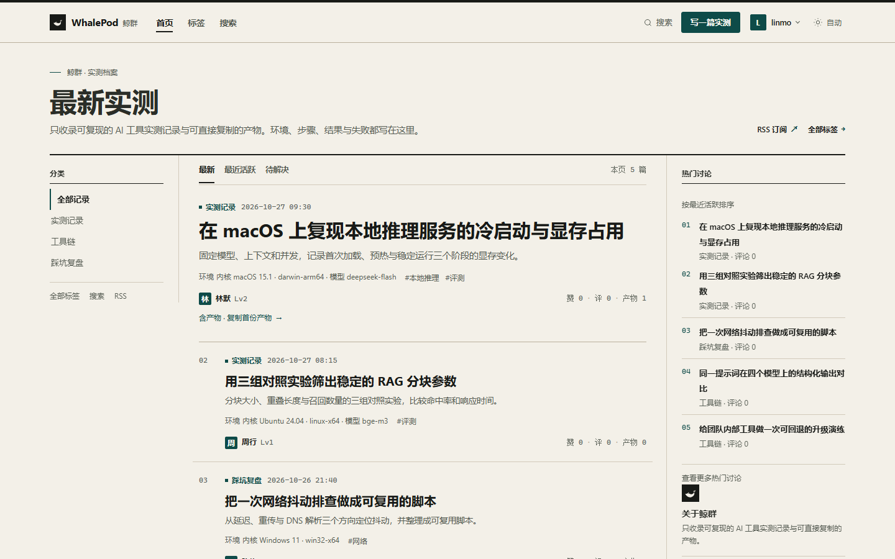

# WhalePod（鲸群）

[](https://github.com/HestiaLab/WhalePod/actions/workflows/ci.yml)
[](https://github.com/HestiaLab/WhalePod/actions/workflows/release.yml)

面向 AI 工具使用者的邀请制技术社区：只收录可复现的实测记录与可直接复制的产物。

> v0.1.0 · 2026-10-27 · 需求基线：[SRS v0.1.0](docs/SRS.md)
>
> 静态项目介绍：[hestialab.github.io/WhalePod](https://hestialab.github.io/WhalePod/)



## 交付状态

v0.1.0 代码与本地可执行验收已完成：

- 邀请制账号、GitHub OAuth 代码、开发登录、设备验证、信任等级。
- 板块/标签、帖子/评论、Markdown 清洗、图片上传、产物复制、点赞/采纳、举报/申诉、通知与邮件 outbox。
- 人工审核后台、敏感词策略、只读模式/关闭登录、服务账号、审计、系统健康、备份脚本。
- 公开 SSR 页面、公开 JSON API、RSS/Sitemap/robots、搜索与 SEO；AI 审核 Agent API 与 stdio MCP 默认关闭。
- 实测档案 UI，含暗色、打印、forced-colors、无 JS、200% 文本与响应式验收。

验证基线：Release 构建 0 warning / 0 error；38 单元 + 244 真实 PostgreSQL/HTTP 集成 + 1 真实 E2E 流程通过（0 跳过）；浏览器写路径在可弃库完成发帖→审核→评论→公开可见。历史 axe 结论的原始报告未留存，现提供 `tests/browser/` 可复跑脚本。完整证据见 [acceptance.md](docs/design/acceptance.md)。

**生产启用前仍需外部验收**：真实 GitHub OAuth 凭据与回调、SMTP/COS/S3、腾讯云预发迁移与回滚、Q-02 本地模型与标注评估、真实屏幕阅读器/物理设备、CLI 实机与签名、10 分钟容量压测。详见 [production-readiness.md](docs/design/production-readiness.md)。

## 架构

```text
Browser ──HTTPS──> Web (Blazor Web App, SSR + 按需交互)
   │                    │
   │                    ├─ PostgreSQL（业务数据、审计、发件箱、任务）
   │                    ├─ 本地媒体目录 / S3 兼容对象存储
   │                    └─ SMTP（事务只写 outbox，API worker 投递）
   │
   └──同站 /api/v1──> API (Minimal API, 公开读写 + Agent API)
                        ├─ PostgreSQL（与 Web 共享）
                        ├─ 媒体存储
                        └─ 后台 worker（邮件、媒体、challenge、保留期）

管理员本机 Agent ──出站 HTTPS / stdio MCP──> API /agent/*
```

- Web 与 API 必须同站部署，共享 Data Protection 密钥目录、会话 Cookie 与 CSRF Cookie。
- API 进程运行后台 worker；Web 不运行外部发送/清理任务。
- Agent 只发起出站 HTTPS；MCP 只走 stdio，不监听公网端口。

详细设计见 [architecture.md](docs/design/architecture.md)，实体与索引见 [erd.md](docs/design/erd.md)。

## 快速开始

前置：.NET 10 SDK、PostgreSQL 18（本地开发实例默认 `127.0.0.1:55432`）。

```bash
dotnet restore WhalePod.slnx
dotnet tool restore
dotnet tool run dotnet-ef database update \
  --project src/WhalePod.Infrastructure \
  --startup-project src/WhalePod.Infrastructure

# 终端 1
ASPNETCORE_ENVIRONMENT=Development ASPNETCORE_URLS=http://localhost:5224 \
  dotnet run --project src/WhalePod.Web --no-launch-profile

# 终端 2
ASPNETCORE_ENVIRONMENT=Development ASPNETCORE_URLS=http://localhost:5010 \
  dotnet run --project src/WhalePod.Api --no-launch-profile
```

开发登录（仅 Development 且 `Auth:DevLoginEnabled=true`）：

```text
http://localhost:5224/dev/test-login?handle=alice
```

`Auth:BootstrapAdminHandles` 中的 handle 会在登录时提升为管理员并写审计。生产使用 GitHub OAuth，不得打开开发登录。

本地 PostgreSQL 故障排查：开发实例仅监听回环地址，不得用于生产。若 `pg_isready` 无响应，先检查 `pg_ctl status -D $PGDATA` 与 `server.log`，确认没有第二个 postmaster 占用端口；不要删除数据目录。`shared_buffers=32MB`、`max_connections=30` 只是开发机恢复参数，不代表生产容量。

构建与测试：

```bash
dotnet build WhalePod.slnx -c Release
export WHALEPOD_TEST_DB_CONNECTION="Host=127.0.0.1;Port=55432;Database=whalepod_test;Username=postgres"
dotnet test WhalePod.slnx -c Release
```

集成测试使用真实 PostgreSQL；测试不得跳过。完整配置见 [configuration.md](docs/configuration.md)，API 调用示例见 [api/usage.md](docs/api/usage.md)。

## 能力概览

- **账号与访问**：GitHub OAuth 代码、邀请激活、开发登录、账号状态、头像、注销、邮件偏好与退订；Cookie 会话 + CSRF。
- **内容与编辑**：板块/标签、帖子/评论、Markdown 清洗、图片重编码、产物复制、点赞/采纳、编辑器预览与本地草稿。
- **审核与治理**：人工队列/裁决、举报、申诉、敏感词策略、只读模式/关闭登录、服务账号、审计与系统健康。
- **设备与 AI**：Ed25519 设备验证与 CLI、设备徽章与管理员历史；AI 只建议、人工裁决，默认关闭，支持预算/熔断与 stdio MCP。
- **后台与运维**：统一管理入口、邀请码/板块/标签/用户管理、备份脚本、健康检查、结构化日志与队列清理。
- **搜索与发现**：公开 SSR 信息流/详情/标签/用户页、RSS/Sitemap/robots、SEO 与 JSON-LD、中文搜索与限流。

## 文档

| 文档 | 内容 |
|---|---|
| [SRS](docs/SRS.md) | 需求基线 |
| [architecture](docs/design/architecture.md) | 架构、关键决策与安全约束 |
| [erd](docs/design/erd.md) | 数据模型、约束与索引 |
| [OpenAPI](docs/api/openapi.yaml) | 公开/管理/Agent API 契约 |
| [API 使用示例](docs/api/usage.md) | CSRF、发帖、互动、通知、上传 |
| [configuration](docs/configuration.md) | 完整配置参考 |
| [traceability](docs/design/traceability.md) | 需求追踪矩阵 |
| [acceptance](docs/design/acceptance.md) | 验收、UAT、可访问性与生产前置 |
| [performance](docs/design/performance.md) | 本地压测、复制计数、搜索基线 |
| [production-readiness](docs/design/production-readiness.md) | 生产配置、迁移、备份、监控、回滚 |
| [agent-mcp](docs/agent-mcp.md) | 本机 AI 审核 Agent 与 stdio MCP |
| [device-cli](docs/device-cli.md) | Device CLI 使用与发布 |
| [privacy-github-hmac](docs/design/privacy-github-hmac.md) | HMAC 黑名单可选能力与法务前置 |

## 生产启用前置

- 真实 GitHub OAuth App、回调域名与近期重认证。
- 真实 SMTP、退信/投诉、COS/S3、CDN/WAF 与对象生命周期。
- 腾讯云预发迁移、秘密注入、备份恢复、发布/回滚演练。
- Q-02 本地模型、200 条标注样本、真实 MCP 客户端 + 模型 E2E。
- C-09 法务确认、ICP/公安备案、日志保留与密钥轮换。
- 真实屏幕阅读器、物理 iOS/Android/iPad、macOS/Linux CLI 实机与签名/公证。
- 完整 10 分钟容量压测与生产监控阈值校准。

本地验收通过不等于生产可用；上线清单见 [production-readiness.md](docs/design/production-readiness.md) 第 8 节。

## 范围与限制

- AI 只建议、人工裁决；无自动通过/驳回，AI/MCP 默认关闭。
- 机审供应商、@提及、标签缓存失效、管理员手动重发邮件、投诉反馈、多管理员复核未实现。
- 浏览量去重为进程内；多实例部署前需持久化。公开分类侧栏会渲染全部板块，数据量异常时需限制或分页。
- 触控目标满足 WCAG 2.2 AA 24px，但部分控件未达到内部 44px 目标；`/Error` 直接 GET 返回 200 为既有路由语义。

完整限制与后续计划见 [acceptance.md](docs/design/acceptance.md) 与 [SRS §8](docs/SRS.md#8-范围外与后续版本)。

## 开发约定

- 需求变更先改 SRS，再改代码；行为以 SRS 验收标准为准。
- 公开页面使用静态 SSR；只有必要时才把组件标记为交互式。
- 认证、授权、设备验签、上传、审核状态机、AI 建议与 MCP 工具必须有人类评审。
- 提交信息采用 `type(scope): 中文描述`；默认不开源许可，未确定策略前不要添加 LICENSE。
