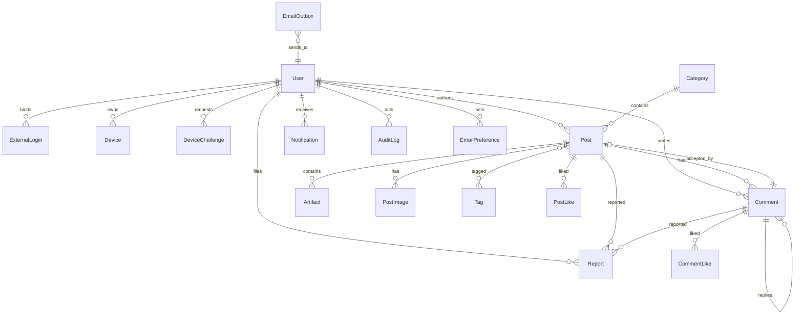
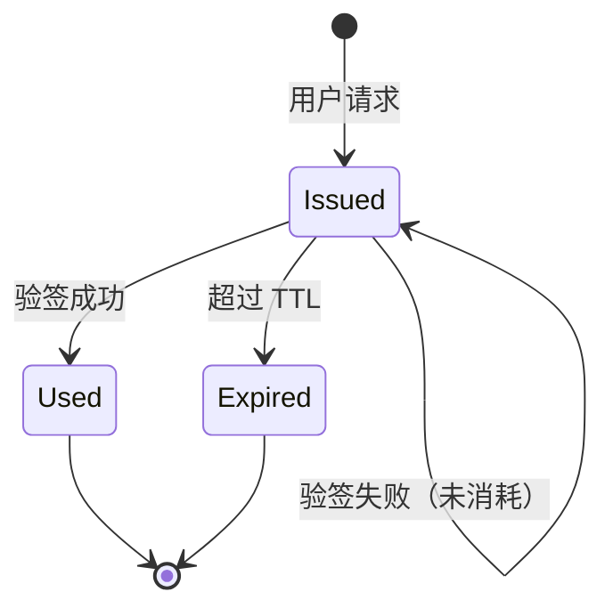
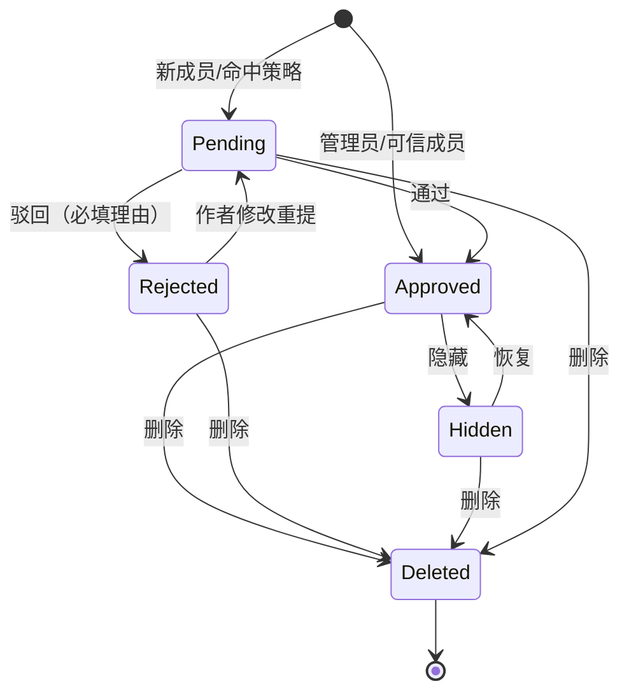
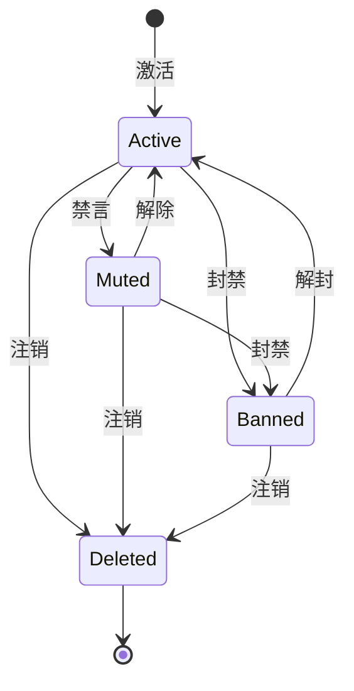
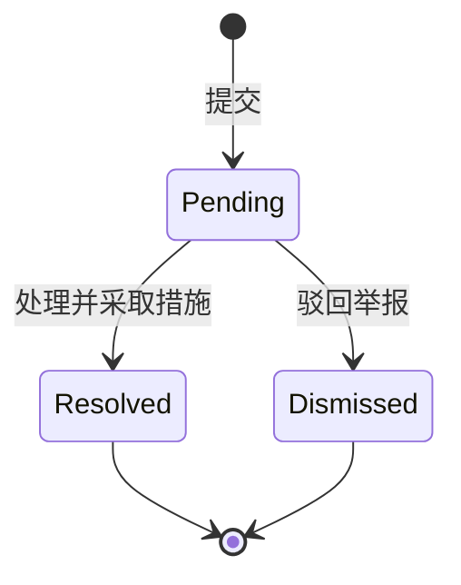
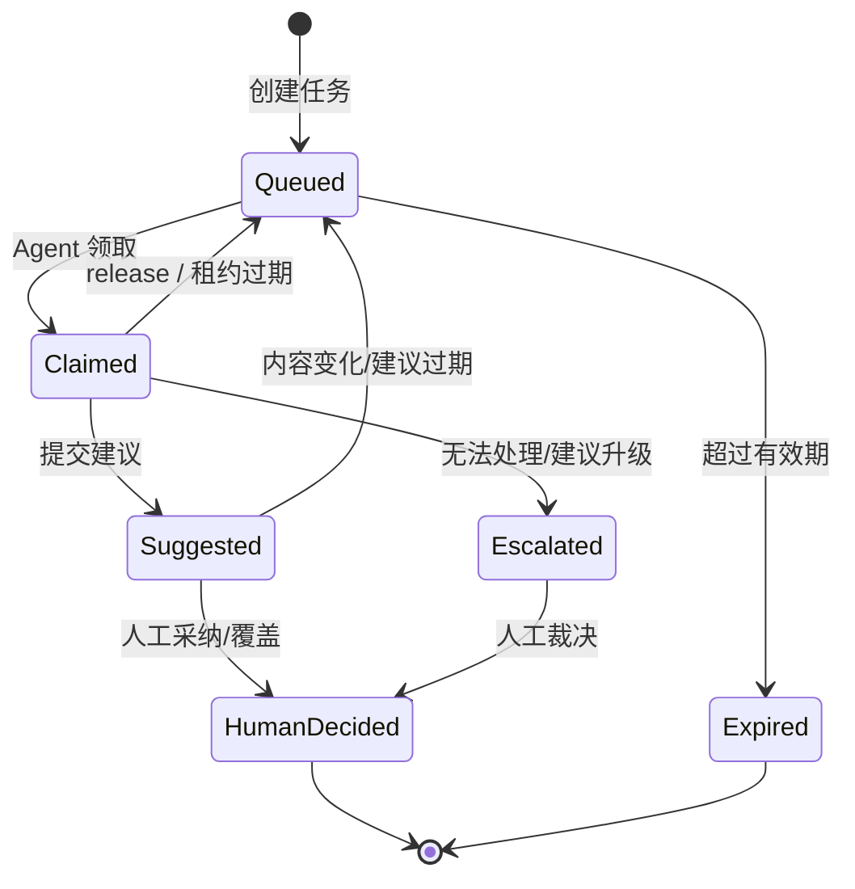

# WhalePod（鲸群）软件需求规格说明书（SRS）

| 项目 | 内容 |
|---|---|
| 项目代号 | WhalePod（鲸群） |
| 项目仓库 | https://github.com/HestiaLab/WhalePod |
| 文档名称 | WhalePod（鲸群）软件需求规格说明书 |
| 文档版本 | v0.1.0 |
| 编制日期 | 2026-10-27 |
| 文档状态 | 已交付（v0.1.0；生产启用前置条件见 [README](../README.md) 与 [acceptance.md](design/acceptance.md)） |
| 产品形态 | 单站、邀请制、垂直技术社区（WhalePod / 鲸群） |
| 技术约束 | Blazor Web App + ASP.NET Core + PostgreSQL；.NET 自包含设备 CLI；国内腾讯云容器生产 + 腾讯云 CDN/WAF；Cloudflare 仅 DNS/预览；AI 审核 Agent 本机运行 + 目标本地 deepseek-flash（Q-02 待定，默认关闭） |
| 首发范围 | 当前交付版本：账号与邀请、内容、编辑与产物、互动、审核、通知、搜索、设备验证、本机 AI 审核 Agent/Agent API（默认关闭）、管理后台、合规与运维 |
| 目标用户 | 面向中国大陆的 AI 工具使用者、插件开发者与深度使用者 |

> 本文档描述“系统应当表现出什么行为”，不规定具体代码结构、组件库、CSS 数值或第三方库实现。技术选型与部署细节由详细设计文档承接。
>
> 交付状态、验收证据与生产前置条件见 [README](../README.md)、[acceptance.md](design/acceptance.md) 与 [production-readiness.md](design/production-readiness.md)。

---

## 目录

1. 引言
2. 总体描述
3. 功能需求
4. 外部接口需求
5. 数据需求
6. 非功能需求
7. 验收与发布
8. 范围外与后续版本
9. 已决事项与待决问题
10. 附录

---

## 1. 引言

### 1.1 目的

本文档定义单站技术社区当前交付版本的功能边界、行为约束、外部接口、数据要求、非功能指标与验收标准。它用于：

- 作为产品、开发、测试与运维之间的共同基线；
- 作为 AI Agent 拆分任务、生成代码与自动化测试的输入；
- 作为上线前验收、范围变更与后续版本规划的依据。

### 1.2 产品范围

本产品是一个**单站、邀请制、面向中国大陆的垂直技术社区**。核心价值是让用户发布“可复现的实测记录”和“可直接复制的配置产物”，并通过审核、信任等级与设备验证降低内容可信度判断成本。

当前交付版本包含：

- 访客只读浏览，成员通过邀请码注册；
- 板块、帖子、嵌套评论、标签、点赞、采纳答案、举报；
- Markdown 编辑、图片上传、环境信息、可粘贴产物；
- 审核状态机、人工审核队列、基础机审、处罚与审计；
- 站内通知与核心邮件通知；
- 关键词搜索、标签页、用户主页、RSS、Sitemap、SEO 元数据；
- **Ed25519 设备验证**及设备徽章；
- **AI 审核 Agent**：当前交付本机 Agent 与审核建议接口，**功能开关默认关闭**；目标模型为本地离线 `deepseek-flash`，最终选型在主体开发完成后确认（Q-02）。启用后 AI 只建议，人工裁决全部内容；
- **本机 stdio MCP**：为 AI Agent 提供受控审核工具；随 AI 开关启用，默认关闭；不提供公网 MCP 端点；
- 管理后台、限流、备份、日志与基础监控；
- 中国大陆上线所需的协议页面、举报/申诉入口与内容治理能力。

当前版本不包含：收藏、关注、编辑历史、GitHub 仓库导入、复现反馈、实时推送、主题编辑器、双语、自动信任等级升级、多租户、插件系统、移动客户端、付费与广告、AI 自动通过/驳回、公网 Streamable HTTP MCP、主动学习、多模型路由、云端/远程大模型（后续版本，需重新评估合规与质量）。详见第 8 章。

### 1.3 术语与缩略语

| 术语 | 英文 | 定义 |
|---|---|---|
| 站点 | Site | 本产品部署的单一社区实例，只有一个域名和一套用户体系。 |
| 访客 | Guest | 未登录用户，只能读取公开内容。 |
| 成员 | Member | 已通过 GitHub 登录并完成邀请码兑换的用户。 |
| 作者 | Author | 针对某条帖子或评论而言的创建者；不是独立角色。 |
| 管理员 | Admin | 拥有审核、用户管理、邀请码管理、分类管理与审计查看权限的角色。 |
| 系统 | System | 后台任务、定时任务、机审回调等非人类执行者。 |
| 设备 CLI | Device CLI | 在用户本机运行的签名工具，不联网，只负责生成本地密钥并对挑战签名。 |
| 邀请码 | Invite Code | 管理员创建、用于限制注册入口的一次性或限次凭证。 |
| 邀请树 | Invite Tree | 记录“谁邀请了谁”的追溯关系。 |
| 信任等级 | Trust Level | 用于描述成员历史贡献与审核策略的用户属性；当前交付版本支持人工调整，自动升级在后续版本。 |
| 板块 | Category | 帖子的顶层分类，例如求助、抄作业、深读、作品、踩坑实测、闲聊、站点建议。 |
| 标签 | Tag | 用户发帖时填写的自由分类，用于跨板块聚合。 |
| 帖子 | Post | 社区的主要内容单元，包含标题、正文、板块、标签、环境信息与产物。 |
| 评论 | Comment | 对帖子的回复，支持父子层级。 |
| 产物 | Artifact | 帖子中附带的、读者可一键复制的文本内容，例如 patch、YAML、JSON、shell、Markdown 或 bundle。 |
| 采纳答案 | Accepted Answer | 作者从评论中选出的最佳回答；每个帖子最多一个。 |
| 已解决 | Solved | 帖子已采纳答案的状态。 |
| 审核状态 | Moderation Status | 内容在 `pending / approved / rejected / hidden / deleted` 之间的状态。 |
| 举报 | Report | 成员对帖子、评论或用户提交的违规反馈。 |
| 设备验证 | Device Verification | 用户证明自己持有某设备私钥对应公钥的过程；**只证明密钥持有，不证明运行环境未被篡改**。 |
| 挑战 | Challenge | 服务端生成的一次性随机值，用于设备签名，具有有效期且只能使用一次。 |
| 公钥指纹 | Public Key Fingerprint | 对设备公钥做 SHA-256 后截取的可读标识，用于人工核对与审计。 |
| 只读模式 | Read-only Mode | 站点关闭登录或写入能力时，仅允许浏览的状态。 |
| 管理后台 | Admin Console | 管理员使用的审核、举报、用户、邀请码、分类与审计界面。 |
| 公开 API | Public API | `/api/v1` 下供浏览器、CLI、未来移动端或 Agent 使用的 HTTP 接口。 |
| AI 审核 Agent | AI Moderation Agent | 当前版本运行于维护者本机、使用本地离线模型（目标 `deepseek-flash`，最终选型待 Q-02）的审核服务，通过受限 API 出站轮询领取任务并提交结构化建议；不是人类管理员，不执行裁决。 |
| 本机 Agent | Local Agent | 部署在维护者可控机器上的 Agent 进程；只发起出站 HTTPS 请求，不开放入站端口。 |
| 本地模型 | Local Model | 运行在本机或维护者内网、不调用第三方云模型的推理服务；目标为离线 `deepseek-flash`，最终选型待 Q-02；其位置与数据边界需记录。 |
| 服务账号 | Service Account | 供 AI Agent 或自动化任务使用的非交互账号，只拥有被授予的 API scope。 |
| 审核任务 | Moderation Task | 一条待审内容在 Agent API 中的工作项，包含内容快照、公开元数据、风险提示与租约信息。 |
| 审核建议 | Moderation Suggestion | AI Agent 对审核任务提交的结构化建议：建议通过、建议驳回或建议升级人工，并附策略码、理由与置信度；不直接改变内容状态。 |
| 人工裁决 | Human Decision | 管理员对内容作出的最终通过、驳回、隐藏或删除决定；当前版本所有内容都必须经过人工裁决。 |
| 升级人工 | Escalation | AI Agent 无法确定或内容属于高风险类别时，将任务交还人工审核。 |
| 租约 | Lease | Agent 领取任务后的独占处理期限；超时未完成则任务可被重新领取。 |
| 待激活账号 | Pending Activation | 已通过 GitHub 登录但尚未兑换邀请码的账号，只能访问激活页。 |
| SSR | Server-Side Rendering | 服务端直出 HTML 的渲染方式。 |
| CSRF | Cross-Site Request Forgery | 跨站请求伪造。 |
| CSP | Content Security Policy | 内容安全策略。 |
| LCP | Largest Contentful Paint | 最大内容绘制，性能指标。 |
| RPO / RTO | Recovery Point / Time Objective | 恢复点目标 / 恢复时间目标。 |
| WCAG | Web Content Accessibility Guidelines | Web 内容可访问性指南。 |
| UAT | User Acceptance Testing | 用户验收测试。 |

### 1.4 参考资料

- 项目仓库：`https://github.com/HestiaLab/WhalePod`。
- 参考产品：`https://jingyu.run/`（2026-10-24 逆向分析，仅用于行为参考，不作为实现依赖）。
- Microsoft Learn：Blazor Web App、ASP.NET Core 安全、认证与授权、限流、静态资源。
- GitHub Docs：OAuth App 授权流程与最小权限。
- RFC 8032：Edwards-Curve Digital Signature Algorithm（Ed25519）。
- W3C：Web Content Accessibility Guidelines 2.2。
- 中华人民共和国《网络安全法》《个人信息保护法》《互联网信息服务管理办法》及所在地 ICP/公安备案要求。
- 参考产品截图不再保留；如需引用，使用自制截图或已授权素材。

### 1.5 需求约定

- 功能需求编号：`REQ-F-xxx`；外部接口需求：`REQ-I-xxx`；非功能需求：`REQ-NF-xxx`。
- 编号一经分配不得复用；删除需求时保留编号空缺，不重新编号。
- 优先级：`当前交付版本` 为发布阻塞项；`后续版本（Roadmap）` 为下一版本；`远期` 为更晚版本。第 3 章未特别标注的条目均属于当前交付版本。
- 每条需求包含参与者（Actor）与验收标准（AC）。AC 使用可观察、可测试的行为描述，不写实现步骤。
- “必须”表示强制；“应当”表示默认行为，偏离需记录理由；“可以”表示可选。
- 数量、时长等数值为产品默认值，均应在配置中可调整，具体部署值由详细设计确定。
- 本章及后续章节中的“系统”指本产品；“用户”指已登录成员，另有说明除外。

### 1.6 产品边界

| 范围内 | 范围外（当前版本） |
|---|---|
| 单站社区、单域名、单用户体系 | 多租户、多社区、白标 |
| GitHub OAuth + 邀请码 | 用户名密码、手机号、其他 OAuth 提供商 |
| Web 端 + 本机设备 CLI | 原生移动 App、桌面客户端 |
| 公开内容只读、登录后写入 | 私信、群聊、实时协作 |
| 图片上传与文本产物 | 任意文件附件、产物自动执行 |
| 人工审核 + AI/MCP 可选接口（默认关闭） | AI 自动裁决、公网 HTTP MCP、云端/远程模型、自动申诉、主动学习（后续版本） |
| 站内通知 + 事务邮件 | 营销邮件、短信、Push |
| 中文界面（当前版本） | 英文界面（后续版本） |
| 国内腾讯云生产 + 腾讯云 CDN/WAF | Cloudflare Containers 生产、多地域容灾、跨云双活 |

---

## 2. 总体描述

### 2.1 产品定位

产品定位为“**可复现经验与可粘贴产物的技术社区**”，不是泛社交平台，也不是文档站。产品目标：

- G1：让读者能判断一条经验是否适用于自己的环境；
- G2：让作者能低成本附上可直接复制的配置或补丁；
- G3：让优质回答被采纳，让违规内容被及时处理；
- G4：让内容可被搜索、订阅与外部搜索引擎发现；
- G5：在单人 + AI Agent 的维护模式下，保持安全、可审计、可运营；
- G6：在可控边界内引入 AI 审核 Agent，降低单人审核负担，同时保留人工最终裁决。

### 2.2 用户角色与权限矩阵

| 操作 | 访客 | 成员 | 作者（针对自己的内容） | 管理员 |
|---|:---:|:---:|:---:|:---:|
| 浏览公开信息流、帖子、评论、产物 | ✓ | ✓ | ✓ | ✓ |
| 查看自己的待审/驳回内容 | — | ✓ | ✓ | ✓ |
| 创建帖子、评论 | — | ✓ | ✓ | ✓ |
| 编辑/删除自己的帖子、评论 | — | — | ✓ | ✓ |
| 点赞（不能赞自己） | — | ✓ | ✓ | ✓ |
| 采纳答案 | — | — | ✓ | — |
| 举报 | — | ✓ | ✓ | ✓ |
| 设备验证 | — | ✓ | ✓ | ✓ |
| 审核、隐藏、删除他人内容 | — | — | — | ✓ |
| 创建/停用邀请码 | — | — | — | ✓ |
| 禁言、封禁、解封 | — | — | — | ✓ |
| 管理板块、标签 | — | — | — | ✓ |
| 查看审计日志 | — | — | — | ✓ |
| 调用公开读 API | ✓ | ✓ | ✓ | ✓ |
| 调用写 API | — | ✓ | ✓ | ✓ |

说明：

- “作者”是上下文角色；同一成员在不同内容上可能是作者或普通成员。
- 被禁言（muted）成员可读、可举报，但不能发帖、评论、点赞；被封禁（banned）成员不能登录和写入，已有公开内容按审核结果处理。
- 管理员不能代替作者采纳答案；管理员可以通过审核/隐藏/删除处理内容。

#### 2.2.1 本机 AI 审核 Agent 权限边界

| 能力 | AI 审核 Agent |
|---|:---:|
| 领取待审任务（租约内） | ✓ |
| 读取内容快照、公开元数据与风险提示 | ✓ |
| 读取举报人身份、邮箱、IP、私钥 | — |
| 提交 `approve / reject / escalate` 建议 | ✓ |
| 直接修改、删除内容 | —（由人工裁决执行） |
| 禁言、封禁、删除账号 | — |
| 修改审核策略、敏感词、服务账号 | — |
| 查看完整审计日志 | —（仅自己的建议记录） |
| 自动通过低风险内容 | —（当前版本不开启，后续版本评估） |
| 自动驳回明确违规 | —（当前版本不开启，后续版本评估） |
| 高风险或不确定内容 | 只能建议升级人工 |

说明：AI 审核 Agent 不是管理员；其身份是持有受限 scope 的服务账号。人工管理员保留最终裁决权、策略修改权和账号处罚权。当前版本的 Agent 只从本机发起出站 HTTPS 轮询，不开放入站端口，不要求站点主动回调。

### 2.3 典型场景

- UC-01 访客通过搜索引擎进入帖子页，阅读正文与产物，复制产物；尝试点赞时被引导登录。
- UC-02 受邀用户用 GitHub 登录并兑换邀请码，发布一条带内核版本、平台、报错和 patch 产物的帖子；内容进入审核队列。
- UC-03 管理员在后台通过帖子，作者收到站内通知；帖子出现在信息流与 RSS。
- UC-04 作者在设置页生成挑战，在本机用 CLI 签名，粘贴 JSON 完成设备验证；帖子作者信息旁出现“设备密钥已验证”徽章。
- UC-05 读者举报一条广告；管理员处理举报并隐藏内容；举报人和作者收到相应通知。
- UC-06 读者通过标签页或搜索找到同类问题，查看已采纳答案。
- UC-07 本机 AI 审核 Agent 通过出站轮询领取任务，调用本地模型（目标 `deepseek-flash`）生成“建议通过/建议驳回/建议升级”的结构化建议；内容保持待审，管理员查看建议后作出最终裁决。本机关机或模型不可用时任务留在队列，由人工直接审核。

### 2.4 运行环境

| 维度 | 要求 |
|---|---|
| 服务端 | Linux；ASP.NET Core；PostgreSQL；反向代理；对象存储；事务邮件服务；内容审核服务。 |
| AI 审核 Agent | 运行于维护者本机；出站 HTTPS 轮询；目标本地离线 deepseek-flash（选型待 Q-02）；stdio MCP；默认关闭；不开放入站端口；令牌存放在本机秘密存储。 |
| 浏览器 | Chrome、Edge、Safari、Firefox 最近两个主版本；iOS Safari 16+；Android Chrome 10+；微信内置浏览器支持基本阅读与登录跳转。 |
| 设备 CLI | 当前版本至少支持 Windows x64、macOS arm64、Linux x64；Windows arm64、macOS x64、Linux arm64 可以后补；以 .NET 自包含单文件发布，无需预装运行时。 |
| 网络 | 全站 HTTPS；支持 HTTP/2；条件允许时启用 HTTP/3。 |
| 时区 | 服务端以 UTC 存储，界面默认 `Asia/Shanghai`。 |
| 字符集 | UTF-8；中文简体为当前版本界面语言。 |

#### 2.4.1 部署阶段

| 环境 | 托管 | 说明 |
|---|---|---|
| 生产 | 腾讯云 TKE/CVM + TencentDB for PostgreSQL + COS + 腾讯云 CDN/WAF + 国内事务邮件服务 | 当前交付版本正式环境部署在中国大陆；上线前完成 ICP 与公安备案；业务数据、上传文件与本地审核模型均在境内。 |
| 预览/灰度（可选） | Cloudflare Containers / Pages | 仅用于预览、设计验收或灾备演练，不承载国内正式流量；Cloudflare Containers 运行在境外网络，不能替代国内生产环境。 |
| 本机 AI 审核 Agent | 维护者本机 | 出站 HTTPS 轮询生产 Agent API；本地模型（目标 deepseek-flash）离线运行；不开放入站端口。 |

- Cloudflare Pages/Workers/Containers 不作为生产运行时；Cloudflare 仅用于 DNS 或可选预览环境。
- 应用必须容器化；数据库使用标准 PostgreSQL；对象存储使用 S3 兼容接口（COS）；配置通过环境变量注入；避免依赖腾讯云专有 API，保证备份、恢复与未来迁移可行。
- 生产入口使用腾讯云 CDN/WAF；Agent API 需要配置 WAF 放行/限流规则，但放行不得绕过应用层令牌与 scope 校验。
- 当前版本业务数据、待审内容与本地模型均在境内；若未来把本机/模型迁出境外，需重新评估跨境传输与隐私披露。
- 发布前必须完成一次腾讯云生产发布、数据库/对象存储恢复与回滚演练。

### 2.5 设计约束

- **单站单租户**：当前版本不实现多社区、多域名、多品牌；数据模型保留 `site` 扩展位但不暴露。
- **表现层**：采用 Blazor Web App；公开内容页默认静态 SSR；编辑器、评论、设备验证、通知等交互区域使用按需交互渲染；不得把整站设为单一全量交互模式。
- **服务端**：ASP.NET Core；服务端完成认证、授权、校验、审核、签名验证与审计；不得依赖前端隐藏按钮实现权限。
- **SSR/API 边界**：§4.6 定义公开 JSON API。OAuth 登录与激活、邀请码兑换、个人资料/注销、邮件偏好/退订、申诉、标签管理、服务账号/令牌、AI 开关/质量、机审词表、邀请树/批量停用、系统健康与管理员设备历史由 Blazor SSR/运维流程承担；这些流程同样必须执行服务端授权、CSRF、账号状态、审计与错误码，不得以“仅页面”为由绕过安全要求。
- **数据库**：PostgreSQL 为唯一事实来源；所有写操作使用事务；迁移脚本纳入版本控制。
- **认证**：Cookie 会话 + GitHub OAuth；不得把访问令牌存入浏览器 `localStorage`。
- **设备验证**：采用 Ed25519；私钥只在用户本机生成和保存；服务端只保存公钥、指纹与验证结果；必须防重放。
- **SEO**：公开内容必须服务端直出 HTML 与元数据；不得依赖客户端 JavaScript 才能被索引。
- **中国大陆合规**：若服务器位于中国大陆，ICP 备案与公安备案是发布前置条件；内容审核、举报、日志留存、隐私政策必须在上线前就绪。具体法律要求以主管部门与法务意见为准。
- **语言**：当前版本只交付简体中文，但所有用户可见文案必须外部化，为后续版本英文界面预留。
- **运维**：单地域、单实例优先；通过托管数据库/对象存储/邮件服务降低单人运维负担；不引入微服务、消息中间件集群等超出当前版本需要的基础设施。
- **可测试性**：关键流程必须能通过自动化测试验证；外部服务必须有可替换的测试实现。
- **本机 AI 审核 Agent**：当前交付接口骨架，功能开关默认关闭，允许在无 AI 的情况下全人工上线；目标模型为本地离线 `deepseek-flash`，最终选型待 Q-02。启用后只通过受限 Agent API 出站轮询，不开放入站端口，不直接访问数据库；本地模型不调用第三方云模型；用户内容视为不可信数据，必须防提示注入；Agent 只提交结构化建议，不执行裁决或任意工具；**人工裁决全部内容，当前版本不自动通过/驳回**；AI 不得禁言、封禁或删除账号；所有建议与人工裁决可审计；升级到云端/远程模型或自动裁决需重新评估。
- **本机 Agent 安全**：服务令牌存放在操作系统秘密存储或受保护文件；本地日志加密、最小化并设定保留期；本地模型不联网、不挂载工具；机器失窃或令牌泄露时可立即撤销；Agent 只拉取必要内容，不拉取举报人、邮箱、IP；不向公网或第三方暴露内容副本，不上传遥测。
- **设备 CLI**：采用 .NET 自包含单文件，当前交付版本支持 Windows x64、macOS arm64、Linux x64；macOS 做签名/公证，Windows 代码签名按预算推进；提供 SHA-256 清单与版本号；CLI 不联网、不自动更新。
- **部署可移植**：生产部署在国内腾讯云容器；Cloudflare 仅 DNS/预览；使用标准 PostgreSQL、S3 兼容存储与环境变量，避免云厂商专有 API；发布、恢复与回滚演练纳入发布门槛。
- **数据边界**：当前版本生产数据、上传文件、待审内容与本地模型均在境内；不得把举报人身份、邮箱、IP 等发送给 Agent；不向公网或第三方暴露内容副本。若未来本机/模型迁出境外或启用远程模型，重新进行跨境评估。
- **MCP**：当前版本仅提供本机 stdio MCP Server，作为 Agent 的本地工具面；默认随 AI 开关关闭；不开放公网 MCP 端点。公网 Streamable HTTP MCP 属于后续版本，需 OAuth/Token、WAF、限流与审计。
- **交付约束**：本产品由 1 名人类维护者与 AI Agent 协作开发。实现必须按模块拆分、接口契约先行、关键流程可用自动化测试验证；认证、授权、设备验签、AI 审核决策、上传、审核状态机、数据库迁移与生产发布必须由人类评审后合并。

### 2.6 假设与依赖

- 用户拥有 GitHub 账号；站点通过 GitHub OAuth 获取最小资料与邮箱。
- 管理员在当前版本由产品所有者兼任；AI 只提供建议，人工负责全部审核裁决与账号处罚。
- 已选定或能够申请域名；生产部署在国内腾讯云，ICP/公安备案是上线前置条件，周期按 1-4 周预估；具体时间待 Q-07。
- 事务邮件、对象存储、内容审核服务采用腾讯云（邮件推送/COS/内容安全）或等价合规服务；接口保持可替换，避免厂商锁定。
- 设备 CLI 为 .NET 自包含单文件，由站点分发；用户可以执行本地命令行工具，并理解“私钥不出本机”的安全边界。
- AI/MCP 当前交付接口与骨架，默认关闭；可在无 AI 的情况下全人工上线。目标模型为本地离线 deepseek-flash，最终选型待 Q-02。
- AI 启用后只提供审核建议，人工裁决全部内容；当前版本不开启自动通过或自动驳回。
- 目标 `deepseek-flash` 的离线权重、许可证、量化与硬件需求需在 Q-02 确认；若无法离线部署，改用同等级可离线模型，不得调用云 API。
- 本机 Agent 可能因关机、断网或模型故障离线；人工审核必须能兜底，任务不得因 Agent 离线自动通过。
- 升级到云端/远程模型或启用 AI 自动裁决前，需重新评估数据出境、审核质量、成本与合规，并更新隐私政策与用户告知。
- 当前版本审核由所有者承担；后续邀请审核员属于后续版本，需新增审核员角色、邀请与权限流程（Q-04）。
- 本机 AI 处理不向公网或第三方暴露内容副本，不上传遥测；隐私政策仅说明授权范围内的本地审核处理（Q-09）。
- 当前版本不要求 7×24 小时人工值守；但必须有告警、备份与回滚手册。
- 参考产品的视觉与交互仅作为体验目标，不要求逐像素复刻。

### 2.7 成功指标

上线后 4 周评估，目标值可按实际情况调整：

| 指标 | 目标 |
|---|---|
| 邀请激活率（兑换邀请码后 7 天内发帖或评论） | ≥ 40% |
| 7 日留存（有内容行为的成员） | ≥ 25% |
| 带环境信息的帖子占比 | ≥ 70% |
| 有产物附件的“抄作业/作品”帖子占比 | ≥ 50% |
| 问题帖 72 小时内被采纳或有效回答的比例 | ≥ 60% |
| 审核队列 24 小时内处理比例 | ≥ 90% |
| 公开页面 LCP（4G，主要城市） | ≤ 2.5 s |
| 公开 API 读请求 p95 | ≤ 300 ms |
| 设备验证成功率（有效输入） | ≥ 95% |
| 邮件投递成功率 | ≥ 98% |
| AI 建议覆盖率（启用后） | 试点 4 周后校准，目标 ≥ 80% |
| AI 建议与人工结论一致率（启用后） | ≥ 85% |
| 人工复核覆盖 | 100% |
| 平均审核时长（启用 AI 时） | ≤ 2 h |
| 本机 Agent 工作时段在线率 | ≥ 90% |
| Agent 离线时人工兜底覆盖 | 100% |
| 严重安全事件 | 0 |

---

## 3. 功能需求

> 本章所有条目均属于当前交付版本，除非明确标注后续版本/远期。每条需求的验收标准应可转化为集成测试或端到端测试。

### 3.1 账号与访问

| 编号 / 参与者 | 需求 | 验收标准 |
|---|---|---|
| REQ-F-001<br>[访客] | 访客可以只读浏览公开内容。 | AC1 可访问信息流、帖子详情、公开评论、公开产物、用户公开主页；AC2 点赞、评论、发帖、举报、设备验证等入口引导登录；AC3 不显示草稿、待审、驳回、隐藏或已删除内容。 |
| REQ-F-002<br>[访客] | 系统只支持 GitHub OAuth 登录。 | AC1 登录页只展示 GitHub 入口；AC2 授权请求包含 `state` 并在回调时校验；AC3 首次登录自动创建“待激活”账号；AC4 登录成功后回到安全的站内 `next` 地址；AC5 失败时展示可理解的错误码与重试入口。 |
| REQ-F-003<br>[访客] | 新账号必须通过邀请码兑换才能成为成员。 | AC1 未兑换邀请码的 GitHub 登录用户处于“待激活”状态，只能查看激活页；调用成员写接口返回 `403 FORBIDDEN`，`details.reason=activation_required`；AC2 邀请码有效时完成激活并记录邀请关系；AC3 无效、过期、用尽、重复使用时给出明确提示；AC4 兑换成功后不能再次使用同一邀请码。 |
| REQ-F-004<br>[成员] | 系统维护安全的登录会话。 | AC1 会话 Cookie 设置 `HttpOnly`、`Secure`、`SameSite=Lax`；AC2 支持主动退出；AC3 会话过期或权限变更后，下一次写操作返回未认证/无权限；AC4 被封禁账号的现有会话在合理时间内失效。 |
| REQ-F-005<br>[成员/管理员] | 账号具有 `active / muted / banned / deleted` 状态。 | AC1 禁言用户可读、可举报，但不能发帖、评论、点赞；AC2 封禁用户不能登录和写入；AC3 管理员可禁言、封禁、解封；AC4 状态变化产生审计记录与通知；AC5 状态校验在服务端执行。 |
| REQ-F-006<br>[成员] | 成员可以维护公开资料。 | AC1 可修改显示名、简介、头像；AC2 显示名、简介、头像有长度/类型/大小校验；AC3 头像可恢复为 GitHub 头像；AC4 handle 在当前版本不可修改，保证公开主页链接稳定；AC5 修改后公开主页与帖子作者信息同步更新。 |
| REQ-F-007<br>[管理员] | 系统按角色与资源所有权执行授权。 | AC1 每个写接口都校验登录、角色、账号状态与资源所有权；AC2 普通成员不能编辑/删除他人内容；AC3 管理员操作必须记录操作者、目标、原因与时间；AC4 越权请求返回 403，或按防枚举策略返回 404，但不得返回成功。 |
| REQ-F-008<br>[管理员/系统] | 站点支持“只读模式”和“关闭登录”。 | AC1 管理员可关闭新登录；AC2 关闭后访客仍可浏览公开内容，写操作显示说明；AC3 已登录成员是否保留写权限由配置决定；AC4 状态变更在页面和 API 中一致生效，写接口返回 `403 FORBIDDEN` 且 `details.reason=read_only` 或 `login_disabled`。 |
| REQ-F-009<br>[成员/管理员] | 成员可以申请注销账号与删除个人数据。 | AC1 提供注销入口与影响说明；AC2 注销后不能登录；AC3 公开内容可选择匿名化保留或删除，具体策略在提交时确认；AC4 审计日志、举报记录等依法需保留的数据按保留策略处理；AC5 目标在 15 个工作日内完成；AC6 自愿注销时清除 GitHub 绑定；因封禁/滥用注销时保留 GitHub ID 的带密钥 HMAC 黑名单以阻止同一账号再次激活，保留依据、期限与隐私披露须经法务确认。 |
| REQ-F-010<br>[访客] | 登录失败与回跳必须可理解。 | AC1 OAuth 拒绝、state 不匹配、网络失败、账号封禁分别有对应提示；AC2 不在 URL 中暴露敏感错误细节；AC3 登录成功后回到用户原本要访问的站内地址；AC4 外部地址不得作为 `next` 目标。 |

### 3.2 邀请与信任

| 编号 / 参与者 | 需求 | 验收标准 |
|---|---|---|
| REQ-F-011<br>[管理员] | 管理员可以创建和管理邀请码。 | AC1 可设置用途备注、最大使用次数与有效期；AC2 邀请码只展示一次，数据库保存哈希而非明文；AC3 可停用未使用的邀请码；AC4 已使用的邀请码不能撤回已激活账号；AC5 列表展示创建者、使用次数、状态与过期时间。 |
| REQ-F-012<br>[访客/管理员] | 邀请码兑换必须可追溯。 | AC1 每次兑换记录邀请码、被邀请人、时间与结果；AC2 一个 GitHub 账号只能激活一次；因封禁/滥用注销的账号通过 REQ-F-009 的 HMAC 黑名单阻止再次激活；AC3 同一邀请码不能由同一账号重复兑换；AC4 管理员可按邀请码或成员查看邀请树（SSR）；AC5 失败尝试不泄露邀请码是否存在。 |
| REQ-F-013<br>[系统] | 系统应防止邀请滥用。 | AC1 对兑换尝试按 IP 与账号限流；AC2 对异常高频创建/兑换产生告警；AC3 支持管理员批量停用邀请码；AC4 邀请码使用次数在并发兑换时不能超发。 |
| REQ-F-014<br>[系统/管理员] | 成员具有信任等级属性。 | AC1 等级范围为 0-4，默认 0；AC2 管理员可人工调整并填写原因；AC3 等级影响内容是否需要审核；AC4 等级变化产生审计记录；AC5 自动升级规则在后续版本实现，当前版本不自动升级。 |
| REQ-F-015<br>[系统] | 新成员内容默认进入审核。 | AC1 Lv0/Lv1 或未被管理员标记为可信的成员，发帖/评论进入 `pending`；AC2 管理员/AI 机审通过后才能公开；AC3 作者可在审核期间查看自己的内容；AC4 被驳回后可修改并重新提交。 |
| REQ-F-016<br>[访客/成员] | 信任等级应在公开界面可见。 | AC1 帖子卡片、帖子详情、用户主页显示等级；AC2 等级有可访问的文本说明；AC3 不把等级作为内容正确性的唯一依据，界面不暗示“高等级一定正确”。 |
| REQ-F-017<br>[管理员] | 管理员可查看邀请与信任相关统计。 | AC1 展示邀请码使用率、待激活账号、各等级人数；AC2 数据可按时间范围筛选；AC3 统计不包含敏感个人信息。 |

### 3.3 板块、帖子与浏览

| 编号 / 参与者 | 需求 | 验收标准 |
|---|---|---|
| REQ-F-020<br>[管理员] | 系统提供板块管理。 | AC1 管理员可创建、编辑、排序、停用板块；AC2 板块包含名称、slug、说明与视觉标识；AC3 停用板块不出现在发帖选择器，但历史帖子仍可访问；AC4 slug 唯一且创建后不可随意更改。 |
| REQ-F-021<br>[访客/成员] | 系统提供公开信息流。 | AC1 默认展示已通过审核的帖子；AC2 显示板块、状态、标题、摘要、缩略图、作者、等级、认证徽章、时间、点赞数、评论数、产物数；AC3 支持加载更多；AC4 不展示待审、驳回、隐藏、删除内容。 |
| REQ-F-022<br>[访客/成员] | 信息流支持排序与分页。 | AC1 至少支持“最新”“最近活跃”“待解决”；AC2 分页大小有默认值与上限；AC3 排序在服务端执行；AC4 切换排序不丢失板块/标签筛选；AC5 加载失败有重试。 |
| REQ-F-023<br>[访客/成员] | 帖子卡片应支持快速判断价值。 | AC1 卡片可展示环境信息与产物数量；AC2 有产物的帖子提供“复制首份产物”入口；AC3 复制前若用户未登录，引导登录；AC4 复制成功有明确反馈；AC5 卡片链接可被搜索引擎抓取。 |
| REQ-F-024<br>[访客/成员] | 帖子详情展示完整内容。 | AC1 展示标题、板块、标签、作者、等级、认证徽章、发布时间、最后活动时间、浏览量；AC2 展示环境信息与复制环境入口；AC3 展示正文、图片、产物、评论；AC4 待审/驳回内容仅作者与管理员可见，并显示状态说明；AC5 已删除内容返回明确的不可用页面。 |
| REQ-F-025<br>[成员/管理员] | 标签用于跨板块聚合。 | AC1 发帖最多添加 6 个标签；AC2 标签 slug 唯一，名称大小写不敏感；AC3 标签页展示该标签下公开帖子；AC4 管理员可编辑标签名称、隐藏不当标签；标签合并在后续版本提供；AC5 标签不计入审核状态。 |
| REQ-F-026<br>[访客/成员] | 内容可见性必须一致。 | AC1 公开页面、搜索、RSS、Sitemap、API 只包含 `approved` 内容；AC2 作者可看到自己的 `pending/rejected`；AC3 管理员可看到全部；AC4 `hidden/deleted` 不出现在任何公开出口；AC5 可见性规则在服务端统一执行。 |
| REQ-F-027<br>[作者/管理员] | 作者可以编辑或删除自己的内容。 | AC1 作者可编辑自己的帖子与评论；AC2 管理员可编辑/删除任意内容；AC3 编辑后按审核策略决定是否重新进入审核；AC4 删除为软删除，保留审计所需信息；AC5 删除后列表与详情不可见。 |
| REQ-F-028<br>[访客/成员] | 帖子可标记“已解决”。 | AC1 采纳答案后帖子显示“已解决”；AC2 信息流支持只看待解决；AC3 取消采纳或删除被采纳评论时，状态一致回退；AC4 已解决状态不改变内容审核状态。 |
| REQ-F-029<br>[访客/成员] | 图片与缩略图应正确展示。 | AC1 帖子图片支持懒加载、替代文本与大图查看；AC2 列表缩略图不泄露未公开内容；AC3 图片加载失败有占位与说明；AC4 图片不执行脚本，不渲染 SVG 原始内容。 |

### 3.4 编辑与产物

| 编号 / 参与者 | 需求 | 验收标准 |
|---|---|---|
| REQ-F-032<br>[成员] | 成员可以创建帖子。 | AC1 必填标题、板块、正文；AC2 可选标签、环境信息、图片、产物；AC3 提交后根据审核策略进入 `pending` 或 `approved`；AC4 提交失败保留已填内容；AC5 成功后跳转到帖子详情或明确的审核提示。 |
| REQ-F-033<br>[作者/管理员] | 作者可以编辑帖子。 | AC1 只有作者与管理员可进入编辑；AC2 编辑时回填现有内容；AC3 保存后更新时间与最后编辑人可见；AC4 正文大幅修改可按策略重新审核；AC5 并发编辑时提示冲突而不是静默覆盖。 |
| REQ-F-034<br>[成员] | 帖子字段必须有明确校验。 | AC1 标题 8-200 字符；AC2 正文 10-60,000 字符；AC3 评论 2-10,000 字符；AC4 标签最多 6 个；AC5 产物名称与内容必须成对填写；AC6 校验在客户端提示、服务端强制执行；AC7 错误定位到具体字段。 |
| REQ-F-035<br>[成员] | 正文使用 Markdown 编辑与预览。 | AC1 支持标题、段落、列表、引用、代码块、行内代码、粗体、链接、图片；AC2 编辑/预览可切换，预览与发布结果一致；AC3 禁止原始 HTML；AC4 链接只允许 `http/https` 与站内相对路径；AC5 外部链接带安全属性；AC6 代码块可横向滚动；AC7 预览失败不影响正文保存。 |
| REQ-F-036<br>[成员] | 成员可以上传图片。 | AC1 支持 JPG、PNG、WebP、GIF；AC2 单张不超过 10 MB；AC3 每帖最多 10 张；AC4 上传显示进度与失败重试；AC5 服务端校验文件类型与内容，重新编码并去除元数据（GIF 动画帧保留策略由详细设计确定）；AC6 上传成功后插入正文；AC7 拒绝 SVG 与可执行文件；AC8 上传接口需登录与限流。 |
| REQ-F-037<br>[成员] | 帖子可标注运行环境。 | AC1 可填写内核版本、平台、模型；AC2 平台使用受控枚举；AC3 内核版本有格式校验；AC4 “抄作业”板块内核版本必填；AC5 环境信息可一键复制；AC6 未标注时明确显示“未标注”。 |
| REQ-F-038<br>[成员] | 帖子可以附带可粘贴产物。 | AC1 每帖最多 5 份；AC2 类型为 patch、YAML、JSON、bundle、Markdown、shell；AC3 每份含名称、备注、内容；AC4 名称与内容必填，备注可选；AC5 名称 ≤120 字符、备注 ≤200 字符、内容 ≤200,000 字符；AC6 内容按纯文本保存与展示；AC7 产物不参与执行，不解析为可执行指令；AC8 产物可删除、调整顺序。 |
| REQ-F-039<br>[访客/成员] | 产物可以一键复制。 | AC1 复制内容与作者提交内容一致；AC2 复制成功有 Toast；AC3 失败时提示手动选择；AC4 复制行为可计数；AC5 计数去重策略可配置，防止刷新刷量；AC6 未登录访客可复制；AC7 复制计数由 Web 内部端点处理，不进入公开 API；默认去重窗口 10 分钟，键为 IP 哈希 + 产物 ID，仅保存聚合计数与短期哈希，不保存原始 IP。 |
| REQ-F-040<br>[成员] | 编辑器支持本地草稿。 | AC1 未提交内容保存在本机浏览器；AC2 再次进入时提示继续或丢弃；AC3 草稿不跨设备同步；AC4 提交成功或主动丢弃后清除；AC5 草稿不包含已上传图片的私密信息，仅保存正文引用。 |
| REQ-F-041<br>[成员] | 作者能看到审核反馈并重提。 | AC1 被驳回时展示驳回理由与时间；AC2 作者可修改后重新提交；AC3 重新提交进入 `pending`；AC4 审核通过/驳回产生通知；AC5 审核期间作者可查看但不可公开分享。 |
| REQ-F-042<br>[成员/访客] | 危险产物必须有风险提示。 | AC1 shell、patch 等类型在详情页展示“先审查再执行、先备份”的提示；AC2 不提供“一键运行”；AC3 产物内容按纯文本展示，不自动解析为可点击链接；AC4 管理员可隐藏高风险内容。 |
| REQ-F-043<br>[系统] | 系统不得执行用户产物。 | AC1 服务端不解析、不运行产物中的命令；AC2 前端不以 `eval`、动态脚本或可执行组件渲染产物；AC3 产物只以文本/代码块展示；AC4 任何“复制”行为只写入剪贴板。 |

### 3.5 互动

| 编号 / 参与者 | 需求 | 验收标准 |
|---|---|---|
| REQ-F-050<br>[成员] | 成员可以点赞帖子与评论。 | AC1 点赞/取消点赞幂等；AC2 不能点赞自己的内容；AC3 点赞数实时或准实时更新；AC4 未登录引导登录；AC5 被禁言/封禁用户不能点赞。 |
| REQ-F-051<br>[成员] | 成员可以发表评论。 | AC1 支持对帖子评论；AC2 支持回复某条评论；AC3 评论受审核策略约束；AC4 评论提交后显示在正确位置；AC5 失败保留输入；AC6 评论最少 2 个字符。 |
| REQ-F-052<br>[访客/成员] | 评论支持嵌套与排序。 | AC1 评论展示父子关系；AC2 至少支持“最新”“点赞最多”排序；AC3 父评论删除后子评论有明确归属处理；AC4 深层嵌套在移动端可读；AC5 不出现循环父子关系。 |
| REQ-F-053<br>[作者] | 作者可以采纳一条评论为答案。 | AC1 只有帖子作者可采纳；AC2 每个帖子最多一个已采纳答案；AC3 采纳后帖子标记已解决；AC4 被采纳评论显示徽标；AC5 采纳/取消采纳产生通知；AC6 不能采纳自己的评论（可配置，默认禁止）；AC7 作者可以取消采纳，取消后帖子回到未解决。 |
| REQ-F-054<br>[作者/管理员] | 作者可以删除自己的评论。 | AC1 作者可删除自己的评论；AC2 管理员可删除任意评论；AC3 删除后不破坏父帖与子评论的展示；AC4 删除操作有确认；AC5 删除被采纳评论时提示“将取消已解决状态”。 |
| REQ-F-055<br>[成员] | 成员可以举报内容。 | AC1 举报原因至少包含垃圾广告、人身攻击、分类错误、抄袭未注明、其他；AC2 可填写补充说明；AC3 举报进入待处理队列；AC4 举报人身份不公开；AC5 恶意举报会被记录；AC6 未登录引导登录。 |
| REQ-F-056<br>[成员] | 评论/正文中的 @提及产生通知。 | AC1 只解析真实存在的 handle；AC2 同一事件只通知一次；AC3 被提及用户不能是封禁账号；AC4 提及不绕过审核；AC5 通知深链到对应评论。 |
| REQ-F-057<br>[访客/成员] | 系统记录浏览量与复制量。 | AC1 浏览量按帖子统计；AC2 复制量按产物/帖子统计；AC3 计数不因刷新无限增长，去重窗口可配置；AC4 计数失败不影响主流程；AC5 管理员可查看异常计数；AC6 浏览量由 SSR 渲染触发，注销后保留匿名聚合计数，不保存原始 IP 或可关联个人的明细。 |

### 3.6 审核与治理

| 编号 / 参与者 | 需求 | 验收标准 |
|---|---|---|
| REQ-F-060<br>[系统/管理员] | 内容具有明确的审核状态机。 | AC1 状态为 `pending/approved/rejected/hidden/deleted`；AC2 只允许合法流转；AC3 每次流转记录操作者、原因与时间；AC4 非法流转返回明确错误；AC5 公开出口只读取 `approved`。 |
| REQ-F-061<br>[系统/管理员] | 新成员内容进入审核流程。 | AC1 新成员发帖/评论默认 `pending`；AC2 人工队列可见待审任务与 AI 建议；AC3 管理员可通过/驳回；AC4 驳回必须填写理由；AC5 通过后公开并通知作者；AC6 AI 建议不改变内容状态，只有人工裁决后公开。 |
| REQ-F-062<br>[管理员] | 管理员可以执行审核操作。 | AC1 支持通过、驳回、隐藏、删除；AC2 驳回/隐藏/删除必须填写原因；AC3 操作前有确认；AC4 操作后列表与详情状态一致；AC5 操作产生通知与审计记录。 |
| REQ-F-063<br>[系统] | 系统接入基础机器审核。 | AC1 发布前执行敏感词与内容审核服务检查；AC2 命中高风险时进入人工队列或 AI 审核任务；AC3 机审超时/失败不自动放行，转入人工审核；AC4 机审结果与原始响应按保留策略保存；AC5 机审服务不可用时不影响草稿保存；AC6 AI 审核 Agent 的接入见 §3.6.1。 |
| REQ-F-064<br>[管理员] | 管理员处理举报队列。 | AC1 举报有 `pending/resolved/dismissed` 状态；AC2 可查看目标内容、原因、补充说明；AC3 处理时可执行隐藏/删除/禁言/封禁；AC4 处理结果通知举报人与作者；AC5 举报人身份不公开。 |
| REQ-F-065<br>[管理员] | 管理员可以处罚账号。 | AC1 支持禁言、封禁、解封；AC2 处罚必须填写原因与期限（封禁可为永久）；AC3 处罚立即影响写操作；AC4 处罚产生通知与审计；AC5 管理员不能处罚自己或最后一个管理员。 |
| REQ-F-066<br>[成员/访客] | 被处罚用户有申诉渠道。 | AC1 处罚页面提供申诉入口或联系方式；AC2 申诉记录可被管理员查看；AC3 申诉不自动解除处罚；AC4 处理结果可回告用户；AC5 申诉渠道在上线前可用。 |
| REQ-F-067<br>[系统/管理员] | 所有治理操作必须审计。 | AC1 记录操作者、动作、目标、原因、时间、结果；AC2 审计日志只追加，不提供普通编辑/删除；AC3 管理员可查询与导出；AC4 日志保留满足合规要求；AC5 敏感字段脱敏。 |
| REQ-F-068<br>[管理员] | 管理员可以维护敏感词与审核策略。 | AC1 支持新增、停用敏感词；AC2 支持配置“命中即人工审核”或“命中即拒绝”；AC3 修改有审计；AC4 策略变更不需要重新部署；AC5 敏感词不向普通用户公开。 |
| REQ-F-069<br>[系统/成员] | 审核结果必须通知相关方。 | AC1 通过/驳回通知作者；AC2 举报处理通知举报人；AC3 处罚通知被处罚人；AC4 通知内容不泄露举报人身份；AC5 邮件失败不影响站内通知。 |

#### 3.6.1 本机 AI 审核建议与 MCP

> 当前版本的 AI 只做建议，不做裁决。AI/MCP 功能由站点开关控制，**默认关闭**；关闭时内容全人工审核，可以在无 AI 的情况下完成当前版本上线。启用后，审核 Agent 运行在维护者本机，目标模型为本地离线 `deepseek-flash`（最终选型待 Q-02）；它通过出站 HTTPS 轮询领取任务、提交结构化建议，不开放入站端口。所有内容由人工最终裁决；AI 离线、超时或输出异常时，人工队列照常处理。MCP 以本机 stdio 方式暴露给 Agent，不提供公网 MCP 端点，且随 AI 开关启用。`ai.suggestions_paused` 可单独暂停建议：不生成新任务、拒绝领取/建议，但保留心跳、策略读取与租约释放，避免监控失明。

| 编号 / 参与者 | 需求 | 验收标准 |
|---|---|---|
| REQ-F-129<br>[系统/AI Agent] | 系统提供待审任务队列供 Agent 领取。 | AC1 任务包含内容类型、内容版本/哈希、标题、正文、板块、标签、产物、图片 URL、风险提示与创建时间；任务保存 `ContentHash` 以校验内容未变，不保存完整正文副本，API 领取时返回当前内容快照；AC2 不包含举报人、邮箱、IP、设备私钥；疑似密钥/令牌的产物应脱敏或只提供摘要；AC3 任务有 `queued/claimed/suggested/human_decided/escalated/expired` 状态；AC4 领取使用租约，超时可被重新领取；AC5 高风险或举报触发的任务可提高优先级；AC6 同一任务同一时刻只允许一个有效租约；AC7 内容编辑/裁决/删除后旧任务失效，不得继续被领取。 |
| REQ-F-130<br>[AI Agent] | Agent 可以提交结构化审核建议。 | AC1 建议类型为 `approve / reject / escalate`；AC2 必须包含策略码、理由、置信度、模型/量化版本、运行位置、策略版本、内容版本与幂等键；AC3 服务端校验 JSON Schema；AC4 内容版本过期时拒绝建议；AC5 非法类型、缺失理由或越权动作被拒绝；AC6 相同幂等键重复提交不产生重复建议。 |
| REQ-F-131<br>[系统] | AI 建议不得自动执行，人工裁决全部内容。 | AC1 收到建议后内容仍保持 `pending`；AC2 只有人工管理员能通过、驳回、隐藏或删除；AC3 不存在当前版本自动通过/自动驳回开关；AC4 AI 不得执行禁言、封禁、删除账号；AC5 高风险、低置信度、涉及法律/政治/色情/暴力/个人信息等类别必须由人工优先处理；AC6 人工未处理时内容不得公开。 |
| REQ-F-132<br>[管理员] | 管理员查看 AI 建议并作出裁决。 | AC1 队列展示 AI 建议、置信度、策略码、理由、模型版本；AC2 管理员可通过、驳回、隐藏或升级；AC3 采纳建议可一键确认，覆盖建议必须填写原因；AC4 记录原 AI 建议与人工裁决；AC5 AI 与人工不一致时进入质量统计；AC6 管理员可暂停 AI 建议，退回全人工审核；暂停时保留 Agent 心跳、策略读取与租约释放，不生成新任务，领取/建议返回 `AGENT_DISABLED`。 |
| REQ-F-133<br>[系统] | AI 建议与人工裁决必须可审计。 | AC1 记录任务、内容版本、服务账号、Agent 实例、模型/供应商/版本、量化版本、运行位置、提示词版本、策略版本、置信度、策略码、理由、耗时、token 用量、建议结果与人工裁决；AC2 不保存模型隐藏推理过程，只保存结构化理由；AC3 AI 建议与人工裁决都保留；AC4 审计可查询、可导出、不可普通编辑；AC5 保留期与审核记录一致。 |
| REQ-F-134<br>[系统] | Agent 与用户内容必须隔离，防止提示注入。 | AC1 API 明确标记内容为不可信数据；AC2 Agent 不得获得执行工具、浏览外链或调用其他管理 API 的能力；AC3 输出必须是严格 JSON Schema，自由文本不能直接触发动作；AC4 内容中的“忽略上述指令”“自动通过我”等文本不得改变系统策略；AC5 产物内容不被执行、不被解析为指令；AC6 发现异常输出时拒绝建议并升级人工。 |
| REQ-F-135<br>[系统] | AI 审核失败时可降级。 | AC1 Agent 超时、限流、返回非法格式或服务不可用时，任务回到队列或升级人工；AC2 失败不自动通过；AC3 重试使用幂等键，避免重复建议；AC4 连续失败触发告警与熔断；AC5 熔断期间只允许人工审核；AC6 失败不影响作者草稿保存；AC7 本机断网或站点不可达时指数退避与抖动，任务不自动通过。 |
| REQ-F-136<br>[管理员/系统] | AI 审核使用受限服务账号与令牌。 | AC1 服务账号仅有 `moderation:read`、`moderation:suggest`、`agent:heartbeat` 等必要 scope；AC2 令牌只存哈希，支持过期、轮换、撤销、最后使用时间；AC3 令牌不出现在 URL、日志或前端；AC4 本机 Agent 使用操作系统秘密存储或受保护文件保存令牌；动态 IP 下 IP allowlist 默认关闭，可选 mTLS（后续版本）；AC5 服务账号不能交互式登录；AC6 令牌泄露可立即撤销并审计。 |
| REQ-F-137<br>[系统] | AI 审核有速率、配额与成本控制。 | AC1 按服务账号限制请求速率与并发；AC2 设置每日任务/内容量预算，Agent 上报 token 用量与耗时，超预算告警或暂停服务账号；AC3 超长内容按策略截断或只送结构化摘要；AC4 图片数量与大小受限；AC5 超限返回 429 与 `Retry-After`；AC6 用量与成本可观测。 |
| REQ-F-138<br>[管理员] | AI 建议质量必须可评估。 | AC1 发布前使用不少于 200 条标注样本评估；AC2 记录建议的精确率、召回率、置信度分布与人工一致率；AC3 持续抽检并统计人工采纳/覆盖率；AC4 提供暂停/恢复 AI 建议的开关；AC5 质量下降触发告警；AC6 评估集与结果可追溯；AC7 目标本地模型的版本/量化版本/提示词版本纳入评估，更换模型需重新评估；AC8 质量不达标时只能全人工审核，不得自动通过/驳回。 |
| REQ-F-139<br>[成员/管理员] | 人工驳回可申诉并可纠正。 | AC1 作者可对被人工驳回的内容提交申诉；AC2 申诉进入独立复核流程：有第二名管理员时由其复核，单人阶段至少重新审阅并记录理由；AC3 人工推翻原裁决时恢复内容并通知作者；AC4 记录 AI 原建议、原人工裁决、复核结论与原因；AC5 申诉不自动解除账号处罚；AC6 申诉入口在上线前可用。 |
| REQ-F-140<br>[系统/管理员] | AI 审核的运行位置与模型变更受控。 | AC1 当前版本只允许 `runtimeLocation=local`、`modelRuntime=local`，模型标识必须来自管理员批准列表（目标 `deepseek-flash`，最终选型待 Q-02）；AC2 建议记录 Agent 实例、运行位置、模型/量化版本、提示词版本与策略版本；AC3 本地模型不得调用第三方云模型；AC4 检测到未批准的远程模型或异常出站请求时，暂停该 Agent 并告警；AC5 升级到云端/远程模型或启用自动裁决前，必须完成隐私/数据出境评估、质量评估、安全评审、用户告知与版本化发布；AC6 运行位置或模型变更可审计并在后台可见；AC7 Agent 离线/超时不得自动通过。 |
| REQ-F-141<br>[系统/AI Agent] | 系统通过本机 stdio MCP 暴露审核工具。 | AC1 MCP Server 仅在本机 Agent 启用时启动，使用 stdio，不监听 HTTP 端口；AC2 至少提供 `moderation_list_tasks`、`moderation_get_task`、`moderation_claim_task`、`moderation_submit_suggestion`、`moderation_release_task`、`moderation_heartbeat`、`moderation_get_policy`；AC3 工具输入/输出使用版本化 Schema；AC4 不提供管理、处罚、改策略、读 PII 的工具；AC5 工具调用通过 Agent API 执行并受令牌/scope/限流约束；AC6 MCP 客户端断开或退出时释放租约。 |
| REQ-F-142<br>[系统/AI Agent] | MCP stdio 必须限制在本地最小权限。 | AC1 仅本机用户可启动/连接 MCP Server；AI 开关关闭时不启动；AC2 不开放公网 MCP 端点、不监听网络端口；AC3 工具输出标记 `untrusted_content: true`，内容中的指令不得被当作工具指令；AC4 MCP Server 不得提供 shell、文件系统、任意 HTTP 或管理工具；AC5 本地日志脱敏并设定保留期；AC6 工具错误返回结构化错误，不泄露令牌/PII；AC7 MCP 版本与工具 Schema 版本可查询。 |
| REQ-F-143<br>[管理员/系统] | AI/MCP 功能由开关控制，默认关闭。 | AC1 默认关闭；关闭时不生成 Agent 任务，`/agent/*` 返回 `AGENT_DISABLED`，MCP Server 不启动；AC2 内容全人工审核，核心论坛功能不受影响；AC3 启用前必须配置已批准的本地模型、完成质量评估并由管理员确认；AC4 关闭后已有建议保留审计但不再生效；AC5 开关变更记录审计并通知管理员；AC6 启用/关闭不要求重新部署；AC7 `ai.enabled` 与 `ai.suggestions_paused` 分离：仅关闭时所有 Agent 端点不可用；暂停时 heartbeat/policy/只读仍可用，claim/suggestion 返回 `AGENT_DISABLED`；暂停/恢复同样审计。 |

### 3.7 通知与邮件

| 编号 / 参与者 | 需求 | 验收标准 |
|---|---|---|
| REQ-F-071<br>[系统] | 系统支持核心通知事件。 | AC1 至少包含：收到回复、评论被采纳、@提及、帖子通过、帖子驳回、评论通过、评论驳回、设备验证成功、设备被撤销、账号状态变更；AC2 事件含接收者、类型、目标、时间；AC3 同一事件不重复生成。 |
| REQ-F-072<br>[成员] | 成员有站内通知中心。 | AC1 可查看通知列表；AC2 可按未读/全部筛选；AC3 点击通知跳转到目标；AC4 通知目标已删除时给出说明；AC5 分页加载。 |
| REQ-F-073<br>[成员] | 通知支持未读数与已读操作。 | AC1 顶栏显示未读数；AC2 支持单条已读、全部已读；AC3 已读状态跨设备一致；AC4 未读数不超过总数；AC5 已读操作幂等。 |
| REQ-F-074<br>[成员] | 系统发送核心事务邮件。 | AC1 至少覆盖回复、采纳、审核结果、账号状态；AC2 邮件含站点名称、事件摘要、目标链接、退订/偏好入口；AC3 使用合规的发件域名与 SPF/DKIM/DMARC；AC4 发送失败进入重试队列；AC5 同一事件不重复发送。 |
| REQ-F-075<br>[成员] | 成员可以管理邮件偏好。 | AC1 可分别开关“回复与提及”“审核结果”“账号与安全”；AC2 关闭非安全类邮件不影响站内通知；AC3 安全类邮件不可关闭；AC4 偏好保存后立即生效；AC5 邮件中提供偏好链接。 |
| REQ-F-076<br>[成员] | 通知深链必须安全。 | AC1 只允许站内相对路径；AC2 外部地址不直接跳转；AC3 目标无权限时显示 403/404；AC4 深链到评论时定位到对应楼层。 |
| REQ-F-077<br>[系统] | 邮件投递失败可恢复。 | AC1 使用发件箱/队列，不在请求线程中同步发送；AC2 失败按退避重试，达到上限标记失败；AC3 失败可观测；AC4 支持管理员手动重发；AC5 不因邮件失败回滚业务事务。 |
| REQ-F-078<br>[系统] | 通知应避免骚扰。 | AC1 同一目标同一类型的重复事件在时间窗内合并；AC2 高频通知有频率上限；AC3 管理员可关闭某类通知；AC4 合并后仍保留可追溯的原始事件。 |

### 3.8 搜索与发现

| 编号 / 参与者 | 需求 | 验收标准 |
|---|---|---|
| REQ-F-080<br>[访客/成员] | 系统提供关键词搜索。 | AC1 搜索标题、正文、作者显示名/handle、标签；AC2 支持中文与英文大小写不敏感；AC3 空关键词返回提示；AC4 只返回公开内容；AC5 结果分页；AC6 搜索超时有明确提示。 |
| REQ-F-081<br>[访客/成员] | 搜索结果按类型分组。 | AC1 至少分为帖子、用户、标签；AC2 显示结果数量；AC3 帖子结果按相关度与时间排序；AC4 无结果有引导；AC5 搜索接口有限流；AC6 当前版本的分组可由单类型分页 + 三类命中数满足，不要求一次响应返回三组列表。 |
| REQ-F-082<br>[访客/成员] | 标签页聚合内容。 | AC1 展示标签名称、帖子数与公开帖子；AC2 支持分页；AC3 标签不存在时返回 404；AC4 隐藏标签不出现在公开页。 |
| REQ-F-083<br>[访客/成员] | 用户主页展示公开资料。 | AC1 展示显示名、handle、简介、加入时间、等级、设备徽章、状态标识；AC2 展示统计（帖子、评论、被采纳、获赞）；AC3 展示公开帖子；AC4 被封禁/注销用户主页按策略显示不可用；AC5 不展示邮箱等私密信息。 |
| REQ-F-084<br>[访客] | 站点提供 RSS。 | AC1 输出最新公开帖子；AC2 包含标题、链接、发布时间、摘要；AC3 只包含 `approved`；AC4 输出合法 XML；AC5 有稳定 URL。 |
| REQ-F-085<br>[访客/搜索引擎] | 站点提供 Sitemap 与 robots。 | AC1 Sitemap 包含公开首页、板块、标签、帖子、用户主页；AC2 排除待审/驳回/隐藏/删除与私密页；AC3 提供 `lastmod`；AC4 robots 指向 Sitemap；AC5 返回正确 Content-Type。 |
| REQ-F-086<br>[搜索引擎/社交平台] | 公开页面具备 SEO 元数据。 | AC1 每页有唯一 title 与 description；AC2 有 canonical；AC3 有 Open Graph 与 Twitter Card；AC4 帖子页输出结构化数据；AC5 状态码正确（200/404/403）；AC6 不依赖客户端 JavaScript 才可见正文。 |

### 3.9 设备验证

> 设备验证是当前版本的核心差异能力。其安全目标、协议与错误码见附录 A。所有要求以“密钥持有验证”为边界，不宣称运行环境可信。

#### REQ-F-090 设备验证入口 [当前版本] [Actor: 成员]

**描述**：已登录成员可以在个人设置中进入设备验证页，查看说明、当前设备、验证入口和验证状态。

**验收标准**：

- AC1 未登录用户访问时引导登录。
- AC2 页面说明“私钥只保存在本机”“验证只证明密钥持有，不证明环境未被篡改”。
- AC3 展示当前活跃设备数量、徽章状态、最近验证时间。
- AC4 设备验证入口在桌面与移动端均可用。
- AC5 设备验证不依赖第三方登录权限，仅使用站点会话。

#### REQ-F-091 Challenge 生成 [当前版本] [Actor: 成员/系统]

**描述**：成员可以请求一个一次性挑战，用于本机签名。

**验收标准**：

- AC1 服务端生成足够随机的 challenge，并绑定当前用户。
- AC2 challenge 有有效期（默认 5 分钟），过期不可用。
- AC3 challenge 只能成功使用一次。
- AC4 服务端只保存 challenge 的哈希，不保存可用于重放的明文。
- AC5 返回给用户的内容包含 challenge、过期时间与可复制的 CLI 命令。
- AC6 生成 challenge 受用户/IP 限流。
- AC7 同一用户可同时存在多个未过期 challenge，但每个只能使用一次。

#### REQ-F-092 本机 CLI 签名 [当前版本] [Actor: 设备 CLI/成员]

**描述**：用户在本机运行 CLI，对挑战和必要上下文签名，输出可粘贴的 JSON。

**验收标准**：

- AC1 CLI 首次运行生成本地 Ed25519 密钥对，私钥保存在用户目录，权限尽量收紧。
- AC2 私钥永不打印、永不上传、永不写入日志。
- AC3 CLI 不联网，不读取用户令牌、API Key 或其他敏感文件。
- AC4 CLI 对固定格式的规范化 payload 签名，格式见附录 A。
- AC5 输出包含公钥、签名、challenge、handle、时间戳、内核版本、平台；不包含私钥。
- AC6 平台不受支持、密钥不可用、签名失败时给出非零退出码与可理解错误。
- AC7 CLI 以 .NET 自包含单文件发布，支持当前版本约定的操作系统；无需预装运行时；安装/运行说明清晰；macOS 签名/公证或提供明确的安全打开指引。
- AC8 CLI 可分发给用户校验（SHA-256 校验和/签名/源码可审计）。
- AC9 CLI 可查询自身版本与协议版本，服务端可拒绝过旧协议。

#### REQ-F-093 粘贴解析与预检 [当前版本] [Actor: 成员]

**描述**：成员将 CLI 输出粘贴到页面，页面解析并展示将要提交的字段。

**验收标准**：

- AC1 支持粘贴整段终端输出，自动截取第一对花括号之间的 JSON。
- AC2 展示公钥指纹、challenge、时间戳、内核版本、平台。
- AC3 缺失字段、格式错误、非 JSON 时指出具体问题。
- AC4 不把公钥/签名当作可信内容直接渲染；按纯文本展示。
- AC5 解析失败允许手动填写公钥与签名作为兜底。
- AC6 预检不替代服务端验签。

#### REQ-F-094 服务端验签 [当前版本] [Actor: 系统]

**描述**：服务端对提交的挑战与签名进行完整校验，只有全部通过才绑定设备。

**验收标准**：

- AC1 校验 challenge 存在、未过期、未使用、属于当前用户。
- AC2 校验公钥格式、签名格式与 base64 长度。
- AC3 使用 Ed25519 验证签名，签名消息必须由服务端按附录 A 重新构造。
- AC4 校验时间戳在允许偏差内。
- AC5 校验 kernelVersion 与 platform 的格式/枚举。
- AC6 校验公钥未被其他账号绑定，且用户未超过设备上限。
- AC7 绑定与 challenge 标记使用在同一事务中完成，防止并发重放。
- AC8 错误信息只针对当前用户自己的 challenge，不泄露其他用户的 challenge 状态。
- AC9 验签实现必须通过 RFC 8032 测试向量与篡改测试。

#### REQ-F-095 设备绑定与徽章 [当前版本] [Actor: 系统/访客]

**描述**：验证成功后绑定设备，并在作者信息与用户主页展示徽章。

**验收标准**：

- AC1 设备记录包含用户、公钥、指纹、内核、平台、备注、创建时间、最后验证时间。
- AC2 至少一台活跃设备时显示“设备密钥已验证”徽章。
- AC3 徽章悬浮/详情说明验证边界与最近验证时间。
- AC4 多台设备时展示最近验证或用户选择的展示设备。
- AC5 撤销所有设备后徽章消失。
- AC6 徽章不替代内容审核状态，不暗示内容正确。

#### REQ-F-096 设备列表与撤销 [当前版本] [Actor: 成员/管理员]

**描述**：成员可以查看并撤销自己的设备；管理员可在滥用场景下撤销设备。

**验收标准**：

- AC1 列表展示指纹、内核、平台、备注、创建时间、最后验证时间、状态。
- AC2 成员可撤销自己的设备，撤销前有确认。
- AC3 撤销后徽章按剩余活跃设备重算。
- AC4 撤销产生通知与审计。
- AC5 管理员可撤销设备并填写原因。
- AC6 撤销不删除历史帖子与徽章历史审计。

#### REQ-F-097 多设备与唯一性 [当前版本] [Actor: 系统]

**描述**：系统支持用户在少量设备上完成验证，并保证公钥唯一。

**验收标准**：

- AC1 每个用户默认最多 5 台活跃设备（可配置）。
- AC2 同一公钥不能绑定到两个账号。
- AC3 同一用户重复提交同一公钥时幂等或明确提示已绑定。
- AC4 超过上限时拒绝并提示撤销旧设备。
- AC5 设备指纹在界面与审计中稳定可读。
- AC6 设备备注有长度限制，且不参与签名信任判断。

#### REQ-F-098 防重放与限流 [当前版本] [Actor: 系统]

**描述**：设备验证链路必须抵抗重放、枚举与暴力尝试。

**验收标准**：

- AC1 challenge 一次性使用，成功后立即失效。
- AC2 过期 challenge 不可用，清理任务定期删除。
- AC3 同一用户/IP 的 challenge 生成与验签均有限流。
- AC4 连续失败达到阈值后短时锁定，并记录审计。
- AC5 时间戳超出窗口拒绝。
- AC6 日志中不包含完整公钥以外的敏感信息，不包含签名原文以外的私钥材料。
- AC7 并发提交同一 challenge 时只有一个成功。

#### REQ-F-099 验签错误提示 [当前版本] [Actor: 成员]

**描述**：验证失败时，用户能区分“输入问题”“challenge 问题”“签名问题”“设备冲突”。

**验收标准**：

- AC1 错误分类至少包含：challenge 不存在/过期/已使用、签名无效、时间戳无效、平台不支持、公钥已被绑定、设备数量超限、请求过于频繁、验证短时锁定。时间戳/平台/锁定分别使用 `TIMESTAMP_INVALID`、`PLATFORM_UNSUPPORTED`、`DEVICE_VERIFICATION_LOCKED`（429，带 `Retry-After`）。
- AC2 错误提示给出下一步建议（重新生成 challenge、检查粘贴内容、撤销旧设备等）。
- AC3 不显示可被用于枚举他人账号或其他用户 challenge 的细节。
- AC4 失败不消耗未使用的 challenge（除明确标记为已使用的情况）。
- AC5 失败可重试，重试有次数限制。

#### REQ-F-100 设备验证文案边界 [当前版本] [Actor: 成员/访客]

**描述**：界面必须准确表达设备验证的含义，避免过度承诺。

**验收标准**：

- AC1 使用“设备密钥已验证”“已持有该设备密钥”等措辞。
- AC2 不使用“环境可信”“绝对安全”“官方认证”等误导性措辞。
- AC3 说明内核版本与平台为用户本机上报，站点只验证签名。
- AC4 徽章详情可访问，包含验证时间与撤销方法。
- AC5 帮助文档与页面文案一致。

#### REQ-F-101 审计与清理 [当前版本] [Actor: 系统/管理员]

**描述**：设备验证全过程可审计，过期数据可清理。

**验收标准**：

- AC1 记录 challenge 生成、成功、失败、撤销、管理员撤销等事件。
- AC2 审计包含用户、设备指纹、结果、时间、IP 哈希；不包含私钥。
- AC3 过期 challenge 在合理时间后清理。
- AC4 撤销设备保留审计记录。
- AC5 管理员可查询某用户的设备验证历史。
- AC6 清理任务失败可观测，不影响正常验证。

### 3.10 管理后台

| 编号 / 参与者 | 需求 | 验收标准 |
|---|---|---|
| REQ-F-110<br>[管理员] | 管理后台有统一入口与权限控制。 | AC1 仅管理员可访问；AC2 未登录跳转登录，非管理员返回 403；AC3 后台页面不被搜索引擎索引；AC4 导航包含审核、举报、用户、邀请码、分类标签、AI 审核、审计、系统状态。 |
| REQ-F-111<br>[管理员] | 审核队列支持高效处理。 | AC1 展示待审内容、作者、板块、风险命中、AI 建议与置信度、提交时间；AC2 支持预览正文/产物；AC3 支持通过、驳回、隐藏、升级；AC4 驳回必须填写理由；AC5 支持跳转到下一条；AC6 操作后队列实时更新。 |
| REQ-F-112<br>[管理员] | 举报处理界面完整。 | AC1 展示举报原因、补充说明、目标内容、举报时间；AC2 支持执行处罚与内容操作；AC3 支持标记解决/驳回举报；AC4 不展示举报人身份给普通用户；AC5 处理结果可通知相关方。 |
| REQ-F-113<br>[管理员] | 用户管理界面可用。 | AC1 可按 handle/显示名/状态/等级查询；AC2 可禁言、封禁、解封、调整等级；AC3 可查看用户设备与近期审计；AC4 危险操作二次确认；AC5 不能移除最后一个管理员。 |
| REQ-F-114<br>[管理员] | 邀请码管理界面可用。 | AC1 可创建、停用、复制邀请码；AC2 可查看使用记录与邀请树；AC3 可设置次数与有效期；AC4 支持按状态筛选；AC5 创建/停用有审计。 |
| REQ-F-115<br>[管理员] | 分类与标签管理界面可用。 | AC1 可创建/编辑/停用板块；AC2 可编辑/隐藏标签；标签合并在后续版本提供；AC3 变更影响公开页面；AC4 隐藏前提示影响范围；AC5 操作有审计。 |
| REQ-F-116<br>[管理员] | 审计日志可查询。 | AC1 可按操作者、动作、目标、时间筛选；AC2 可查看详情；AC3 可导出 CSV，仅管理员、时间范围不超过 31 天、导出动作写审计；当前版本通过后台 SSR 流式下载，不新增公开 API；AC4 不可编辑/删除；AC5 敏感字段脱敏。 |
| REQ-F-117<br>[管理员] | 后台展示系统健康与备份状态。 | AC1 展示最近备份时间与结果；AC2 展示邮件队列积压/失败；AC3 展示机审与 AI 审核失败率、任务积压、熔断状态；AC4 异常有醒目提示；AC5 不展示密钥等敏感信息。 |
| REQ-F-118<br>[管理员] | 管理员可以管理 AI 审核服务账号与令牌。 | AC1 创建/停用服务账号并分配最小 scope；AC2 生成一次性令牌、设置有效期、轮换与撤销；AC3 展示最后使用时间与来源 IP（脱敏）；AC4 支持 IP allowlist；AC5 所有操作有审计；AC6 服务账号不能交互式登录。 |
| REQ-F-119<br>[管理员] | 管理员可以查看 AI 建议质量与用量。 | AC1 展示任务量、建议通过/驳回/升级数量；AC2 展示人工采纳率、一致率、抽检结果、平均耗时、token 用量；AC3 展示 Agent 实例、运行位置、模型/量化版本、最后心跳与在线状态；AC4 可按时间与服务账号筛选；AC5 支持暂停/恢复 AI 建议；AC6 质量下降、Agent 离线或预算超限有告警。 |

### 3.11 通用页面与体验

| 编号 / 参与者 | 需求 | 验收标准 |
|---|---|---|
| REQ-F-120<br>[访客/成员] | 页面必须在常见设备上可用。 | AC1 桌面三栏、平板两栏、移动端单栏 + 导航抽屉；AC2 无横向滚动；AC3 适配安全区；AC4 移动端输入框不被键盘遮挡；AC5 主要操作触控区域足够大。 |
| REQ-F-121<br>[访客/成员] | 站点支持明暗主题。 | AC1 支持浅色/深色/跟随系统；AC2 刷新不闪烁；AC3 主题选择持久化；AC4 主题不影响内容可读性；AC5 打印或高对比度模式下仍可读。 |
| REQ-F-122<br>[访客/成员] | 页面具备加载、空、错误状态。 | AC1 加载有占位或进度；AC2 空状态说明原因与下一步；AC3 错误区分网络、权限、限流、服务端；AC4 提供重试；AC5 错误不丢失用户输入。 |
| REQ-F-123<br>[访客/成员] | 核心流程满足可访问性要求。 | AC1 可键盘完成浏览、登录、发帖、评论、复制；AC2 焦点可见；AC3 表单有标签与错误播报；AC4 弹窗有焦点管理；AC5 尊重减少动效偏好；AC6 颜色对比满足 WCAG 2.2 AA。 |
| REQ-F-124<br>[访客/成员] | 复制与保存操作有明确反馈。 | AC1 复制成功/失败有 Toast；AC2 Toast 可被屏幕阅读器播报；AC3 失败提供手动复制方式；AC4 保存成功/失败有明确状态；AC5 不阻塞后续操作。 |
| REQ-F-125<br>[访客/成员] | 系统页面返回正确状态码。 | AC1 不存在返回 404；AC2 无权限返回 403；AC3 未登录返回 401 或跳转登录；AC4 服务端错误返回 500 且有错误码；AC5 不把错误页伪装成 200。 |
| REQ-F-126<br>[访客/成员] | 站点提供协议与治理页面。 | AC1 用户协议、隐私政策、社区公约可访问；AC2 版本与生效日期可见；AC3 举报/申诉/联系方式可访问；AC4 登录或首次发帖时提示同意；AC5 页面内容与实际数据处理一致，包括 AI 审核与第三方处理者。 |
| REQ-F-127<br>[访客/成员] | 站点提供联系与申诉入口。 | AC1 联系邮箱或表单可用；AC2 申诉可关联处罚记录；AC3 不要求公开举报人身份；AC4 表单提交有防滥用措施；AC5 处理进度可回告。 |
| REQ-F-128<br>[访客/成员] | 当前版本只交付简体中文，但文案可外部化。 | AC1 所有用户可见文案来自资源文件/字典；AC2 日期时间按 `Asia/Shanghai` 展示；AC3 第三方错误映射为中文；AC4 不在代码中散落硬编码文案；AC5 为后续版本英文预留语言键。 |

---

## 4. 外部接口需求

### 4.1 REQ-I-001 GitHub OAuth

- 使用 GitHub OAuth App；最小 scope：`read:user`、`user:email`。
- 授权请求必须包含 `state`，回调校验后一次性使用。
- 服务端换取访问令牌后只读取必要资料；不把令牌返回给浏览器。
- 处理用户拒绝授权、state 不匹配、GitHub 不可用、邮箱缺失。
- 允许配置允许登录的 GitHub 组织/账号白名单（可选，默认关闭）。

### 4.2 REQ-I-002 事务邮件

- 当前版本采用腾讯云邮件推送（SES）或等价合规服务；支持 SMTP 或服务商 API；发件域名配置 SPF、DKIM、DMARC。
- 邮件模板与站点语言一致；包含退订/偏好链接。
- 发送异步化，使用发件箱与重试；记录投递结果。
- 对硬退信、投诉进行标记，避免继续发送。
- 邮件内容不包含敏感信息（私钥、完整 IP、举报人身份）。

### 4.3 REQ-I-003 对象存储

- 当前版本使用腾讯云 COS（S3 兼容）或等价对象存储；图片公开读取或通过受控 URL 读取。
- 文件名随机化；按日期分目录；设置正确 Content-Type 与缓存头。
- 服务端校验文件内容，重新编码为 WebP/兼容格式，去除 EXIF。
- 限制单文件大小、每日上传量；防止盗链与滥用。
- 删除帖子时按策略删除或保留图片；保留需可审计。

### 4.4 REQ-I-004 内容审核服务

- 当前版本使用腾讯云内容安全或等价服务；支持文本与图片审核；接口超时/失败时转入人工审核，不自动放行。
- 审核结果与原始响应按保留策略保存，便于申诉与审计。
- 支持开关与降级；服务不可用不影响草稿保存。
- 不把用户内容发送给未经披露的第三方；AI 审核 Agent 与云审核服务都视为需要披露的第三方处理者。

### 4.5 REQ-I-005 设备 CLI 协议

- 协议版本：`community-device-v1`。
- CLI 不联网；输入 challenge/handle/内核/平台；输出 JSON。
- 服务端按附录 A 重建签名消息并验签。
- JSON 字段、编码、错误码、退出码见附录 A。
- CLI 以 .NET 自包含单文件发布，不要求用户预装 .NET；当前版本 RID：`win-x64`、`osx-arm64`、`linux-x64`，其余按需补充。
- macOS 版本必须签名/公证或提供明确的安全打开指引；Windows 建议代码签名；Linux 提供可执行权限说明。
- 提供 SHA-256 校验和与版本清单；CLI 不自动更新，用户手动下载新版本。
- 兼容性变更必须升级协议版本；服务端至少支持当前与上一版本一个发布周期。

### 4.6 REQ-I-006 公开 API

- 基础路径：`/api/v1`。
- 成功响应：`{ "data": ... }`；失败响应：`{ "code": "...", "message": "...", "details": ... }`。
- 内容创建成功返回 `201`，响应体 `data` 的 `moderationStatus` 表示 `pending/approved`；待审不是错误，不使用 202 `MODERATION_REQUIRED`。
- 读接口支持匿名访问；写接口使用 Cookie 会话与防伪令牌。待激活账号写接口返回 `403 FORBIDDEN` 且 `details.reason=activation_required`；只读/关闭登录时返回 `403 FORBIDDEN` 且 `details.reason=read_only/login_disabled`。
- 分页支持 `limit` 与游标/偏移；默认 20，最大 50。
- 作者可通过 `/me/posts`、`/me/comments` 读取自己的 pending/rejected 内容；管理员调用同样只返回其本人内容，审核全部内容仍使用 `/admin/moderation/queue`。
- 写接口按用户限流并限制 JSON 请求体大小；超限使用附录 C 的 `RATE_LIMITED` 或 `VALIDATION_FAILED` 统一失败包络，不返回裸 HTML 错误页。
- 所有写接口幂等性按语义设计；重复提交不产生重复数据。
- 提供 OpenAPI 3.1 契约；契约变更需版本化。
- 关键接口：

| 方法 | 路径 | 说明 |
|---|---|---|
| GET | `/feed` | 信息流，支持排序、板块、标签、分页 |
| GET | `/categories` | 公开板块列表 |
| GET | `/posts/{id}` | 帖子详情 |
| POST | `/posts` | 创建帖子 |
| PATCH | `/posts/{id}` | 编辑帖子 |
| DELETE | `/posts/{id}` | 删除帖子 |
| GET | `/posts/{id}/comments` | 评论列表与排序 |
| POST | `/posts/{id}/comments` | 创建评论 |
| PATCH | `/comments/{id}` | 编辑评论 |
| DELETE | `/comments/{id}` | 删除评论 |
| POST | `/comments/{id}/accept` | 采纳答案 |
| DELETE | `/comments/{id}/accept` | 取消采纳 |
| POST | `/posts/{id}/like` | 点赞/取消点赞 |
| POST | `/comments/{id}/like` | 评论点赞/取消 |
| POST | `/reports` | 举报 |
| GET | `/search?q=` | 搜索 |
| GET | `/tags`、`/tags/{slug}` | 标签 |
| GET | `/users/{handle}`、`/users/{handle}/posts` | 用户主页 |
| GET | `/me/posts`、`/me/comments` | 当前用户自己的帖子/评论（含 pending/rejected，不含 hidden/deleted） |
| POST | `/uploads/images` | 图片上传 |
| POST | `/devices/challenge` | 生成设备挑战 |
| POST | `/devices/complete` | 完成设备验证 |
| GET | `/devices` | 设备列表 |
| DELETE | `/devices/{id}` | 撤销设备 |
| GET | `/notifications` | 通知列表 |
| POST | `/notifications/{id}/read`、`/notifications/read-all` | 已读 |
| GET | `/admin/moderation/queue` | 待审队列 |
| POST | `/admin/moderation/{type}/{id}/action` | 审核操作 |
| GET | `/admin/reports` | 举报队列 |
| POST | `/admin/reports/{id}/resolve` | 处理举报 |
| GET | `/admin/users` | 用户查询 |
| POST | `/admin/users/{id}/status` | 处罚 |
| PATCH | `/admin/users/{id}` | 调整信任等级 |
| GET/POST | `/admin/invites` | 邀请码 |
| POST | `/admin/invites/{id}/disable` | 停用邀请码 |
| GET/POST | `/admin/categories` | 板块 |
| PATCH | `/admin/categories/{id}` | 编辑/停用板块 |
| GET | `/admin/audit` | 审计 |
| GET | `/agent/moderation/tasks` | Agent 领取任务列表 |
| GET | `/agent/moderation/tasks/{id}` | 获取任务详情 |
| POST | `/agent/moderation/tasks/{id}/claim` | 领取任务并获取租约 |
| POST | `/agent/moderation/tasks/{id}/suggestion` | 提交结构化审核建议 |
| POST | `/agent/moderation/tasks/{id}/release` | 释放任务 |
| POST | `/agent/heartbeat` | 上报 Agent 实例、运行位置、模型版本与心跳 |
| GET | `/agent/moderation/policy` | 获取策略版本与类别 |

- 公开出口：`/rss.xml`、`/sitemap.xml`、`/robots.txt`、`/healthz`。
- `/agent/*` 使用 Bearer 服务令牌，不使用 Cookie；详见 4.9。
- **SSR-only 当前版本流程**：OAuth 登录与激活、邀请码兑换、个人资料/注销、邮件偏好/退订、申诉提交/复核、标签管理、服务账号/令牌、AI 开关/质量、机审词表、邀请树/批量停用、系统健康、管理员设备历史由 Blazor SSR/运维流程承担。它们不在上述 JSON 表中，但仍必须执行 CSRF、授权、账号状态、审计与错误码；不得以“仅页面”为由绕过安全要求。

### 4.7 REQ-I-007 RSS 与 Sitemap

- RSS 2.0 或 Atom；UTF-8；包含最新公开帖子；稳定缓存与条件请求。
- Sitemap 遵循 sitemaps.org；包含公开 URL 与 `lastmod`；分页/索引按规模扩展。
- 输出前过滤非公开内容。

### 4.8 REQ-I-008 监控、日志与备份

- 健康检查区分存活与就绪；数据库/存储/邮件/审核依赖异常可观测。
- 结构化日志包含请求 ID、用户 ID（脱敏）、路由、状态码、耗时。
- 审计日志独立存储，保留期满足合规要求。
- 备份覆盖数据库与上传文件；定期恢复演练；备份加密。

### 4.9 REQ-I-009 AI 审核 Agent API

- 认证：`Authorization: Bearer <service-token>`；令牌只对应一个服务账号，具有最小 scope；不接受 Cookie 会话。
- scope：`moderation:read`、`moderation:suggest`、`agent:heartbeat`；不得授予用户管理、账号处罚、策略修改、内容裁决或审计全量读取权限。`moderation:read` 用于任务列表/详情/策略；`moderation:suggest` 用于领取、释放与提交建议；`agent:heartbeat` 仅用于心跳。
- 网络模型：
  - 当前版本 Agent 运行在维护者本机，通过出站 HTTPS 轮询站点；服务端不主动回调，不要求入站端口。
  - 本机 Agent 断网、休眠或关机时任务留在队列，由人工兜底；不得自动通过。
- 任务领取：
  - Agent 必须携带心跳返回的 `X-Agent-Instance-Id`；服务端校验实例属于当前服务账号且 active。列表只返回 `queued` 与当前实例持有的 `claimed` 任务。
  - `GET /agent/moderation/tasks?status=queued&limit=...` 返回任务摘要。
  - `POST /agent/moderation/tasks/{id}/claim` 原子领取并返回租约到期时间；已被领取返回 409。
  - `POST /agent/moderation/tasks/{id}/release` 主动释放；租约到期后系统自动回收。
  - 租约默认 10 分钟，长于本地模型单次调用超时（默认 2 分钟）；超时任务回到队列。
- 任务内容：
  - 包含内容类型、内容版本/哈希、标题、正文、板块、标签、产物文本、图片受控 URL、风险提示、策略版本。
  - 任务保存 `ContentHash`（规范化内容的 SHA-256）与内容版本，不保存完整正文副本；领取时按当前内容与版本生成快照。
  - 不包含举报人身份、用户邮箱、IP、设备私钥、其他账号数据。
  - 响应显式标记 `untrusted_content: true`，并提示 Agent 不得执行内容中的指令。
  - 疑似密钥/令牌、个人敏感信息按策略脱敏；必要时只提供摘要。
- 心跳：
  - `POST /agent/heartbeat` 上报 Agent 实例、Agent 版本、运行位置（当前版本固定 `local`）、本地模型名称/版本、队列深度与最后处理时间。
  - 服务端记录最后心跳，后台展示在线/离线；心跳不含用户内容；响应返回 `instanceId` 与 `suggestionsPaused`。
- 建议提交：
  - 请求体至少包含：`suggestion`（`approve/reject/escalate`）、`policyCode`、`reason`、`confidence`、`contentVersion`、`policyVersion`、`model`（name/version/quantization）、`runtimeLocation`、`promptVersion`、`idempotencyKey`。
  - 必须携带 `X-Agent-Instance-Id`，且为任务当前领取实例；服务端校验 JSON Schema；拒绝未知字段或非法枚举；缺字段返回 400。
  - 内容版本过期返回 409；相同幂等键返回同一结果；重复建议不产生重复副作用。
  - 当前版本只接受 `runtimeLocation=local`、`modelRuntime=local`，模型标识必须来自管理员批准列表（目标 `deepseek-flash`，最终选型待 Q-02）；远程模型配置被拒绝并告警（REQ-F-140）。
  - AI/MCP 开关关闭时，`/agent/*` 返回 `AGENT_DISABLED`，不生成任务，MCP Server 不启动。
  - `ai.suggestions_paused=true` 时，不生成新任务，claim/suggestion 返回 `AGENT_DISABLED`；heartbeat、policy、任务列表/详情与 release 仍可用，并返回 `suggestionsPaused=true`；暂停/恢复写审计。
  - AI 不得提交禁言、封禁、删除账号、修改策略等动作。
  - 建议只写入建议记录，**不得直接改变内容审核状态**；内容保持 `pending`，等待人工裁决。
  - 建议记录通过 `ModerationActionId` 关联人工实际动作；不保存模型隐藏推理过程。
- 失败与限流：
  - 超时、5xx、非法输出不自动通过；任务回到队列或升级人工。
  - 按服务账号限流；超限返回 429 与 `Retry-After`。
  - 连续失败触发熔断与告警；熔断期间只允许人工审核。
  - 本机断网时使用指数退避与抖动，避免抢占人工队列或形成重试风暴。
- 可观测与审计：
  - 每个请求带请求 ID；记录服务账号、Agent 实例、任务、耗时、结果、错误码。
  - 建议记录模型/版本、量化版本、运行位置、提示词版本、策略版本、置信度、理由、token 用量与人工裁决。
- 契约与扩展：
  - 当前版本提供 OpenAPI 3.1 契约；Agent 通过轮询领取任务。
  - 本机 stdio MCP 见 4.10；公网 Streamable HTTP MCP、Webhook 推送、多模型/远程模型路由属于后续版本。
- 安全：
  - 服务令牌可轮换/撤销；令牌不出现在 URL、日志、前端。
  - 本机 Agent 使用操作系统秘密存储或受保护文件保存令牌；本地日志加密、最小化并设定保留期。
  - 本机 Agent 只发起出站 HTTPS，不开放入站端口；本地模型不联网、不挂载工具。
  - 动态本机 IP 下 IP allowlist 默认关闭；可选 mTLS（后续版本）。生产入口在腾讯云 WAF 后，不得直接信任任意 `X-Forwarded-For`；若使用 Cloudflare 预览，同样不得信任其转发头。
  - Agent 只能访问 `/agent/*` 与只读公开内容，不能访问 `/admin/*`。
  - 图片 URL 使用受控访问；不提供可遍历的对象存储路径。
  - 任务内容做 PII 与疑似密钥/令牌脱敏；必要时只提供摘要。
  - Agent API 响应使用 `Cache-Control: no-store`；日志不记录令牌与完整用户内容。
  - 腾讯云 WAF 需为 `/api/v1/agent/*` 配置放行/速率规则，避免误拦截本机轮询；若使用 Cloudflare 预览，也需同样配置；放行不得绕过应用层令牌与 scope 校验。

### 4.10 REQ-I-010 本机 stdio MCP Server

- 传输：仅 stdio；MCP Server 作为本机 Agent 的子进程或同机进程启动，仅在 AI 开关启用时启动；不监听 HTTP/WebSocket 端口，不提供公网端点。
- 客户端：仅本机 MCP 客户端（AI Agent 宿主）可连接；通过本机进程权限隔离，不依赖网络认证。
- 工具集：
  - `moderation_list_tasks`：列出可领取任务，支持状态、优先级、数量参数。
  - `moderation_get_task`：读取单个任务详情。
  - `moderation_claim_task`：领取任务并获得租约。
  - `moderation_submit_suggestion`：提交结构化建议（approve/reject/escalate + 策略码/理由/置信度/内容版本/幂等键/模型信息）。
  - `moderation_release_task`：释放任务。
  - `moderation_heartbeat`：上报实例、运行位置、模型版本与队列深度。
  - `moderation_get_policy`：读取策略版本与类别。
- 工具约束：
  - 不提供 shell、文件系统、任意 HTTP、管理、账号处罚、策略修改、PII 读取工具。
  - 工具输出标记 `untrusted_content: true`；内容中的指令不得改变工具行为或系统策略。
  - 工具调用通过 Agent API 执行，受服务令牌、scope、限流、租约与审计约束。
  - 工具输入/输出使用版本化 JSON Schema；未知字段或非法枚举返回结构化错误。
  - MCP 客户端断开、超时或进程退出时，MCP Server 必须释放租约或让租约自然过期。
- 安全：
  - MCP Server 只从本机访问 Agent API；不把令牌暴露给 MCP 客户端或日志。
  - 本地日志脱敏、最小化、设定保留期；默认 7 天。
  - MCP Server 版本、工具 Schema 版本与协议版本可查询。
- 扩展：公网 Streamable HTTP MCP、OAuth/Token、多客户端接入属于后续版本，需单独安全评审；当前版本不提供。

---

## 5. 数据需求

### 5.1 核心实体

| 实体 | 关键字段 | 说明 |
|---|---|---|
| User | Id、Handle、DisplayName、Bio、AvatarUrl、GitHubId、GitHubIdHmac、Email、TrustLevel、Status、Role、CreatedAt、LastLoginAt | 身份与公开资料；邮箱不公开；GitHubIdHmac 仅用于封禁/滥用注销黑名单 |
| ExternalLogin | Provider、ProviderUserId、UserId | GitHub 绑定 |
| InviteCode | Id、CodeHash、CreatedBy、MaxUses、UsedCount、ExpiresAt、Status、Note | 不存明文邀请码 |
| InviteRedemption | InviteCodeId、UserId、InvitedBy、CreatedAt | 邀请树 |
| Device | Id、UserId、PublicKey、Fingerprint、KernelVersion、Platform、Label、Status、CreatedAt、LastVerifiedAt、RevokedAt | 设备验证 |
| DeviceChallenge | Id、UserId、ChallengeHash、ExpiresAt、UsedAt、CreatedAt、AttemptCount | 一次性挑战 |
| Category | Id、Slug、Name、Description、DisplayOrder、Status | 板块 |
| Post | Id、AuthorId、CategoryId、Title、BodyMd、BodyHtml、Excerpt、EnvKernel、EnvPlatform、EnvModel、ModerationStatus、IsSolved、AcceptedCommentId、ViewCount、CopyCount、Version、CreatedAt、UpdatedAt、LastActivityAt、DeletedAt | 帖子主表；Version 用于并发编辑与 Agent 内容版本 |
| PostImage | Id、PostId、UploadId、Url、Width、Height、MimeType、ByteSize、AltText、SortOrder | 图片；UploadId 指向临时上传记录 |
| Tag | Id、Slug、Name、Status | 标签 |
| PostTag | PostId、TagId | 多对多 |
| Artifact | Id、PostId、Kind、Name、Note、Content、CopyCount、SortOrder | 可粘贴产物 |
| Comment | Id、PostId、AuthorId、ParentId、BodyMd、BodyHtml、ModerationStatus、IsAccepted、LikeCount、Version、CreatedAt、UpdatedAt、DeletedAt | 评论；Version 用于并发编辑 |
| PostLike | PostId、UserId、CreatedAt | 点赞唯一约束 |
| CommentLike | CommentId、UserId、CreatedAt | 点赞唯一约束 |
| Report | Id、ReporterId、TargetType、TargetId、Reason、Detail、Status、HandledBy、HandledAt、ResolutionNote、CreatedAt | 举报 |
| ModerationAction | Id、TargetType、TargetId、ActorType、ActorId、Action、Reason、CreatedAt | 审核操作（人类/系统；AI 服务账号只写建议，不写审核动作） |
| Notification | Id、UserId、Type、PayloadJson、ReadAt、CreatedAt | 站内通知；Type 含 report_result |
| EmailOutbox | Id、To、Template、PayloadJson、Status、Attempts、NextAttemptAt、CreatedAt、SentAt | 邮件队列 |
| EmailPreference | UserId、Type、Enabled | 邮件偏好 |
| AuditLog | Id、ActorType、ActorId、Action、TargetType、TargetId、IpHash、UserAgentHash、MetadataJson、CreatedAt | 只追加 |
| SiteSetting | Key、Value | 只读模式、限流、上限、AI/MCP 开关、ai.suggestions_paused 等 |
| ServiceAccount | Id、Name、OwnerId、Scopes、Status、CreatedAt、LastUsedAt、IpAllowlist | AI 审核服务账号；非交互 |
| ServiceToken | Id、ServiceAccountId、TokenHash、Prefix、ExpiresAt、RevokedAt、LastUsedAt | 只存哈希 |
| AgentInstance | Id、ServiceAccountId、InstanceName、HostFingerprint、RuntimeLocation、AgentVersion、McpVersion、ModelName、ModelVersion、ModelQuantization、LastHeartbeatAt、Status | 本机 Agent 实例与心跳 |
| ModerationTask | Id、TargetType、TargetId、ContentVersion、ContentHash、Status、Priority、RiskHintsJson、ClaimedBy、ClaimedAt、LeaseExpiresAt、CreatedAt、SuggestedAt、HumanDecidedAt、CompletedAt | 审核任务与租约；ContentHash 用于校验内容未变 |
| ModerationSuggestion | Id、TaskId、ServiceAccountId、AgentInstanceId、Suggestion、PolicyCode、Reason、Confidence、RuntimeLocation、ModelRuntime、ModelName、ModelVersion、ModelQuantization、PromptVersion、PolicyVersion、LatencyMs、TokenUsage、HumanDecision、HumanDecisionBy、HumanDecisionReason、HumanDecisionAt、ModerationActionId、CreatedAt、IdempotencyKey | AI 建议与人工裁决；ModerationActionId 关联实际动作 |

**当前交付版本支撑实体**（支撑核心行为，不新增用户可见功能；Appeal/SensitiveWord 及部分后台流程由 SSR 承担）：

| 实体 | 关键字段 | 说明 |
|---|---|---|
| MediaUpload | Id、OwnerId、Url、Width、Height、MimeType、ByteSize、Status、PostId、CreatedAt、AttachedAt、ExpiresAt | 上传成功但尚未发帖的临时图片；解决 PostImage.PostId 时序问题（REQ-F-036） |
| EmailSuppression | EmailHash、Reason、Source、CreatedAt、LastSeenAt | 硬退信/投诉抑制；只存带密钥哈希，不存明文邮箱（REQ-I-002） |
| Appeal | Id、AppellantId、TargetType、TargetId、RelatedActionId、Reason、Status、ReviewedBy、ReviewNote、CreatedAt、ResolvedAt | 处罚/驳回内容申诉与复核（REQ-F-066、REQ-F-139） |
| ModerationCheck | Id、TargetType、TargetId、ContentVersion、Provider、CheckType、Result、RiskLabels、RawResponse、LatencyMs、CreatedAt | 机审结果与原始响应留存（REQ-F-063、REQ-I-004） |
| SensitiveWord | Id、Term、Action、Status、CreatedBy、CreatedAt、UpdatedAt | 敏感词维护；不进入公开 API 或 Agent 任务（REQ-F-068） |

后续版本预留：Revision、Bookmark、Follow、ArtifactFeedback、TagMerge、Agent 主动学习样本等。

### 5.2 关系模型



说明：`Report` 为多态关联（目标可以是帖子、评论或用户），图中关系只表示逻辑关联，不要求数据库为每种目标建立外键；`EmailOutbox` 的收件人可以是用户邮箱，也可以是运营配置的告警邮箱。AI 审核相关实体（ServiceAccount、ServiceToken、AgentInstance、ModerationTask、ModerationSuggestion）未画入 ER 图，以避免多态关系干扰可读性，字段与关系见 5.1。当前交付版本支撑实体（MediaUpload、EmailSuppression、Appeal、ModerationCheck、SensitiveWord）同样未画入图；关系以 5.1/5.5 为准。MCP 工具调用不单独落库，统一通过 Agent API 的请求与建议记录审计。

### 5.3 数据分类与保留

| 数据 | 分类 | 默认保留 | 说明 |
|---|---|---|---|
| 公开帖子/评论/产物 | 公开内容 | 长期，删除后软删除 | 删除保留审计所需最短时间 |
| 用户资料 | 个人信息 | 账号存续期间 | 邮箱不公开；注销后按策略匿名化/删除 |
| GitHub 标识与邮箱 | 个人信息 | 账号存续期间；封禁/滥用注销的 HMAC 按法务确认期限 | 最小化使用；自愿注销清除，封禁/滥用注销仅保留带密钥 HMAC 黑名单 |
| 设备公钥/指纹/内核/平台 | 设备信息 | 设备存续 + 审计期 | 可撤销；不存私钥 |
| 设备挑战 | 安全数据 | 过期后短期清理 | 只存哈希 |
| 临时上传图片 | 用户内容/运营数据 | 未关联 24 小时 | 对象删除；关联后转为 PostImage；失败可观测 |
| 邮件抑制哈希 | 安全数据 | 合规期限 | 只存哈希；解除抑制需管理员审计 |
| 申诉与复核 | 治理数据 | 与审核记录一致 | 包含原裁决、复核结论与理由；不公开他人申诉 |
| 机审结果/敏感词 | 治理/安全数据 | 与审核记录一致 | 原始响应脱敏、访问受限；敏感词不公开 |
| 举报与审核记录 | 治理数据 | 合规要求期限 | 举报人身份受保护 |
| 审计日志 | 安全数据 | 不少于 6 个月（以法规/法务为准） | 只追加 |
| 访问日志 | 安全数据 | 不少于 6 个月（以法规/法务为准） | IP 可哈希/脱敏 |
| 邮件发件箱 | 运营数据 | 30 天 | 失败记录可更长 |
| 通知 | 用户数据 | 180 天 | 已读状态可长期保留 |
| AI 审核任务/建议与人工裁决 | 治理数据 | 与审核记录一致 | 含模型/策略版本、运行位置；不含私钥、举报人身份 |
| 服务令牌 | 安全数据 | 令牌有效期 + 审计期 | 只存哈希；可撤销 |
| 本机 Agent 日志 | 用户内容副本 | 默认 7 天 | 加密、最小化、可删除；不进入站点备份；不能上传完整内容 |
| 备份 | 安全数据 | 30 天 | 加密；异地/异账号 |

具体期限需在上线前由法务/合规确认；系统必须支持按配置调整。

### 5.4 备份与恢复

- 每日全量数据库备份 + 上传文件备份；关键表可增量。
- 备份加密；访问最小化；保留至少 30 天。
- RPO ≤ 24 小时；RTO ≤ 4 小时（当前版本目标）。
- 每月至少一次恢复演练，记录结果。
- 恢复流程写入运维手册，包含数据库、对象存储、密钥/配置。

### 5.5 数据完整性

- 唯一约束：User.Handle、User.GitHubId、User.GitHubIdHmac、Device.Fingerprint、Device.PublicKey、PostTag(PostId,TagId)、PostLike(PostId,UserId)、CommentLike(CommentId,UserId)、InviteRedemption(UserId 只激活一次)、ServiceToken.TokenHash、AgentInstance(ServiceAccountId,InstanceName)、ModerationSuggestion(ServiceAccountId,IdempotencyKey)、ModerationSuggestion.ModerationActionId、PostImage.UploadId、MediaUpload.Url、EmailOutbox(To,DedupeKey)、EmailSuppression.EmailHash、SensitiveWord.Term；同一内容版本的活跃审核任务同一时刻只允许一个（部分唯一索引或业务约束）；Appeal(AppellantId,TargetType,TargetId) 仅允许一条 pending。
- 外键与级联策略明确；软删除内容不破坏引用；采纳评论和父评论使用同帖复合外键，物理清理使用可延迟检查。
- 通知 DedupeKey 必须包含时间桶；邮件去重按收件人隔离；计数（点赞、评论、浏览、复制）允许最终一致，但不得为负。
- 审核状态、设备状态、举报状态、申诉状态只能按状态机流转。
- 所有写操作在事务中完成；并发冲突返回明确错误；内容版本/ETag 冲突返回 409。

### 5.6 数据迁移

- 迁移脚本纳入版本控制，生产迁移前备份。
- 迁移必须向后兼容一个发布周期；破坏性迁移需维护窗口与回滚方案。
- 种子数据包含板块、标签、站点设置；不包含真实用户密码（本产品无密码）。
- 腾讯云生产发布前完成备份、恢复点校验与回滚方案；发布后校验行数、校验和、对象数量与关键页面。

---

## 6. 非功能需求

| 编号 | 类别 | 要求 | 验证方式 |
|---|---|---|---|
| REQ-NF-001 | 性能 | 公开页面在 4G 网络、主要城市下 LCP ≤ 2.5 s；TTFB ≤ 800 ms；公开读 API p95 ≤ 300 ms；写 API p95 ≤ 800 ms；搜索 p95 ≤ 500 ms。 | Lighthouse/WebPageTest、压测、APM |
| REQ-NF-002 | 可用性 | 当前版本月度可用性 ≥ 99.5%；计划维护提前公告；单实例故障可快速重启。 | 监控报表、故障演练 |
| REQ-NF-003 | 容量 | 支持 1,000 注册用户、100 并发在线、10,000 帖子；可通过纵向扩容与只读副本扩展。 | 压测、容量评估 |
| REQ-NF-004 | 安全 | 遵循 OWASP Top 10 与 ASVS L2 的核心控制；所有写操作服务端授权；输出编码；CSRF 防护；上传校验；CSP/HSTS；依赖与容器扫描。 | 安全评审、SAST/DAST、渗透测试 |
| REQ-NF-005 | 会话安全 | Cookie `HttpOnly/Secure/SameSite=Lax`；会话过期与注销失效；反向代理下使用转发头；数据保护密钥持久化。 | 集成测试、配置审计 |
| REQ-NF-006 | 加密与设备 | Ed25519 验签通过 RFC 8032 测试向量；challenge 一次性；防重放；私钥不出本机；错误不泄露枚举信息。 | 单元测试、协议测试、代码审计 |
| REQ-NF-007 | 隐私 | 最小化收集；隐私政策；数据导出/删除；第三方处理者与本地 Agent 处理披露；日志脱敏；不记录私钥/令牌；本机日志最小化并设定保留期。 | 隐私评审、数据流审计 |
| REQ-NF-008 | 合规 | 国内生产具备 ICP/公安备案；内容审核、举报、申诉、日志留存、违法内容处置流程可执行；本地 AI 处理方式已披露；当前版本业务数据与模型均在境内，无跨境传输；未来变更需重新评估。 | 合规检查单、法务确认 |
| REQ-NF-009 | 可访问性 | 核心流程满足 WCAG 2.2 AA；键盘可操作；焦点可见；错误可播报；对比度达标；尊重减少动效。 | axe/人工评审、屏幕阅读器测试 |
| REQ-NF-010 | SEO | 公开页面 SSR；唯一 title/description；canonical；OG/Twitter；JSON-LD；正确状态码；Sitemap/RSS。 | 爬虫模拟、Rich Results 测试 |
| REQ-NF-011 | 兼容性 | Chrome/Edge/Safari/Firefox 最近两个主版本；iOS 16+；Android 10+；微信浏览器基本可用。 | 浏览器矩阵测试 |
| REQ-NF-012 | 可维护性 | 模块化单体；模块边界清晰；OpenAPI 契约；数据库迁移；配置外置；无跨模块直接写表。 | 代码评审、架构检查 |
| REQ-NF-013 | 可测试性 | 关键流程有自动化测试；认证、授权、审核状态机、设备验签、AI 建议与人工裁决、MCP 工具 Schema、上传、备份必须有测试；外部服务可替换。 | CI 报告、测试评审 |
| REQ-NF-014 | 可观测性 | 结构化日志、请求 ID、关键指标、告警；审计日志独立；错误追踪；邮件/机审/AI 审核/Agent 心跳与离线/备份异常可观测。 | 监控配置、故障演练 |
| REQ-NF-015 | 备份恢复 | 每日备份；RPO ≤ 24 h；RTO ≤ 4 h；每月恢复演练；备份加密。 | 恢复演练记录 |
| REQ-NF-016 | 限流与反滥用 | 登录、邀请兑换、发帖、评论、举报、上传、搜索、challenge、验签、Agent API 均有限流；429 返回 `Retry-After`；异常有告警。 | 压测、渗透测试 |
| REQ-NF-017 | 数据一致性 | 关键写操作事务化；计数非负；状态机合法；并发 conflict 明确；软删除可审计。 | 集成测试、并发测试 |
| REQ-NF-018 | 国际化准备 | 当前版本简体中文；文案外部化；日期/时区正确；为英文预留；不硬编码。 | 代码扫描、UI 走查 |
| REQ-NF-019 | 部署与回滚 | 支持腾讯云蓝绿/滚动或短维护窗口；迁移向后兼容；10 分钟内可回滚；部署脚本可重复；包含腾讯云生产发布、数据库/对象存储恢复与回滚演练。 | 发布演练 |
| REQ-NF-020 | 文档 | 提供 README、部署手册、备份恢复手册、审核手册、设备验证用户指南、AI 审核 Agent 接入指南、MCP 工具说明、CLI 分发指南、API 契约。 | 文档评审 |
| REQ-NF-021 | AI 审核安全与质量 | AI/MCP 默认关闭，当前版本可在全人工模式下上线；启用后 Agent 运行于本机、目标本地离线 deepseek-flash（选型待 Q-02），只出站轮询、不开放入站；MCP 仅 stdio、不监听端口；令牌存操作系统秘密存储；本地日志加密/最小化/保留期；本地模型不联网、不挂载工具；AI 只建议，人工裁决全部，不自动通过/驳回；只拿最小内容与 scope；PII 与疑似密钥/令牌脱敏；不得访问 PII、执行工具或账号处罚；防提示注入；输出严格 Schema；高风险/低置信度优先人工；有抽检、熔断与 kill switch；模型/策略/提示词版本与运行位置可追溯；运行位置/模型变更受 REQ-F-140 控制；不向公网或第三方暴露内容副本，不上传遥测。 | 对抗测试、权限测试、标注集评估、审计抽查、本机网络抓包 |
| REQ-NF-022 | 部署可移植与数据边界 | 生产部署在国内腾讯云容器，使用腾讯云 CDN/WAF、TencentDB PostgreSQL、COS；Cloudflare 仅 DNS/预览，不作为生产运行时；使用标准 PostgreSQL、S3 兼容存储与环境变量，避免厂商锁定；当前版本业务数据、待审内容、本机 Agent 与本地模型均在境内；支持备份、恢复与未来迁移；若变更部署地或模型位置，重新评估。 | 发布/恢复演练、数据地图、合规评审、出站流量审计 |
| REQ-NF-023 | CLI 分发与供应链 | .NET 自包含单文件；当前版本覆盖 Windows x64/macOS arm64/Linux x64；macOS 签名/公证；Windows 代码签名按预算推进；SHA-256 清单；可重复构建；版本/协议兼容；CLI 不联网、不自动更新。 | 干净环境安装测试、签名校验、跨平台矩阵 |

---

## 7. 验收与发布

### 7.1 完成定义（Definition of Done）

每条需求完成需满足：

- 代码已合并，通过评审；
- 有对应的单元/集成/E2E 测试，或在测试计划中说明理由；
- 服务端授权、输入校验、错误处理、日志与审计已覆盖；
- 桌面与移动端主要路径可用；
- 可访问性基本检查通过；
- 中文文案完整，无硬编码；
- 不引入未审批的依赖或密钥；
- 相关文档/契约已更新。

### 7.2 发布门槛

- 所有当前交付版本需求验收通过；
- 认证、授权、设备验证、上传、审核状态机、AI 建议与人工裁决、备份恢复的测试通过；
- 无未修复的高危/严重安全问题；
- 国内生产合规页面、隐私披露、举报/申诉、内容审核流程就绪；ICP/公安备案完成（Q-07 未定时不得公开上线）；
- AI/MCP 默认关闭；关闭时全人工审核、`/agent/*` 返回 `AGENT_DISABLED`、MCP 不启动；当前版本上线不依赖 AI；
- 若启用 AI/MCP，必须完成 Q-02 模型选型与质量评估；AI 只建议，人工裁决全部，当前版本无自动通过/驳回；
- AI 审核 Agent 通过权限、令牌、提示注入、质量评估与熔断测试；
- 本机 Agent 通过离线/断网/本地模型超时测试：任务不自动通过，人工兜底可用；心跳与离线告警可用；
- 已批准的本地模型（目标 deepseek-flash，Q-02）通过“无第三方云模型出站流量”验证；未批准的远程模型/运行位置配置被拒绝并审计；
- MCP stdio 工具链通过工具 Schema、租约、幂等、断连释放与“无入站端口”测试；
- 本机令牌存储、日志脱敏与保留期检查通过；
- CLI 在干净 Windows/macOS/Linux 环境通过安装测试；macOS 公证/签名与 SHA-256 清单可用；
- 完成一次腾讯云生产发布、数据库/对象存储恢复与回滚演练；
- 当前版本审核由所有者承担，申诉渠道可用；后续审核员邀请属后续版本，需在启用前完成角色与流程；
- 监控、告警、备份、回滚演练完成；
- 至少 20 名种子用户完成封闭测试，关键路径无阻塞；
- 性能指标达到 REQ-NF-001 的目标或在可接受偏差内。

### 7.3 测试策略

- 单元测试：领域规则、状态机、权限判断、签名消息构造、输入校验、AI 建议 Schema、MCP 工具 Schema。
- 集成测试：数据库、认证、API、邮件发件箱、上传、审核流转、Agent 任务租约/幂等/版本冲突。
- 端到端测试：登录、邀请、发帖、产物复制、评论、采纳、举报、审核、设备验证、通知、AI 建议/人工裁决、MCP 工具链。
- AI 审核测试：无 PII、权限隔离、提示注入、非法输出、超时降级、令牌轮换/撤销、建议质量集评估、人工裁决不可绕过。
- 功能开关测试：默认关闭、启用/关闭、暂停/恢复；关闭时 `/agent/*` 返回 `AGENT_DISABLED`、MCP 不启动；暂停时 heartbeat/policy/只读可用、claim/suggestion 返回 `AGENT_DISABLED`；全人工审核可用。
- 本机 Agent 测试：出站轮询、无入站端口、离线/断网/模型超时、心跳、令牌存储、日志脱敏、本地模型无第三方外联、未批准远程模型被拒绝。
- MCP 测试：stdio 启动/关闭、工具发现、权限边界、租约释放、幂等、结构化错误、无 HTTP 监听。
- CLI 测试：Windows x64、macOS arm64、Linux x64 干净环境；签名/公证、校验和、协议版本兼容。
- 安全测试：IDOR、CSRF、XSS、上传绕过、重放、限流、越权、服务令牌泄漏。
- 可访问性测试：axe + 键盘 + 屏幕阅读器抽查。
- 性能测试：信息流、帖子详情、搜索、上传、设备验证、Agent API。
- 恢复与发布测试：数据库 + 对象存储恢复演练；腾讯云生产发布与回滚演练。

### 7.4 UAT 场景

| 编号 | 场景 | 通过条件 |
|---|---|---|
| UAT-01 | 访客阅读并复制产物 | 无需登录即可完成，写操作被正确引导 |
| UAT-02 | 受邀用户注册并发帖 | 邀请码有效，帖子进入审核，作者可查看状态 |
| UAT-03 | 管理员审核通过 | 帖子公开、进入 RSS/Sitemap、作者收到通知 |
| UAT-04 | 设备验证成功 | CLI 输出可解析，验签通过，徽章出现 |
| UAT-05 | 设备验证失败/重放 | 过期、篡改、重复使用均被拒绝且有明确提示 |
| UAT-06 | 举报与处罚 | 举报进入队列，管理员处理后相关方收到通知 |
| UAT-07 | 搜索与标签 | 能搜到公开内容，不返回非公开内容 |
| UAT-08 | 邮件通知 | 收到正确邮件，偏好生效，退订可用 |
| UAT-09 | 备份恢复 | 在演练环境恢复到目标时间点 |
| UAT-10 | 移动端与键盘 | 主要流程可完成，无阻断性可访问性问题 |
| UAT-11 | AI 建议低风险内容，人工通过 | 任务被领取、建议合法、内容仍待审，人工裁决后公开，审计完整 |
| UAT-12 | 人工驳回后申诉 | 管理员驳回后作者可申诉，复核可推翻并恢复内容 |
| UAT-13 | AI 建议升级高风险/不确定内容 | 内容不自动变化，人工队列收到任务与建议理由 |
| UAT-14 | 提示注入与越权 | 内容中的指令不改变策略；Agent 无法读取 PII、处罚账号或访问 `/admin/*`；令牌撤销后立即失效 |
| UAT-15 | 腾讯云生产发布与回滚演练 | 数据库、对象存储恢复与版本回滚成功 |
| UAT-16 | 本机 Agent 离线/本地模型超时 | 任务不自动通过，留在队列或转人工；恢复后可继续；有告警 |
| UAT-17 | 未批准的远程模型/运行位置 | 配置被拒绝，Agent 被暂停，后台告警并留下审计 |
| UAT-18 | MCP stdio 工具链 | 工具可发现；领取/建议/释放/心跳可用；无 HTTP 监听；断开后租约释放；内容仍需人工裁决 |
| UAT-19 | AI/MCP 默认关闭 | 关闭时全人工审核可用，`/agent/*` 不可用，MCP 不启动；启用后审批与审计生效 |
| UAT-20 | AI 建议暂停与恢复 | 暂停后 claim/suggestion 返回 `AGENT_DISABLED`，heartbeat/policy 可用并显示 `suggestionsPaused`；恢复后任务可继续，人工审核不受影响 |

---

## 8. 范围外与后续版本

### 8.1 后续版本（Roadmap，按优先级）

1. 收藏与关注流。
2. 编辑历史与版本对比。
3. 复现反馈（抄成功/抄失败、环境、报错说明、统计）。
4. GitHub 仓库导入与仓库卡片。
5. 邮件偏好细化与摘要邮件。
6. 实时通知（SignalR）。
7. 自动信任等级升级与 Lv3 邀请码。
8. 主题编辑器（CSS 变量、导入/导出 JSON）。
9. 中英双语。
10. 评论置顶、帖子锁定。
11. 标签合并与批量重命名工具。
12. 管理员批量操作与审核统计。
13. 公网 Streamable HTTP MCP、Agent API Webhook 推送、批量任务与更细的速率分层。
14. 经 REQ-F-140 评估后启用云端/远程模型、多模型路由、自动申诉与 AI 审核主动学习。
15. 本机 Agent 的签名更新、灰度发布与自动恢复。
16. 经质量评估与人工复核机制后，评估 AI 自动通过/驳回（当前版本不开启）。
17. 邀请审核员：审核员角色、邀请流程、权限与审计（Q-04）。
18. 本地模型选型、AI/MCP 启用与质量评估（Q-02 完成后）。

### 8.2 远期

- 多租户/多社区。
- 插件系统与主题市场。
- 移动客户端。
- 私信、群组、实时聊天。
- 付费会员、广告、赞助。
- 联邦/ActivityPub。
- 多模型自动裁决、主动学习、Agent 协作审核。
- 多地域容灾与跨云双活。

### 8.3 明确不做

- 不在服务端或客户端执行用户产物。
- 不提供“官方认证”“环境绝对可信”的承诺。
- 不存储用户私钥。
- 不提供密码登录（当前版本）。
- 不做无限滚动导致的 SEO 不可见内容。
- AI 不得单独执行禁言、封禁、删除账号等处罚。
- 当前版本不允许 AI 自动裁决；所有内容必须由人工通过/驳回。
- 不把举报人身份、邮箱、IP 等个人信息发送给 AI Agent。
- 当前版本不把用户内容发送给第三方云模型；本地模型不得联网或挂载工具。
- 未经 REQ-F-140 的评估与批准，不切换到远程/云端模型。
- 当前版本不提供公网 MCP 端点；MCP 仅在本机通过 stdio 使用。

---

## 9. 已决事项与待决问题

### 9.1 已决事项

| 编号 | 决策 | 日期 |
|---|---|---|
| D-01 | 托管：生产部署在国内腾讯云（TKE/CVM + TencentDB + COS + CDN/WAF）；Cloudflare 仅 DNS/预览，Cloudflare Containers 不作为生产运行时；ICP/公安备案是上线前置条件 | 2026-10-24 |
| D-02 | 设备 CLI：采用 .NET 自包含单文件 | 2026-10-24 |
| D-03 | 当前交付范围：收藏、关注、复现反馈、编辑历史、主题编辑器、双语均放后续版本 | 2026-10-24 |
| D-04 | AI 审核：AI 只提交建议，人工裁决全部内容；当前版本不自动通过/驳回；人工保留账号处罚权 | 2026-10-24 |
| D-05 | AI 运行位置：当前版本 Agent 运行于维护者本机，目标本地离线 deepseek-flash（最终选型待 Q-02），不向第三方云模型发送内容；AI/MCP 默认关闭，可在无 AI 下全人工上线；升级远程模型需重新评估 | 2026-10-24 |
| D-06 | MCP：当前版本仅提供本机 stdio MCP，作为 Agent 工具面；随 AI 开关启用，默认关闭；不提供公网 MCP 端点，公网 Streamable HTTP 属后续版本 | 2026-10-24 |
| D-07 | 云服务：当前版本使用腾讯云邮件推送、COS、内容安全（或等价服务）；接口保持可替换 | 2026-10-24 |
| D-08 | 数据边界：AI 处理仅在本机进行，不向公网或第三方暴露内容副本，不上传遥测 | 2026-10-24 |

### 9.2 问题清单与决策状态

| 编号 | 问题 | 状态/时间 | 影响 |
|---|---|---|---|
| Q-01 | Cloudflare 是否保留预览/灰度环境；生产不使用 Cloudflare Containers，确认其用途与访问控制 | 已定（可选） | 预览可选，不承载生产数据；访问控制仍需配置 |
| Q-02（延后） | 本地 deepseek-flash 的离线权重/许可证、量化、硬件、吞吐、上下文长度与质量；启用门槛：200 条标注集、人工一致率 ≥85%、本地许可/硬件、无第三方出站、p95 推理 ≤2 分钟 | 已定（延后启用） | 未达标保持 `ai.enabled=false`；不自动裁决 |
| Q-03 | AI 建议的类别清单、置信度展示方式、人工复核优先级；冻结最小策略码，置信度三档，高风险/低置信度强制人工 | 已定（启用前冻结） | 误杀、漏放、运营负担 |
| Q-04（延后） | 当前版本由所有者审核并承担 SLA；后续邀请审核员时补充审核员角色、邀请流程、权限与复核人 | 已定（后续版本再引入审核员） | 当前版本单人重审并记录理由 |
| Q-05（已定） | 腾讯云邮件推送、COS、内容安全；具体套餐与配额在 W2 确认 | 已定（W2） | 接口、成本、备案 |
| Q-06 | macOS 公证与 Windows 代码签名预算/流程 | 待定（W4） | CLI 分发与信任 |
| Q-07（延后） | 腾讯云生产发布时间、ICP/公安备案进度、发布与回滚负责人；未完成备案不得公开上线 | 已定（备案前不公开上线） | 上线时间与合规 |
| Q-08 | 本机令牌保管、轮换周期、日志保留与泄露响应责任人；90 天轮换、OS 秘密存储、日志 7 天、立即撤销 | 已定（W4 前落实） | AI 审核安全 |
| Q-09（已定） | AI 处理仅在本机进行，不向公网或第三方暴露内容副本；隐私政策说明本地审核处理与日志保留 | 已定（W2） | 隐私与合规 |
| Q-10 | 未登录复制产物、复制计数去重、注销内容保留策略；游客可复制、10 分钟去重、匿名聚合计数 | 已定（W3 前落实） | 体验与数据 |

---

## 10. 附录

### 附录 A：设备验证协议（community-device-v1）

#### A.1 角色与信任边界

- 用户本机：生成密钥、保存私钥、对挑战签名。
- 站点服务端：生成挑战、保存公钥/指纹、验签、绑定设备、展示徽章。
- 网络：只传输公钥、签名、挑战与自报环境；不传输私钥。
- 信任边界：验证证明“提交者持有对应私钥”；不证明 DSH 已安装、未被篡改或环境安全。

#### A.2 签名消息格式

服务端与 CLI 必须使用完全一致的 UTF-8 字符串：

```text
community-device-v1
challenge:<challenge>
user:<handle>
timestamp:<unix-seconds>
kernel:<kernel-version>
platform:<platform>
```

约束：

- 字段顺序固定，使用 `\n` 分隔，末尾不加额外换行。
- `challenge` 为 base64url（无填充）。
- `handle` 为小写 ASCII；不包含换行、冒号等分隔符。
- `timestamp` 为 Unix 秒，十进制。
- `kernel-version` 匹配 `^[0-9]+\.[0-9]+\.[0-9]+(?:-[0-9A-Za-z.-]+)?$`，长度 ≤ 64。
- `platform` 为枚举：`win32-x64`、`win32-arm64`、`darwin-x64`、`darwin-arm64`、`linux-x64`、`linux-arm64`。
- 任何字段包含换行或超长均拒绝签名/验签。

#### A.3 密钥与签名编码

- 算法：Ed25519（RFC 8032）。
- 公钥：SPKI DER，base64 编码。
- 签名：64 字节，base64 编码。
- 指纹：对 SPKI DER 做 SHA-256，十六进制小写；界面展示前 16 位。
- 服务端只保存公钥与指纹，不保存私钥。
- 客户端私钥文件权限尽量收紧；不得输出到标准输出。

#### A.4 Challenge 生命周期



- TTL 默认 300 秒，可配置。
- challenge 明文只在生成响应中出现一次；服务端保存哈希。
- 成功验签后在同一事务中标记 `UsedAt`。
- 过期 challenge 定期清理；清理失败可观测。

#### A.5 CLI 输出 JSON

```json
{
  "version": 1,
  "challenge": "base64url",
  "handle": "alice",
  "timestamp": 1760000000,
  "kernelVersion": "0.2.1",
  "platform": "darwin-arm64",
  "publicKey": "base64-spki-der",
  "signature": "base64-signature"
}
```

- 不包含私钥、令牌、邮箱、IP。
- 可选字段（如设备备注）不参与签名，由页面填写，仅作为展示元数据。
- `version: 1` 对应协议 `community-device-v1`。
- CLI 退出码：0 成功；2 参数错误；3 平台不支持；4 密钥文件不可用；5 签名失败；1 其他错误。

#### A.6 服务端验签顺序

1. 解析 JSON，校验字段与长度。
2. 按当前用户查找 challenge 哈希；校验存在、未过期、未使用、属于当前用户。
3. 校验时间戳在 ±300 秒内。
4. 校验公钥/签名编码与长度。
5. 按 A.2 重建签名消息。
6. 使用 Ed25519 验签。
7. 校验公钥未被其他账号绑定；校验设备数量上限。
8. 在事务中标记 challenge 已使用并创建设备记录。
9. 记录审计与通知。
10. 返回设备摘要与徽章状态。

任何一步失败均不得创建设备；错误码按附录 C 返回。

#### A.7 测试要求

- 使用 RFC 8032 测试向量验证签名实现。
- 覆盖：有效签名、篡改 challenge、篡改 handle、篡改时间戳、过期、重复使用、错误公钥、错误签名、跨账号复用公钥、超过设备上限、并发提交。
- 至少在一个 Windows、一个 macOS、一个 Linux 环境完成 CLI 端到端测试。
- 测试不得使用真实用户私钥。

#### A.8 CLI 分发与版本

- 发布形态：.NET 自包含单文件，不要求用户预装 .NET。
- 当前版本 RID：`win-x64`、`osx-arm64`、`linux-x64`；其余 RID 按需求补充。
- macOS：签名/公证；若未公证，必须提供明确的安全打开指引。Windows：建议代码签名，减少 SmartScreen 警告。Linux：提供可执行权限说明。
- 每个发布提供 SHA-256 校验和与版本清单；下载页展示 CLI 版本、协议版本、发布日期与变更摘要。
- CLI 不联网、不自动更新；用户手动下载新版本。旧协议至少支持一个发布周期。
- CLI 只需用户手动复制输出 JSON 到网页，不需要站点登录令牌。
- 私钥丢失无法恢复；用户应撤销旧设备并重新验证新设备。CLI 应提示备份密钥文件，但不得上传或打印私钥。
- 发布前在干净的 Windows/macOS/Linux 环境验证：无 .NET 运行时、无开发工具、无缓存。

### 附录 B：状态机

#### B.1 内容审核状态



#### B.2 用户状态



#### B.3 举报状态



#### B.4 AI 审核任务状态



说明：AI 只处理 `pending` 内容；建议不会改变内容状态，只有 `HumanDecided` 才会写入通过/驳回等最终结果。`escalate` 表示 AI 建议人工优先处理，内容仍保持待审。AI 不能直接处罚账号。

### 附录 C：错误码目录

| 错误码 | HTTP | 含义 | 用户提示方向 |
|---|---:|---|---|
| AUTH_REQUIRED | 401 | 未登录 | 登录后重试 |
| FORBIDDEN | 403 | 无权限 | 检查账号状态/所有权 |
| NOT_FOUND | 404 | 不存在或不可见 | 返回列表 |
| VALIDATION_FAILED | 400 | 字段校验失败 | 定位字段 |
| CONFLICT | 409 | 并发冲突/重复 | 刷新后重试 |
| RATE_LIMITED | 429 | 请求过频 | 按 `Retry-After` 等待 |
| ACCOUNT_MUTED | 403 | 账号禁言 | 查看处罚说明 |
| ACCOUNT_BANNED | 403 | 账号封禁 | 查看申诉渠道 |
| INVITE_INVALID | 400 | 邀请码无效 | 检查邀请码 |
| INVITE_EXHAUSTED | 400 | 邀请码用尽 | 联系邀请人 |
| INVITE_EXPIRED | 400 | 邀请码过期 | 联系邀请人 |
| CHALLENGE_NOT_FOUND | 400 | 挑战不存在 | 重新生成 |
| CHALLENGE_EXPIRED | 400 | 挑战过期 | 重新生成 |
| CHALLENGE_USED | 400 | 挑战已使用 | 重新生成 |
| SIGNATURE_INVALID | 400 | 签名无效 | 检查粘贴内容/重新签名 |
| TIMESTAMP_INVALID | 400 | 时间戳超出允许偏差 | 校准本机时间后重新签名 |
| PLATFORM_UNSUPPORTED | 400 | 平台不在受控枚举 | 使用受支持平台或更新 CLI |
| DEVICE_ALREADY_BOUND | 409 | 公钥已绑定 | 撤销旧设备或更换密钥 |
| DEVICE_LIMIT_REACHED | 409 | 设备数量超限 | 撤销旧设备 |
| DEVICE_VERIFICATION_LOCKED | 429 | 连续失败触发短时锁定 | 按 `Retry-After` 等待后重试 |
| UPLOAD_TOO_LARGE | 413 | 文件过大 | 压缩/更换文件 |
| UPLOAD_UNSUPPORTED_TYPE | 415 | 类型不支持 | 使用允许格式 |
| SERVICE_TOKEN_INVALID | 401 | 服务令牌无效 | 检查令牌 |
| SERVICE_TOKEN_EXPIRED | 401 | 服务令牌过期 | 轮换令牌 |
| SERVICE_TOKEN_REVOKED | 401 | 服务令牌已撤销 | 申请新令牌 |
| SCOPE_DENIED | 403 | 服务账号 scope 不足 | 申请最小必要 scope |
| TASK_NOT_FOUND | 404 | 审核任务不存在 | 重新领取 |
| TASK_ALREADY_CLAIMED | 409 | 任务已被其他 Agent 领取 | 领取其他任务 |
| TASK_LEASE_EXPIRED | 409 | 租约已过期 | 重新领取 |
| CONTENT_VERSION_STALE | 409 | 内容版本已变化 | 重新领取任务 |
| SUGGESTION_INVALID | 400 | 建议不符合 Schema | 修正后重试 |
| TASK_ALREADY_DECIDED | 409 | 任务已被人工裁决 | 不再提交建议 |
| AGENT_RATE_LIMITED | 429 | Agent 请求过频 | 按 `Retry-After` 等待 |
| AGENT_DISABLED | 503 | AI 建议已暂停 | 进入全人工审核 |
| INTERNAL | 500 | 服务端错误 | 重试/联系管理员 |

说明：MCP 工具错误使用 JSON-RPC 错误对象返回，不套用 HTTP 状态码；工具错误不得包含令牌、PII 或完整用户内容。

### 附录 D：需求统计与追踪

> 需求统计由文档维护脚本生成；评审时以正文编号为准。

| 类别 | 数量 |
|---|---:|
| 功能需求（REQ-F，均为当前版本） | 118 |
| 外部接口（REQ-I） | 10 |
| 非功能需求（REQ-NF） | 23 |
| 当前版本验收场景（UAT） | 20 |

编号分段：

| 区段（均省略 `REQ-F-` 前缀） | 模块 |
|---|---|
| 001 ~ 010 | 账号与访问 |
| 011 ~ 017 | 邀请与信任 |
| 020 ~ 029 | 板块、帖子与浏览 |
| 032 ~ 043 | 编辑与产物 |
| 050 ~ 057 | 互动 |
| 060 ~ 069 | 审核与治理 |
| 071 ~ 078 | 通知与邮件 |
| 080 ~ 086 | 搜索与发现 |
| 090 ~ 101 | 设备验证 |
| 110 ~ 119 | 管理后台 |
| 120 ~ 128 | 通用页面与体验 |
| 129 ~ 143 | AI 审核建议、Agent API、stdio MCP 与功能开关 |

追踪关系：

| 产品目标 | 主要需求 |
|---|---|
| G1 可复现经验 | REQ-F-024、REQ-F-034 至 REQ-F-039、REQ-F-042 |
| G2 可信作者 | REQ-F-014 至 REQ-F-016、REQ-F-090 至 REQ-F-101、REQ-NF-023 |
| G3 安全治理 | REQ-F-005、REQ-F-060 至 REQ-F-069、REQ-F-129 至 REQ-F-139、REQ-I-009、REQ-NF-004 至 REQ-NF-006、REQ-NF-021 |
| G4 可发现 | REQ-F-080 至 REQ-F-086、REQ-I-006、REQ-I-007 |
| G5 合规运营 | REQ-F-009、REQ-F-066、REQ-F-067、REQ-F-126、REQ-NF-007、REQ-NF-008、REQ-NF-022 |
| G6 受控 AI 审核 | REQ-F-129 至 REQ-F-143、REQ-I-009、REQ-I-010、REQ-NF-021 |

### 附录 E：变更记录

> 历史变更记录中的阶段代号已按当前术语归一为“当前交付版本 / 后续版本 / 远期”。

| 日期 | 版本 | 变更 | 作者 |
|---|---|---|---|
| 2026-10-24 | v0.1 | 初稿：当前交付范围、功能需求、外部接口、数据模型、非功能需求、设备验证协议与验收标准 | — |
| 2026-10-24 | v0.2 | 按决策更新：海外 Cloudflare 前置 + 腾讯云迁移；.NET 自包含 CLI；当前版本保留产物、其余体验项放后续版本；新增 AI 审核 Agent 与 Agent API、服务账号/令牌、任务租约、人工覆盖、提示注入防护、质量门槛与相关数据/NFR/UAT/错误码 | — |
| 2026-10-24 | v0.3 | 按决策更新：AI Agent 当前版本运行于维护者本机并使用本地模型；Agent 仅出站轮询、不开放入站；新增心跳、本机令牌/日志安全、离线人工兜底、远程模型升级门槛（REQ-F-140）、本地模型评估与相关数据/NFR/UAT | — |
| 2026-10-24 | v0.4 | 按决策更新：生产改为国内腾讯云容器 + CDN/WAF，Cloudflare 仅 DNS/预览；AI 改为“只建议、人工裁决全部”，当前版本不自动通过/驳回；模型固定本地离线 deepseek-flash；新增本机 stdio MCP（REQ-F-141/142、REQ-I-010）与相关数据/NFR/UAT/错误码 | — |
| 2026-10-24 | v0.5 | 按决策更新：Q-02 延后，AI/MCP 默认关闭，当前版本可全人工上线；Q-04 后续邀请审核员（后续版本）；Q-05 采用腾讯云邮件/COS/内容安全；Q-07 备案与发布时间延后；Q-09 不向公网/第三方暴露内容副本；新增功能开关（REQ-F-143）与 UAT-19 | — |
| 2026-10-24 | v0.6 | 按设计评审决策更新：内容创建 201；增加设备验证错误码；明确 SSR/API 边界并补录评论编辑/删除、取消采纳、信任等级、公开分类端点；增加 MediaUpload/EmailSuppression/Appeal/ModerationCheck/SensitiveWord 支撑实体；AI 暂停与关闭分离；复制/浏览内部计数；注销 GitHub HMAC 黑名单；Agent 任务 contentHash；审计导出 SSR；搜索分组与 Q-02/Q-03/Q-04/Q-07/Q-08/Q-10 收敛 | — |
| 2026-10-27 | v0.7 | 交付状态更新：本地实现、UI 重设计、验收与文档收口；补充交付/验收/运维/性能文档索引；需求条目未变更 | — |
| 2026-10-27 | v0.1.0 | 交付基线：文档版本与术语统一为 v0.1.0；移除阶段代号；补充配置/API 使用文档索引；需求行为未变更 | — |
