# WhalePod（鲸群）数据模型 ERD

| 项目 | 内容 |
|---|---|
| 文档版本 | v0.1.0 |
| 编制日期 | 2026-10-27 |
| 需求基线 | [docs/SRS.md](../SRS.md) v0.1.0（唯一事实来源） |
| 适用数据库 | PostgreSQL 16+（TencentDB for PostgreSQL），标准 SQL，不依赖云厂商扩展 |
| 范围 | 当前交付版本实体、约束、索引、软删除；后续版本实体只登记，不建表 |

> 本文只定义数据结构与约束，不包含 EF Core 代码、迁移脚本或业务实现。所有行为约束仍以 SRS 为准；补充字段与关键决策见 [architecture.md](architecture.md)。

## 1. 建模约定

- **主键**：统一 `uuid`，由应用生成 UUIDv7（时间有序，降低索引碎片），不使用数据库自增 ID，避免公开接口枚举规模。SRS 中的 `Id` 均映射为 `uuid`。
- **时间**：统一 `timestamptz`，以 UTC 存储，界面按 `Asia/Shanghai` 展示（REQ-NF-018）；默认值 `now()`。
- **枚举**：当前版本以 `text + CHECK` 落库，而不是 PostgreSQL `ENUM`，便于迁移期追加值（REQ-NF-019）；API 枚举与 SRS 附录 B/C 保持一致。
- **命名**：表名/列名使用 `snake_case`（EF Core 映射），本文用 PascalCase 表示实体、英文 snake_case 表示列；描述使用中文。
- **大小写不敏感**：`User.Handle` 统一以小写存储；`Tag.Slug` 小写；`Tag.Name` 使用 `citext` 并唯一（REQ-F-025 AC2）。启用扩展 `citext`、`pg_trgm`。
- **软删除**：帖子/评论以 `deleted_at` + `moderation_status='deleted'` 表示；用户以 `status='deleted'` 并原地匿名化；设备以 `status='revoked'` 表示撤销。审计、举报、审核记录不做物理删除。
- **审核可见性**：公开出口只读取 `moderation_status='approved' AND deleted_at IS NULL`（REQ-F-026、REQ-F-060 AC5）；作者可见自己的 `pending/rejected`，管理员可见全部。
- **多态关联**：`Report`、`ModerationAction`、`ModerationTask` 的目标，`AuditLog` 的 actor/target 为多态引用，**不建外键**，由服务层校验并写审计；ER 图中的 `logical_target` 仅为逻辑关系。
- **权限**：授权、账号状态、所有权均不依赖数据库角色实现；数据库账号仅分应用读写账号与迁移账号（REQ-F-007、REQ-NF-004）。
- **不存密钥**：不保存设备私钥、服务令牌明文、邀请码明文、邮箱验证码、模型权重；`SiteSetting` 不存任何密文/密钥（SRS §2.5、REQ-F-136）。

## 2. 当前交付版本 ER 图

```mermaid
erDiagram
    User ||--o{ ExternalLogin : "binds"
    User ||--o{ InviteCode : "creates"
    InviteCode ||--o{ InviteRedemption : "redeemed_as"
    User ||--o{ InviteRedemption : "redeems"
    User ||--o{ Device : "owns"
    User ||--o{ DeviceChallenge : "requests"
    User ||--o{ Post : "authors"
    Category ||--o{ Post : "contains"
    Post ||--o{ PostImage : "has"
    User ||--o{ MediaUpload : "uploads"
    Post |o--o{ MediaUpload : "attaches"
    MediaUpload ||--o| PostImage : "becomes"
    Post ||--o{ Artifact : "has"
    Post ||--o{ PostTag : "tagged"
    Tag ||--o{ PostTag : "labels"
    Post ||--o{ Comment : "has"
    User ||--o{ Comment : "writes"
    Comment ||--o{ Comment : "replies"
    Post ||--o| Comment : "accepts_optional"
    Post ||--o{ PostLike : "receives"
    User ||--o{ PostLike : "gives"
    Comment ||--o{ CommentLike : "receives"
    User ||--o{ CommentLike : "gives"
    User ||--o{ Report : "files"
    Post |o--o{ Report : "logical_target"
    Comment |o--o{ Report : "logical_target"
    User |o--o{ Report : "logical_target"
    User ||--o{ Notification : "receives"
    User ||--o{ EmailPreference : "sets"
    User |o--o{ EmailOutbox : "receives"
    User ||--o{ Appeal : "files"
    ModerationAction |o--o{ Appeal : "context"
    Post |o--o{ ModerationCheck : "logical_target"
    Comment |o--o{ ModerationCheck : "logical_target"
    User ||--o{ ServiceAccount : "owns"
    ServiceAccount ||--o{ ServiceToken : "issues"
    ServiceAccount ||--o{ AgentInstance : "runs"
    AgentInstance |o--o{ ModerationTask : "claims"
    ModerationTask ||--o{ ModerationSuggestion : "receives"
    ServiceAccount ||--o{ ModerationSuggestion : "submits"
    AgentInstance ||--o{ ModerationSuggestion : "produces"
    User |o--o{ ModerationSuggestion : "decides"
    ModerationAction |o--o| ModerationSuggestion : "records_decision"
    Post |o--o{ ModerationTask : "logical_target"
    Comment |o--o{ ModerationTask : "logical_target"
    Post |o--o{ ModerationAction : "logical_target"
    Comment |o--o{ ModerationAction : "logical_target"
    User |o--o{ ModerationAction : "performs"
    User |o--o{ AuditLog : "acts"
    ServiceAccount |o--o{ AuditLog : "acts"
    SiteSetting {
        varchar key PK
        jsonb value
    }
    EmailOutbox {
        uuid id PK
        text status
    }
    EmailSuppression {
        bytea email_hash PK
        text reason
    }
    MediaUpload {
        uuid id PK
        text status
    }
    Appeal {
        uuid id PK
        text status
    }
    ModerationCheck {
        uuid id PK
        text result
    }
    SensitiveWord {
        uuid id PK
        text status
    }
    CopyDedupe {
        bytea key_hash PK
        timestamptz expires_at
    }
```

**关系说明**

- `Post ||--o| Comment : accepts_optional` 表示一个帖子最多采纳一条评论；评论与帖子的常规归属由 `Comment.PostId` 表达。采纳关系使用可延迟外键，`IsSolved` 必须与 `AcceptedCommentId` 一致（REQ-F-053）。
- `PostTag` 是 `Post` 与 `Tag` 的联结表；SRS §5.2 的 `Post }o--o{ Tag` 由两个一对多关系实现。
- `Report` 的目标可以是帖子、评论或用户；`ModerationAction`/`ModerationTask` 的目标是帖子或评论；`AuditLog.ActorId` 可以是用户、服务账号或空（系统）。这些均为逻辑关系，不建外键（SRS §5.2 说明）。
- `EmailOutbox` 收件人可以是用户邮箱，也可以是运营告警邮箱，因此 `user_id` 可空，不做强外键依赖（SRS §5.2）。
- `MediaUpload` 是图片在“上传成功、尚未发帖”阶段的持有记录；`PostImage` 在帖子创建/编辑时由上传记录生成，解决 `PostImage.PostId` 不能为空的时序问题（REQ-F-036 AC6）。
- `Appeal` 支持内容被驳回复核与账号处罚申诉；本图不新增独立 API，申诉提交/复核由 SSR 管理流程承担（REQ-F-066、REQ-F-139）。
- `ModerationCheck` 保存机审/内容安全结果与原始响应；`SensitiveWord` 保存管理员维护的敏感词。两者不进入公开 API（REQ-F-063、REQ-F-068）。
- `EmailSuppression` 以哈希形式保存硬退信/投诉地址，避免继续发送（REQ-I-002）。
- AI 相关五张表（ServiceAccount、ServiceToken、AgentInstance、ModerationTask、ModerationSuggestion）已纳入本图；MCP 工具调用不单独落库，统一经 Agent API 与建议审计（SRS §5.2）。

## 3. 实体字典

> “可空”列中“否”表示 `NOT NULL`。“默认”列中的枚举值均以应用层常量 + DB CHECK 固化。`REQ` 指向 SRS 需求编号。

### 3.1 User

| 字段 | 类型 | 可空 | 默认 | 约束/索引 | 说明 |
|---|---|---|---|---|---|
| id | uuid | 否 | 应用 UUIDv7 | PK | 用户主键 |
| handle | text | 否 | — | UNIQUE；CHECK 小写 ASCII、3–32 字符、`^[a-z0-9][a-z0-9-]*[a-z0-9]$` | 公开 handle；当前版本不可由用户修改（REQ-F-006 AC4）；注销时内部匿名化 |
| display_name | varchar(80) | 否 | — | CHECK 长度 1–80 | 显示名（REQ-F-006） |
| bio | varchar(500) | 是 | NULL | — | 简介 |
| avatar_url | text | 是 | NULL | 仅允许受控 URL/对象键 | 头像；可恢复为 GitHub 头像（REQ-F-006 AC3） |
| github_id | bigint | 是 | NULL | UNIQUE（非空值唯一） | GitHub 数字 ID；不对外暴露；自愿注销时置空并删除 ExternalLogin（REQ-F-009、REQ-I-001） |
| github_id_hmac | bytea | 是 | NULL | UNIQUE（非空值唯一）；CHECK `octet_length=32` | 因封禁/滥用注销时保留的 GitHub ID 带密钥 HMAC 黑名单；不存明文；自愿注销为空（REQ-F-009） |
| email | citext | 是 | NULL | 不公开 | 事务邮件地址；GitHub 未提供已验证邮箱时为空（REQ-I-001、REQ-I-002） |
| email_verified | boolean | 否 | false | — | GitHub 已验证邮箱标记，用于决定能否发信 |
| trust_level | smallint | 否 | 0 | CHECK 0–4；INDEX | 信任等级，当前版本仅人工调整（REQ-F-014） |
| status | text | 否 | `active` | CHECK `active/muted/banned/deleted`；INDEX | 账号状态（REQ-F-005、附录 B.2）；待激活由 `activated_at IS NULL` 表达 |
| status_reason | varchar(500) | 是 | NULL | — | 当前处罚理由/说明，供用户查看与申诉（REQ-F-065、REQ-F-066） |
| status_expires_at | timestamptz | 是 | NULL | — | 禁言/封禁到期时间；NULL=无期限（active/deleted 时忽略） |
| role | text | 否 | `member` | CHECK `member/admin`；INDEX | 当前版本仅成员/管理员；审核员为后续版本（Q-04） |
| activated_at | timestamptz | 是 | NULL | INDEX | 邀请码兑换成功时间；NULL=待激活（REQ-F-003） |
| created_at | timestamptz | 否 | now() | INDEX | 加入时间 |
| updated_at | timestamptz | 否 | now() | — | 资料/状态更新时间 |
| last_login_at | timestamptz | 是 | NULL | — | 最近登录时间 |
| deleted_at | timestamptz | 是 | NULL | — | 注销完成时间；与 status='deleted' 同步（REQ-F-009） |

约束/说明：

- 邮箱、GitHub ID 不进入公开 API、RSS、Sitemap 或 Agent 任务（REQ-F-083 AC5、REQ-F-129 AC2）。
- 状态约束（必须使用 NULL 安全写法，否则 CHECK 对 NULL 求值为 UNKNOWN 会被 PostgreSQL 放行）：
  - `status NOT IN ('muted','banned') OR (status_reason IS NOT NULL AND length(status_reason) > 0)`
  - `status <> 'muted' OR status_expires_at IS NOT NULL`
  - `status <> 'deleted' OR deleted_at IS NOT NULL`
- 最后一个管理员不可被封禁/注销（REQ-F-065 AC5、REQ-F-113 AC5）。服务层使用管理员行/应用级 advisory lock 串行化“管理员计数 + 状态变更”，避免两个并发操作同时看到 count=2 后都成功。
- 注销采用原地匿名化：`handle` 改为内部唯一值 `deleted-<shortid>`，`email/github_id` 清除，`display_name` 改为“已注销用户”，删除 `ExternalLogin` 行，保留 User ID 以维持内容/审计引用（REQ-F-009）。因此 `github_id` 允许为 NULL；PostgreSQL `UNIQUE` 允许多个 NULL，仍保证活跃账号 GitHub ID 唯一。
- 自愿注销不保留 GitHub 黑名单，可通过新邀请码重新注册；因封禁/滥用注销时保留 `github_id_hmac` 黑名单，阻止同一 GitHub 再次激活。保留依据、期限与隐私披露须经法务确认（REQ-F-009 AC6）。

### 3.2 ExternalLogin

| 字段 | 类型 | 可空 | 默认 | 约束/索引 | 说明 |
|---|---|---|---|---|---|
| id | uuid | 否 | 应用 UUIDv7 | PK | — |
| user_id | uuid | 否 | — | FK → user(id) ON DELETE CASCADE；INDEX | 绑定用户 |
| provider | text | 否 | `github` | CHECK `github`；UNIQUE(provider, provider_user_id)；UNIQUE(user_id, provider) | 当前版本仅 GitHub（REQ-F-002、REQ-I-001） |
| provider_user_id | text | 否 | — | 同上 | GitHub 用户 ID 的字符串形式 |
| provider_login | text | 是 | NULL | — | GitHub 登录名快照，仅用于审计/显示回退，不作为站点 handle |
| created_at | timestamptz | 否 | now() | — | 绑定时间 |
| last_login_at | timestamptz | 是 | NULL | — | 最近一次 OAuth 登录 |

- 不存储 OAuth access token（SRS §2.5）；授权仅用于读取最小资料与已验证邮箱。
- `UNIQUE(user_id, provider)` 保证一个用户只绑定一个 GitHub 身份。

### 3.3 InviteCode

| 字段 | 类型 | 可空 | 默认 | 约束/索引 | 说明 |
|---|---|---|---|---|---|
| id | uuid | 否 | 应用 UUIDv7 | PK | — |
| code_hash | bytea | 否 | — | UNIQUE；CHECK `octet_length=32` | 邀请码 SHA-256 哈希；不存明文（REQ-F-011 AC2） |
| code_hint | varchar(8) | 是 | NULL | — | 末 4 位等非敏感提示，用于后台辨认；不可用于兑换 |
| created_by | uuid | 否 | — | FK → user(id) ON DELETE RESTRICT；INDEX | 创建者（管理员） |
| max_uses | integer | 否 | 1 | CHECK 1–1000；更新时不得低于 used_count | 最大使用次数；调低到已用次数以下应由接口拒绝 |
| used_count | integer | 否 | 0 | CHECK 0 ≤ used_count ≤ max_uses | 已成功兑换次数；并发兑换时行锁/条件更新防超发（REQ-F-013 AC4） |
| expires_at | timestamptz | 是 | NULL | INDEX | 有效期；NULL=不过期 |
| status | text | 否 | `active` | CHECK `active/disabled`；INDEX | 仅存人工状态；用尽/过期由 used_count/expires_at 派生（REQ-F-011 AC5） |
| note | varchar(200) | 是 | NULL | — | 用途备注 |
| created_at | timestamptz | 否 | now() | INDEX | 创建时间 |
| disabled_at | timestamptz | 是 | NULL | — | 批量停用时间（REQ-F-013 AC3） |

- 明文邀请码只在创建响应中出现一次；后台列表只显示 `code_hint`、哈希前缀或备注（REQ-F-011 AC2）。
- 兑换失败不写入本表；失败尝试写 `AuditLog`，并只返回通用错误，避免泄露邀请码是否存在（REQ-F-012 AC5）。

### 3.4 InviteRedemption

| 字段 | 类型 | 可空 | 默认 | 约束/索引 | 说明 |
|---|---|---|---|---|---|
| id | uuid | 否 | 应用 UUIDv7 | PK | — |
| invite_code_id | uuid | 否 | — | FK → invite_code(id) ON DELETE RESTRICT；INDEX | 使用的邀请码 |
| user_id | uuid | 否 | — | FK → user(id) ON DELETE RESTRICT；UNIQUE | 被邀请人；UNIQUE 保证一个账号只激活一次（REQ-F-003 AC4、REQ-F-012 AC2） |
| invited_by | uuid | 否 | — | FK → user(id) ON DELETE RESTRICT；INDEX | 邀请人快照（取邀请码创建者），用于邀请树（REQ-F-012 AC4） |
| created_at | timestamptz | 否 | now() | INDEX | 成功激活时间 |

- 本表只记录成功的兑换；失败兑换由 `AuditLog(action='invite.redeem_failed')` 记录，不向调用方泄露邀请码状态（REQ-F-012 AC5）。
- 同一邀请码对同一账号的重复兑换由 `UNIQUE(user_id)` + 邀请码状态校验共同阻止（REQ-F-003 AC4、REQ-F-012 AC3）。
- 邀请树通过 `invited_by` 自关联查询；不建闭包表（当前版本规模有限）。

### 3.5 Device

| 字段 | 类型 | 可空 | 默认 | 约束/索引 | 说明 |
|---|---|---|---|---|---|
| id | uuid | 否 | 应用 UUIDv7 | PK | — |
| user_id | uuid | 否 | — | FK → user(id) ON DELETE RESTRICT；INDEX(user_id, status) | 设备所有者（REQ-F-095） |
| public_key | text | 否 | — | UNIQUE；CHECK 长度 44–200 | Ed25519 公钥，SPKI DER base64（附录 A.3）；不存私钥 |
| fingerprint | char(64) | 否 | — | UNIQUE；CHECK `^[0-9a-f]{64}$` | SPKI DER 的 SHA-256 小写十六进制（附录 A.3、REQ-F-097 AC5） |
| kernel_version | varchar(64) | 否 | — | CHECK 附录 A.2 正则 | 用户本机自报内核版本；不参与可信判断（REQ-F-100 AC3） |
| platform | text | 否 | — | CHECK `win32-x64/win32-arm64/darwin-x64/darwin-arm64/linux-x64/linux-arm64` | 用户本机自报平台（附录 A.2） |
| label | varchar(40) | 是 | NULL | CHECK 长度 ≤40 | 用户备注，不参与签名信任判断（REQ-F-097 AC6） |
| status | text | 否 | `active` | CHECK `active/revoked`；INDEX | 撤销后保留记录用于审计（REQ-F-096 AC6） |
| created_at | timestamptz | 否 | now() | INDEX | 首次验证成功时间 |
| last_verified_at | timestamptz | 否 | now() | — | 最近验证时间（重新验证/新增） |
| revoked_at | timestamptz | 是 | NULL | — | 撤销时间 |
| revoked_by | uuid | 是 | NULL | FK → user(id) ON DELETE RESTRICT | 撤销操作者；成员本人或管理员（REQ-F-096） |
| revoke_reason | varchar(200) | 是 | NULL | — | 管理员撤销时必填（REQ-F-096 AC5） |

- 每个用户默认最多 5 台活跃设备，限制值来自 `SiteSetting.devices.max_active_per_user`；服务层在事务内计数并加用户级锁/唯一约束防并发超限（REQ-F-097 AC1/AC4）。
- `UNIQUE(public_key)` 与 `UNIQUE(fingerprint)` 共同保证同一公钥不能绑定两个账号（REQ-F-097 AC2、SRS §5.5）。
- 徽章展示由“是否存在 `status='active'` 设备”派生，不单独存 User 字段（REQ-F-095 AC2/AC5）。
- `kernel_version`/`platform` 是用户上报，验证只证明密钥持有（REQ-F-100）。

### 3.6 DeviceChallenge

| 字段 | 类型 | 可空 | 默认 | 约束/索引 | 说明 |
|---|---|---|---|---|---|
| id | uuid | 否 | 应用 UUIDv7 | PK | — |
| user_id | uuid | 否 | — | FK → user(id) ON DELETE CASCADE；INDEX(user_id, expires_at) | 挑战绑定当前用户（REQ-F-091 AC1） |
| challenge_hash | bytea | 否 | — | UNIQUE；CHECK `octet_length=32` | challenge 的 SHA-256；不存明文（REQ-F-091 AC4） |
| expires_at | timestamptz | 否 | — | INDEX；CHECK expires_at > created_at | 默认 TTL 300 秒，可配置（附录 A.4） |
| used_at | timestamptz | 是 | NULL | 部分索引 used_at IS NULL | 成功验签后在同一事务置位；一次性（REQ-F-098 AC1） |
| attempt_count | integer | 否 | 0 | CHECK ≥0 | 验签尝试计数，用于短时锁定（REQ-F-098 AC4） |
| created_at | timestamptz | 否 | now() | INDEX | 签发时间 |
| request_ip_hash | bytea | 是 | NULL | — | 生成时 IP 哈希，用于限流与审计（REQ-F-101 AC2）；不存 IP 明文 |

- 并发重放防护：先完成全部格式/时间戳/签名验证，再在同一事务中执行条件更新 `UPDATE device_challenge SET used_at=now() WHERE id=? AND used_at IS NULL AND expires_at>now()`；只有受影响行数为 1 才插入设备。任一步失败回滚，**不得先消耗 challenge 再验签**（REQ-F-094 AC7、REQ-F-098 AC7、REQ-F-099 AC4）。
- 设备上限在事务内锁定用户行（`SELECT ... FOR UPDATE`）后计数，再插入设备，避免两个不同 challenge 并发验证绕过 5 台上限（REQ-F-097 AC1/AC4）。
- 验签失败不消耗 challenge（除非明确判定为已使用），失败次数增加（REQ-F-099 AC4/AC5）。
- 清理任务按批次删除 `expires_at < now() - retention` 或 `used_at` 历史记录（REQ-F-101 AC3）。

### 3.7 Category

| 字段 | 类型 | 可空 | 默认 | 约束/索引 | 说明 |
|---|---|---|---|---|---|
| id | uuid | 否 | 应用 UUIDv7 | PK | — |
| slug | text | 否 | — | UNIQUE；CHECK 小写 slug | 稳定标识；创建后当前版本不允许通过普通编辑修改（REQ-F-020 AC4） |
| name | varchar(40) | 否 | — | CHECK 长度 1–40 | 板块名称 |
| description | varchar(200) | 是 | NULL | — | 板块说明 |
| display_order | integer | 否 | 0 | INDEX(status, display_order) | 排序 |
| status | text | 否 | `active` | CHECK `active/disabled`；INDEX | 停用后不出现在发帖选择器，历史帖子仍可访问（REQ-F-020 AC3） |
| created_at | timestamptz | 否 | now() | — | — |
| updated_at | timestamptz | 否 | now() | — | — |

- 种子板块：求助、抄作业、深读、作品、踩坑实测、闲聊、站点建议（SRS §1.3 示例；最终以种子数据为准）。
- 删除板块为 当前交付范围外；仅停用，不破坏历史帖子外键（REQ-F-020 AC3）。

### 3.8 Post

| 字段 | 类型 | 可空 | 默认 | 约束/索引 | 说明 |
|---|---|---|---|---|---|
| id | uuid | 否 | 应用 UUIDv7 | PK | — |
| author_id | uuid | 否 | — | FK → user(id) ON DELETE RESTRICT；INDEX(author_id, created_at DESC) | 作者；注销时用户行原地匿名化，内容引用不断裂（REQ-F-009） |
| category_id | uuid | 否 | — | FK → category(id) ON DELETE RESTRICT；INDEX(category_id, moderation_status, created_at DESC) | 板块 |
| title | varchar(200) | 否 | — | CHECK 长度 8–200 | 标题（REQ-F-034 AC1） |
| body_md | text | 否 | — | CHECK 长度 10–60,000 | Markdown 原文（REQ-F-034 AC2）；禁止原始 HTML 由渲染层保证（REQ-F-035 AC3） |
| body_html | text | 否 | — | — | 服务端清洗后的 HTML 缓存；公开输出只读此列（REQ-F-035） |
| excerpt | varchar(320) | 否 | — | — | 纯文本摘要，用于卡片/搜索/RSS |
| env_kernel | varchar(64) | 是 | NULL | CHECK 附录 A.2 正则（非空时） | 内核版本；“抄作业”板块必填由服务层校验（REQ-F-037） |
| env_platform | text | 是 | NULL | CHECK 附录 A.2 六种平台（非空时） | 平台受控枚举（REQ-F-037 AC2） |
| env_model | varchar(100) | 是 | NULL | — | 用户标注的模型/工具版本（REQ-F-037） |
| moderation_status | text | 否 | `pending` | CHECK `pending/approved/rejected/hidden/deleted`；INDEX | 审核状态机见附录 B.1（REQ-F-060、REQ-F-061） |
| is_solved | boolean | 否 | false | CHECK `is_solved = (accepted_comment_id IS NOT NULL)`；INDEX | 已解决标记；与采纳状态强一致（REQ-F-028、REQ-F-053） |
| accepted_comment_id | uuid | 是 | NULL | 复合 FK `(accepted_comment_id, id) → comment(id, post_id)` DEFERRABLE；UNIQUE | 每帖最多一个采纳评论，且必须属于本帖（REQ-F-053 AC2） |
| view_count | integer | 否 | 0 | CHECK ≥0 | 浏览计数，允许最终一致（REQ-F-057 AC1） |
| copy_count | integer | 否 | 0 | CHECK ≥0 | 帖子级复制计数（REQ-F-039、REQ-F-057 AC2） |
| version | integer | 否 | 1 | CHECK >0 | 内容版本/并发令牌；编辑、重新提审、审核状态变化时递增；用于 `If-Match` 与 Agent `contentVersion`（REQ-F-033 AC5、REQ-F-130 AC4） |
| created_at | timestamptz | 否 | now() | INDEX | 发布时间 |
| updated_at | timestamptz | 否 | now() | — | 内容更新时间 |
| last_activity_at | timestamptz | 否 | now() | INDEX | 评论/采纳等使帖子活跃；用于“最近活跃”排序（REQ-F-022） |
| deleted_at | timestamptz | 是 | NULL | INDEX | 软删除时间；与 moderation_status='deleted' 同步（REQ-F-027 AC4） |

约束/说明：

- 公开可见条件固定为 `moderation_status='approved' AND deleted_at IS NULL`；作者额外可见自己的 `pending/rejected`；管理员可见全部（REQ-F-026、REQ-F-041 AC5）。
- 标题/正文长度、标签数（≤6）、产物数（≤5）、图片数（≤10）均由服务层校验；数据库对单字段长度兜底（REQ-F-034、REQ-F-025 AC1、REQ-F-038 AC1、REQ-F-036 AC3）。
- 采纳评论必须属于本帖且为公开/可见评论；`Comment.IsAccepted` 部分唯一索引与 `Post.AcceptedCommentId` 在事务内同步（REQ-F-028 AC3、REQ-F-053）。
- 驳回理由不冗余存本表，读取最新 `ModerationAction(reason)`；`version` 随重提递增，避免 Agent 用旧版本提交建议（REQ-F-041、REQ-F-130 AC4）。
- 待审/驳回内容可被作者编辑并重新提交，编辑后 `moderation_status` 回到 `pending` 且 `version` 递增（REQ-F-015 AC4、REQ-F-041）。
- 删除为软删除，保留审计所需最短数据；公开出口不可见（REQ-F-027 AC4/AC5）。

### 3.9 PostImage

| 字段 | 类型 | 可空 | 默认 | 约束/索引 | 说明 |
|---|---|---|---|---|---|
| id | uuid | 否 | 应用 UUIDv7 | PK | — |
| post_id | uuid | 否 | — | FK → post(id) ON DELETE CASCADE；INDEX(post_id, sort_order, id) | 所属帖子 |
| upload_id | uuid | 否 | — | FK → media_upload(id) ON DELETE RESTRICT；UNIQUE | 来源临时上传记录；用于所有权、去重与清理（REQ-F-036 AC6） |
| url | text | 否 | — | 受控 URL/对象键 | 重新编码后的图片地址（REQ-F-036、REQ-I-003） |
| width | integer | 否 | — | CHECK >0 | 像素宽 |
| height | integer | 否 | — | CHECK >0 | 像素高 |
| alt_text | varchar(200) | 是 | NULL | — | 替代文本（REQ-F-029 AC1） |
| mime_type | varchar(50) | 否 | — | CHECK `image/jpeg/image/png/image/webp/image/gif` | 服务端嗅探后类型，不信任扩展名（REQ-F-036 AC5/AC7） |
| byte_size | bigint | 否 | — | CHECK 1–10,485,760 | 单图 ≤10 MB（REQ-F-036 AC2） |
| sort_order | smallint | 否 | 0 | CHECK ≥0 | 排序 |
| created_at | timestamptz | 否 | now() | — | 上传/关联时间 |

- 当前版本不保存 SVG、原始上传文件或 EXIF；上传先写入 `MediaUpload` 临时记录，发帖成功后再生成 `PostImage` 并标记 attached（REQ-F-036 AC5/AC7）。
- 每帖最多 10 张由服务层校验；列表缩略图仅引用已公开帖子的图片（REQ-F-029 AC2）。

#### 3.9.1 MediaUpload（当前交付版本支撑实体）

> SRS §5.1 没有为“上传成功但尚未发帖”的图片提供实体；`PostImage.PostId` 必填导致无法表达该阶段。增加本表不新增用户可见功能，只为满足 REQ-F-036 AC6 与 REQ-I-003 的所有权/清理要求。

| 字段 | 类型 | 可空 | 默认 | 约束/索引 | 说明 |
|---|---|---|---|---|---|
| id | uuid | 否 | 应用 UUIDv7 | PK | 上传 API 返回的临时图片 ID |
| owner_id | uuid | 否 | — | FK → user(id) ON DELETE RESTRICT；INDEX(owner_id, status) | 上传者；发帖时校验归属 |
| url | text | 否 | — | UNIQUE；受控 URL/对象键 | 重新编码后的地址；随机文件名、按日期分目录（REQ-I-003） |
| width | integer | 否 | — | CHECK >0 | 像素宽 |
| height | integer | 否 | — | CHECK >0 | 像素高 |
| mime_type | varchar(50) | 否 | — | CHECK `image/jpeg/image/png/image/webp/image/gif` | 服务端嗅探后类型 |
| byte_size | bigint | 否 | — | CHECK 1–10,485,760 | 单图 ≤10 MB（REQ-F-036 AC2） |
| status | text | 否 | `temp` | CHECK `temp/attached/avatar/deleted`；INDEX(owner_id, status) | temp=可关联；attached=已生成 PostImage；avatar=用户头像对象（post_id 为空、长期保留）；deleted=待对象清理（含被移出帖子的图片与替换的头像） |
| post_id | uuid | 是 | NULL | FK → post(id) ON DELETE SET NULL；INDEX(post_id) | 关联帖子；attached 时非空 |
| created_at | timestamptz | 否 | now() | INDEX | 上传时间 |
| attached_at | timestamptz | 是 | NULL | — | 生成 PostImage 的时间 |
| expires_at | timestamptz | 否 | 创建 + 24h | 部分索引 `(expires_at) WHERE status IN ('temp','deleted')` | 未关联/已移除记录清理，删除对象并标记 deleted |

- 上传接口只创建 `MediaUpload`，不创建 `PostImage`；创建/编辑帖子时按 owner + temp 校验并生成 `PostImage`（REQ-F-036 AC6）。
- 编辑帖子时 `keepImageIds` 保留现有 PostImage，`images` 只接收新的临时上传；未保留的图片删除 PostImage，并将对应 MediaUpload 置 `deleted`、`post_id=NULL`，由清理任务删除对象。
- 过期未关联/已移除记录由清理任务回收；失败可观测，不影响主流程（REQ-F-101 AC6 的同类运维要求）。
- 同一上传只能被一个帖子使用（`PostImage.UploadId UNIQUE`）；禁止跨用户引用。
- 头像上传创建 `status=avatar` 的 MediaUpload，不创建 PostImage；替换/清除/账号注销时标记 `deleted` 并由媒体清理任务删除对象。

#### 3.9.2 CopyDedupe（C-08 内部去重表）

| 字段 | 类型 | 可空 | 默认 | 约束/索引 | 说明 |
|---|---|---|---|---|---|
| key_hash | bytea | 否 | — | PK；CHECK `octet_length=32` | HMAC-SHA-256(secret, IP + artifactId + bucket)，只存哈希，不存原始 IP |
| expires_at | timestamptz | 否 | — | INDEX；CHECK > created_at 由作业保证 | 去重条目到期时间；默认 10 分钟桶 + 2 分钟宽限 |

- 由 C-08 `/internal/counters/copy` 使用；同一 IP + 产物 + 10 分钟桶只计一次；行到期后由清理任务删除。
- 该表是 C-08 实现支撑表，不属于 SRS §5.1 的 27 个核心实体；不进入公开 API，不保存原始 IP 或逐次事件。
- 计数写入 `Artifact.CopyCount` 与 `Post.CopyCount`，失败不影响复制动作。

### 3.10 Tag

| 字段 | 类型 | 可空 | 默认 | 约束/索引 | 说明 |
|---|---|---|---|---|---|
| id | uuid | 否 | 应用 UUIDv7 | PK | — |
| slug | text | 否 | — | UNIQUE；CHECK 小写 slug | 标签 URL 标识（REQ-F-025 AC2） |
| name | citext | 否 | — | UNIQUE；CHECK 长度 1–30 | 显示名，大小写不敏感唯一（REQ-F-025 AC2） |
| status | text | 否 | `active` | CHECK `active/hidden`；INDEX | 隐藏标签不出现在公开页（REQ-F-025 AC4、REQ-F-082 AC4） |
| created_at | timestamptz | 否 | now() | — | — |
| updated_at | timestamptz | 否 | now() | — | — |

- 标签不计入审核状态；标签页只聚合公开帖子（REQ-F-025 AC5、REQ-F-082）。
- 标签合并、批量重命名为后续版本，不设计表结构（SRS §8.1）。

### 3.11 PostTag

| 字段 | 类型 | 可空 | 默认 | 约束/索引 | 说明 |
|---|---|---|---|---|---|
| post_id | uuid | 否 | — | PK(post_id, tag_id)；FK → post(id) ON DELETE CASCADE | 帖子 |
| tag_id | uuid | 否 | — | PK(post_id, tag_id)；FK → tag(id) ON DELETE RESTRICT；INDEX(tag_id, post_id) | 标签；支持标签页按标签查帖子 |
| created_at | timestamptz | 否 | now() | — | 关联时间 |

- 每帖最多 6 个标签，服务层校验（REQ-F-025 AC1、REQ-F-034 AC4）。
- 删除帖子时关联行随帖子物理清理；标签本身保留。

### 3.12 Artifact

| 字段 | 类型 | 可空 | 默认 | 约束/索引 | 说明 |
|---|---|---|---|---|---|
| id | uuid | 否 | 应用 UUIDv7 | PK | — |
| post_id | uuid | 否 | — | FK → post(id) ON DELETE CASCADE；INDEX(post_id, sort_order) | 所属帖子 |
| kind | text | 否 | — | CHECK `patch/yaml/json/bundle/markdown/shell` | 产物类型（REQ-F-038 AC2） |
| name | varchar(120) | 否 | — | CHECK 长度 1–120 | 产物名称（REQ-F-038 AC3/AC5） |
| note | varchar(200) | 是 | NULL | CHECK 长度 ≤200 | 备注（REQ-F-038 AC5） |
| content | text | 否 | — | CHECK 长度 1–200,000 | 纯文本内容；不解析、不执行（REQ-F-038 AC6/AC8、REQ-F-043） |
| copy_count | integer | 否 | 0 | CHECK ≥0 | 单份产物复制计数；去重窗口可配置（REQ-F-039 AC4/AC5） |
| sort_order | smallint | 否 | 0 | CHECK ≥0 | 排序 |
| created_at | timestamptz | 否 | now() | — | — |
| updated_at | timestamptz | 否 | now() | — | — |

- 每帖最多 5 份（REQ-F-038 AC1）；名称与内容必须成对（REQ-F-034 AC5）。
- `shell/patch` 在详情页展示风险提示，不提供一键运行（REQ-F-042）。
- Agent 任务中的产物按密钥/令牌/PII 规则脱敏或摘要，不改变本表原文（REQ-F-129 AC2、REQ-F-134 AC5）。

### 3.13 Comment

| 字段 | 类型 | 可空 | 默认 | 约束/索引 | 说明 |
|---|---|---|---|---|---|
| id | uuid | 否 | 应用 UUIDv7 | PK；UNIQUE(id, post_id) 供同帖复合外键 | — |
| post_id | uuid | 否 | — | FK → post(id) ON DELETE CASCADE；INDEX(post_id, moderation_status, created_at)；INDEX(post_id, parent_id, created_at) | 所属帖子 |
| author_id | uuid | 否 | — | FK → user(id) ON DELETE RESTRICT；INDEX | 作者；注销时原地匿名化 |
| parent_id | uuid | 是 | NULL | FK → comment(id) ON DELETE NO ACTION DEFERRABLE INITIALLY DEFERRED；复合 FK(parent_id, post_id) → comment(id, post_id) DEFERRABLE INITIALLY DEFERRED | 父评论；必须同帖，防跨帖回复（REQ-F-052 AC1/AC5）；延迟检查便于整帖物理清理 |
| body_md | text | 否 | — | CHECK 长度 2–10,000 | Markdown 原文（REQ-F-034 AC3、REQ-F-051 AC6） |
| body_html | text | 否 | — | — | 清洗后的 HTML 缓存 |
| moderation_status | text | 否 | `pending` | CHECK 同 Post；INDEX | 评论审核状态（REQ-F-060、REQ-F-061） |
| is_accepted | boolean | 否 | false | 部分唯一索引 (post_id) WHERE is_accepted | 采纳标记；每帖最多一条（REQ-F-053 AC2） |
| like_count | integer | 否 | 0 | CHECK ≥0 | 点赞计数，最终一致 |
| version | integer | 否 | 1 | CHECK >0 | 评论内容版本；用于并发编辑/Agent 内容版本校验（REQ-F-033 AC5） |
| created_at | timestamptz | 否 | now() | INDEX | 创建时间 |
| updated_at | timestamptz | 否 | now() | — | 更新时间 |
| deleted_at | timestamptz | 是 | NULL | INDEX | 软删除；父评论删除后子评论保留归属（REQ-F-052 AC3、REQ-F-054 AC3） |

约束/说明：

- 必须为 `approved AND deleted_at IS NULL` 才能公开；采纳评论同样按可见性过滤（REQ-F-026、REQ-F-053）。
- 父子环检测由服务层在插入/更新事务内执行；复合外键保证父评论同帖（REQ-F-052 AC5）。
- 删除评论为软删除；若删除的是被采纳评论，事务内清空 `Post.AcceptedCommentId`、`is_solved=false` 并通知相关方（REQ-F-028 AC3、REQ-F-054 AC5）。
- 评论编辑/删除为当前交付版本行为：作者或管理员可操作；编辑使用 `version` + ETag 并发控制，删除为软删除；删除被采纳评论时回退采纳（REQ-F-027、REQ-F-054）。
- 评论的待审/驳回内容仅评论作者与管理员可见；帖子作者不等于评论作者，不能读取他人待审评论（REQ-F-026 AC2）。

### 3.14 PostLike

| 字段 | 类型 | 可空 | 默认 | 约束/索引 | 说明 |
|---|---|---|---|---|---|
| post_id | uuid | 否 | — | PK(post_id, user_id)；FK → post(id) ON DELETE CASCADE | 被点赞帖子 |
| user_id | uuid | 否 | — | PK(post_id, user_id)；FK → user(id) ON DELETE CASCADE；INDEX(user_id) | 点赞人 |
| created_at | timestamptz | 否 | now() | INDEX(post_id, created_at) | 点赞时间 |

- 不能点赞自己的内容（REQ-F-050 AC2），由服务层校验；数据库不建立跨表 CHECK。
- 同用户重复点赞以 PK 冲突处理为幂等成功；取消点赞删除对应行（REQ-F-050 AC1）。
- 禁言/封禁用户不能点赞（REQ-F-050 AC5），接口层统一校验账号状态。

### 3.15 CommentLike

| 字段 | 类型 | 可空 | 默认 | 约束/索引 | 说明 |
|---|---|---|---|---|---|
| comment_id | uuid | 否 | — | PK(comment_id, user_id)；FK → comment(id) ON DELETE CASCADE | 被点赞评论 |
| user_id | uuid | 否 | — | PK(comment_id, user_id)；FK → user(id) ON DELETE CASCADE；INDEX(user_id) | 点赞人 |
| created_at | timestamptz | 否 | now() | INDEX(comment_id, created_at) | 点赞时间 |

- 约束与 PostLike 相同；计数写回 `Comment.LikeCount` 时使用原子增减并保证非负（SRS §5.5）。

### 3.16 Report

| 字段 | 类型 | 可空 | 默认 | 约束/索引 | 说明 |
|---|---|---|---|---|---|
| id | uuid | 否 | 应用 UUIDv7 | PK | — |
| reporter_id | uuid | 否 | — | FK → user(id) ON DELETE RESTRICT；INDEX(reporter_id, created_at) | 举报人；不公开（REQ-F-055 AC4、REQ-F-064 AC5） |
| target_type | text | 否 | — | CHECK `post/comment/user`；INDEX(target_type, target_id) | 举报目标类型 |
| target_id | uuid | 否 | — | 多态引用，无外键 | 目标 ID；服务层校验存在性与可见性 |
| reason | text | 否 | — | CHECK `spam/harassment/misclassified/plagiarism/other` | 举报原因（REQ-F-055 AC1） |
| detail | varchar(1000) | 是 | NULL | CHECK 长度 ≤1000 | 补充说明 |
| status | text | 否 | `pending` | CHECK `pending/resolved/dismissed`；INDEX(status, created_at) | 举报状态机见附录 B.3（REQ-F-064 AC1） |
| handled_by | uuid | 是 | NULL | FK → user(id) ON DELETE RESTRICT；CHECK `status='pending' OR handled_by IS NOT NULL` | 处理管理员 |
| handled_at | timestamptz | 是 | NULL | CHECK `status='pending' OR handled_at IS NOT NULL` | 处理时间 |
| resolution_note | varchar(500) | 是 | NULL | CHECK `status='pending' OR (resolution_note IS NOT NULL AND length(resolution_note)>0)` | 处理说明/驳回理由；非 pending 必填（REQ-F-064 AC3/AC4） |
| created_at | timestamptz | 否 | now() | INDEX | 举报时间 |

- 目标为多态关联，不建外键（SRS §5.2）；目标被软删除后举报记录仍保留，管理页展示不可用说明。
- 举报人身份不进入公开 API；管理后台按授权可见并受审计（REQ-F-067、REQ-F-112 AC4）。
- 同一举报人重复举报同一目标在当前版本允许保留多条记录，用于恶意举报识别；管理端可合并展示（REQ-F-055 AC5）。
- 举报处理动作（隐藏/删除/禁言/封禁）写入 `ModerationAction`/`AuditLog`，本表只保存结论与说明（REQ-F-064）。

### 3.17 ModerationAction

| 字段 | 类型 | 可空 | 默认 | 约束/索引 | 说明 |
|---|---|---|---|---|---|
| id | uuid | 否 | 应用 UUIDv7 | PK | — |
| target_type | text | 否 | — | CHECK `post/comment`；INDEX(target_type, target_id, created_at DESC) | 被审核内容类型 |
| target_id | uuid | 否 | — | 多态引用，无外键 | 内容 ID |
| actor_type | text | 否 | — | CHECK `user/system` | 人工管理员或系统任务；AI 服务账号不能执行裁决（REQ-F-131 AC2/AC4） |
| actor_id | uuid | 是 | NULL | 多态引用，无外键 | 管理员用户 ID；system 时为空 |
| action | text | 否 | — | CHECK `approve/reject/hide/restore/delete/escalate` | 审核/治理动作；状态流参考附录 B.1（REQ-F-060/062）；`escalate` 表示人工标记优先复核，内容保持 `pending`（REQ-F-111 AC3、REQ-F-132 AC2） |
| from_status | text | 否 | — | CHECK 同审核状态 | 变更前状态 |
| to_status | text | 否 | — | CHECK 同审核状态 | 变更后状态 |
| reason | varchar(500) | 是 | NULL | CHECK `action NOT IN ('reject','hide','delete','escalate') OR (reason IS NOT NULL AND length(reason)>0)` | 操作原因（REQ-F-062 AC2、REQ-F-067）；升级复核同样留痕（REQ-F-132 AC2） |
| content_version | integer | 否 | — | CHECK >0 | 操作时的内容版本，保证审计可复现（REQ-F-132 AC4、REQ-F-133） |
| created_at | timestamptz | 否 | now() | INDEX(created_at) | 操作时间 |

- 只追加，不提供普通编辑/删除（REQ-F-067 AC2、REQ-F-116 AC4）。
- 状态机非法流转由服务层拒绝并写失败审计，不修改内容（REQ-F-060 AC4）。
- AI 建议不是本表记录；AI 的人工裁决结果记录在 `ModerationSuggestion.HumanDecision*`，人工内容动作记录在本表，`ModerationSuggestion.moderation_action_id` 建立可审计关联（REQ-F-132、REQ-F-133）。

### 3.18 Notification

| 字段 | 类型 | 可空 | 默认 | 约束/索引 | 说明 |
|---|---|---|---|---|---|
| id | uuid | 否 | 应用 UUIDv7 | PK | — |
| user_id | uuid | 否 | — | FK → user(id) ON DELETE CASCADE；INDEX(user_id, created_at DESC)；部分索引未读 | 接收者（REQ-F-071） |
| type | text | 否 | — | CHECK 十一类事件 | `reply/comment_accepted/mention/post_approved/post_rejected/comment_approved/comment_rejected/device_verified/device_revoked/account_status_changed/report_result`（REQ-F-071 AC1 为至少十类，举报处理结果由 REQ-F-064 AC4/069 AC2 追加） |
| payload_json | jsonb | 否 | `{}` | — | 目标类型/ID、安全站内深链、摘要；不存举报人身份（REQ-F-069 AC4、REQ-F-076） |
| dedupe_key | varchar(200) | 是 | NULL | UNIQUE(user_id, dedupe_key) WHERE dedupe_key IS NOT NULL | 同一事件幂等键；必须包含配置的时间桶（如 30 分钟），使窗口外的新事件可再次通知（REQ-F-071 AC3、REQ-F-078） |
| occurrence_count | integer | 否 | 1 | CHECK ≥1 | 合并窗口内事件次数（REQ-F-078 AC1/AC4） |
| last_occurred_at | timestamptz | 否 | now() | — | 最近一次事件时间 |
| read_at | timestamptz | 是 | NULL | 部分索引 (user_id, created_at DESC) WHERE read_at IS NULL | 已读时间；未读数为 NULL 计数（REQ-F-073） |
| created_at | timestamptz | 否 | now() | INDEX | 创建时间 |

- `dedupe_key` 由事件类型 + 目标 + 触发源 + 时间桶稳定生成；命中时更新 `occurrence_count/last_occurred_at` 而非插入新行（REQ-F-078）。时间桶长度由 `SiteSetting.notifications.merge_window_minutes` 决定，避免“永久去重”导致后续同类事件丢失。
- `report_result` 用于举报处理结果（通知举报人与作者）；邮件模板映射到 `moderation_results` 偏好，不向举报人泄露其他身份（REQ-F-064 AC4、REQ-F-069）。
- 深链必须为站内相对路径，写入前校验；目标无权限时由页面处理 403/404（REQ-F-076）。
- 通知保留 180 天，由清理任务按 `created_at` 分批删除（SRS §5.3）；已读状态跨设备一致（REQ-F-073 AC3）。

### 3.19 EmailOutbox

| 字段 | 类型 | 可空 | 默认 | 约束/索引 | 说明 |
|---|---|---|---|---|---|
| id | uuid | 否 | 应用 UUIDv7 | PK | — |
| to_address | citext | 否 | — | INDEX；仅服务端可见 | 收件地址；可为用户邮箱或运营告警邮箱（SRS §5.2） |
| user_id | uuid | 是 | NULL | FK → user(id) ON DELETE SET NULL | 关联用户；运营告警邮件为空 |
| template | varchar(80) | 否 | — | CHECK 已知模板键 | 模板键（回复、采纳、审核结果、账号状态等，REQ-F-074 AC1） |
| payload_json | jsonb | 否 | `{}` | — | 模板参数；不含私钥、完整 IP、举报人身份（REQ-I-002） |
| status | text | 否 | `pending` | CHECK `pending/sending/sent/failed/suppressed`；INDEX(status, created_at) | 投递状态；suppressed 用于硬退信/投诉（REQ-I-002） |
| attempts | smallint | 否 | 0 | CHECK ≥0 | 尝试次数（REQ-F-077 AC2） |
| next_attempt_at | timestamptz | 否 | now() | 部分索引 `(next_attempt_at) WHERE status IN ('pending','sending')` | 退避重试/租约回收时间（REQ-F-077 AC2） |
| locked_until | timestamptz | 是 | NULL | INDEX `locked_until WHERE status='sending'` | worker 租约，防止并发重复发送；过期 sending 由回收任务重置为 pending |
| dedupe_key | varchar(200) | 是 | NULL | UNIQUE(to_address, dedupe_key) WHERE dedupe_key IS NOT NULL | 同一收件人的同一事件不重复发送（REQ-F-071 AC3、REQ-F-074 AC5） |
| last_error_code | varchar(80) | 是 | NULL | — | 最近失败码，用于告警/后台展示（REQ-F-117 AC2） |
| created_at | timestamptz | 否 | now() | INDEX | 入队时间 |
| sent_at | timestamptz | 是 | NULL | — | 成功发送时间 |

- 邮件异步化，不在请求线程同步发送；失败不影响业务事务（REQ-F-077 AC1/AC5）。
- 保留 30 天，失败记录可延长（SRS §5.3）；发件箱由后台任务批量拉取，使用 `FOR UPDATE SKIP LOCKED` 与 `locked_until`。`sending` 且 `locked_until < now()` 的记录先回收为 pending 再重试，避免卡死。
- 发件域名、SPF/DKIM/DMARC、退订/偏好链接由邮件模板与外部邮件服务保证（REQ-F-074 AC3、REQ-F-075 AC5）。

#### 3.19.1 EmailSuppression（当前交付版本支撑实体）

| 字段 | 类型 | 可空 | 默认 | 约束/索引 | 说明 |
|---|---|---|---|---|---|
| email_hash | bytea | 否 | — | PK；CHECK `octet_length=32` | 收件地址的带密钥 HMAC/SHA-256，不存明文；用于发送前比对 |
| reason | text | 否 | — | CHECK `hard_bounce/complaint/manual`；INDEX(reason, created_at) | 抑制原因（REQ-I-002） |
| source | varchar(80) | 是 | NULL | — | 来源（邮件服务回调/管理员操作），不含敏感内容 |
| created_at | timestamptz | 否 | now() | INDEX | 首次抑制时间 |
| last_seen_at | timestamptz | 否 | now() | — | 最近一次确认时间 |

- 发送前/入队前检查抑制表；命中时邮件记录标为 `suppressed` 或直接不入队（REQ-I-002）。
- 抑制记录不随 `EmailOutbox` 30 天清理删除；解除抑制必须由管理员显式操作并审计。
- 不使用明文邮箱作为主键，避免保留期外泄露；投递服务仍需明文邮箱时只在发送边界使用。

### 3.20 EmailPreference

| 字段 | 类型 | 可空 | 默认 | 约束/索引 | 说明 |
|---|---|---|---|---|---|
| user_id | uuid | 否 | — | PK(user_id, type)；FK → user(id) ON DELETE CASCADE | 用户 |
| type | text | 否 | — | PK(user_id, type)；CHECK `replies_mentions/moderation_results/account_security` | 偏好类型（REQ-F-075 AC1） |
| enabled | boolean | 否 | true | CHECK `type <> 'account_security' OR enabled` | 安全类邮件不可关闭（REQ-F-075 AC3） |
| updated_at | timestamptz | 否 | now() | — | 更新时间 |

- 缺少记录时按默认开启处理；保存后立即生效（REQ-F-075 AC4）。
- 关闭非安全类邮件不影响站内通知（REQ-F-075 AC2）。

### 3.21 AuditLog

| 字段 | 类型 | 可空 | 默认 | 约束/索引 | 说明 |
|---|---|---|---|---|---|
| id | uuid | 否 | 应用 UUIDv7 | PK | — |
| actor_type | text | 否 | — | CHECK `user/service/system`；INDEX(actor_type, actor_id, created_at DESC) | 操作者类型 |
| actor_id | uuid | 是 | NULL | 多态引用，无外键 | 用户/服务账号 ID；system 为空 |
| action | varchar(100) | 否 | — | INDEX(action, created_at DESC) | 如 `post.approve`、`device.revoke`、`user.ban`、`agent.token_revoke`（REQ-F-067 AC1） |
| target_type | varchar(40) | 是 | NULL | INDEX(target_type, target_id, created_at DESC) | 目标类型 |
| target_id | uuid | 是 | NULL | 多态引用，无外键 | 目标 ID |
| request_id | varchar(64) | 是 | NULL | INDEX | 请求关联 ID（REQ-I-008） |
| ip_hash | bytea | 是 | NULL | — | IP 哈希，不存明文（REQ-F-101 AC2） |
| user_agent_hash | bytea | 是 | NULL | — | User-Agent 哈希/摘要 |
| metadata_json | jsonb | 否 | `{}` | — | 动作相关结构化信息；敏感字段脱敏（REQ-F-067 AC5） |
| created_at | timestamptz | 否 | now() | INDEX | 只追加时间 |

- 只追加：应用账号无 UPDATE/DELETE 权限，另加触发器阻止修改/删除；导出/查询由管理员执行（REQ-F-067 AC2/AC3、REQ-F-116）。
- 保留不少于 6 个月，具体以法规/法务确认为准（SRS §5.3）；不随用户注销删除依法需保留的治理记录（REQ-F-009 AC4）。
- 不记录令牌、私钥、完整邀请码、举报人身份明文；需要关联时使用哈希/内部 ID（REQ-F-136 AC3、REQ-NF-007）。

### 3.22 SiteSetting

| 字段 | 类型 | 可空 | 默认 | 约束/索引 | 说明 |
|---|---|---|---|---|---|
| key | varchar(100) | 否 | — | PK；CHECK 只允许白名单键 | 配置键 |
| value | jsonb | 否 | — | — | 配置值；**不得存密钥/令牌** |
| updated_at | timestamptz | 否 | now() | — | 更新时间 |
| updated_by | uuid | 是 | NULL | FK → user(id) ON DELETE SET NULL | 修改管理员；系统初始化可为空 |

建议键（当前版本，具体部署值可调）：

| 键 | 示例值 | 关联需求 |
|---|---|---|
| `site.read_only` | `false` | REQ-F-008 |
| `site.read_only_allow_member_write` | `false` | REQ-F-008 AC3 |
| `site.login_disabled` | `false` | REQ-F-008 |
| `auth.login_disabled` | `false` | REQ-F-008 |
| `content.require_review_default` | `true` | REQ-F-015、REQ-F-061 |
| `content.max_tags_per_post` | `6` | REQ-F-025、REQ-F-034 |
| `content.max_artifacts_per_post` | `5` | REQ-F-038 |
| `content.max_images_per_post` | `10` | REQ-F-036 |
| `devices.max_active_per_user` | `5` | REQ-F-097 |
| `devices.challenge_ttl_seconds` | `300` | REQ-F-091、附录 A.4 |
| `moderation.sensitive_words_policy` | `{"hit":"manual"}` | REQ-F-068 |
| `ai.enabled` | `false` | REQ-F-143 |
| `ai.suggestions_paused` | `false` | REQ-F-132 AC6、REQ-F-138 AC4 |
| `ai.approved_models` | `[{"name":"deepseek-flash","version":"待Q-02","quantization":"待Q-02"}]` | REQ-F-140 |
| `ai.lease_seconds` | `600` | REQ-F-129、REQ-I-009 |
| `ai.daily_token_budget` | `2000000`（部署时调整） | REQ-F-137 |
| `ai.daily_task_budget` | `10000`（部署时调整） | REQ-F-137 AC2 |
| `ai.daily_content_budget` | `10000`（部署时调整） | REQ-F-137 AC2 |
| `ai.quality_min_decided` | `20`（部署时调整） | REQ-F-138 AC5 |
| `ai.quality_min_agreement` | `0.60`（部署时调整） | REQ-F-138 AC5 |
| `notifications.merge_window_minutes` | `30` | REQ-F-078 |
| `retention.notification_days` | `180` | SRS §5.3 |
| `retention.email_outbox_days` | `30` | SRS §5.3 |

- 敏感词表、审核策略与 AI 开关变更必须写 `AuditLog` 并可由管理员在不重新部署的情况下修改（REQ-F-068 AC4、REQ-F-143 AC5/AC6）。
- 只读模式由服务端中间件执行，阻断所有写方法，仅保留浏览/搜索/登出/复制计数与管理员模式开关；关闭登录只阻止新登录，已有会话不受影响（REQ-F-008）。

### 3.23 ServiceAccount

| 字段 | 类型 | 可空 | 默认 | 约束/索引 | 说明 |
|---|---|---|---|---|---|
| id | uuid | 否 | 应用 UUIDv7 | PK | — |
| name | varchar(80) | 否 | — | UNIQUE；CHECK 非空 | 服务账号名称 |
| owner_id | uuid | 否 | — | FK → user(id) ON DELETE RESTRICT；INDEX | 管理员所有者 |
| scopes | text[] | 否 | — | CHECK 非空且仅含 `moderation:read/moderation:suggest/agent:heartbeat` | 最小 scope，创建时必须显式指定（REQ-F-136 AC1、REQ-I-009） |
| ip_allowlist | inet[] | 是 | NULL | — | 可选 IP allowlist，当前版本默认关闭（REQ-F-136 AC4） |
| daily_token_budget | integer | 是 | NULL | CHECK NULL 或 1–1,000,000,000 | 服务账号每日 token 预算覆盖；NULL 使用站点默认（REQ-F-137） |
| status | text | 否 | `active` | CHECK `active/disabled`；INDEX | 停用后令牌立即失效（REQ-F-118） |
| created_at | timestamptz | 否 | now() | — | 创建时间 |
| last_used_at | timestamptz | 是 | NULL | — | 最后使用时间，由令牌验证时更新 |
| disabled_at | timestamptz | 是 | NULL | — | 停用时间 |

- 服务账号不能交互式登录，不参与 `role` 体系，也不能访问 `/admin/*`（REQ-F-136 AC5、REQ-I-009）。
- scope 不包含账号处罚、内容裁决、策略修改、审计全量读取（REQ-F-136 AC1）。

### 3.24 ServiceToken

| 字段 | 类型 | 可空 | 默认 | 约束/索引 | 说明 |
|---|---|---|---|---|---|
| id | uuid | 否 | 应用 UUIDv7 | PK | — |
| service_account_id | uuid | 否 | — | FK → service_account(id) ON DELETE CASCADE；INDEX(service_account_id, expires_at) | 所属服务账号 |
| token_hash | bytea | 否 | — | UNIQUE；CHECK `octet_length=32` | 令牌 SHA-256；不存明文（REQ-F-136 AC2、SRS §5.5） |
| prefix | varchar(12) | 否 | — | — | 可识别前缀，仅用于后台展示/排查 |
| expires_at | timestamptz | 否 | — | INDEX；CHECK expires_at > created_at | 过期时间 |
| revoked_at | timestamptz | 是 | NULL | 部分索引 WHERE revoked_at IS NULL | 撤销时间（REQ-F-136 AC6） |
| revoked_by | uuid | 是 | NULL | FK → user(id) ON DELETE RESTRICT | 撤销管理员 |
| last_used_at | timestamptz | 是 | NULL | — | 最后使用时间 |
| created_at | timestamptz | 否 | now() | — | 签发时间 |

- 明文令牌只在创建/轮换响应中出现一次；日志、URL、错误详情、前端均不得出现（REQ-F-136 AC3）。
- 支持轮换：新令牌生效、旧令牌可设短期重叠后撤销；同一账号可有多枚有效令牌（REQ-F-136 AC2）。
- 令牌校验必须同时检查哈希、服务账号状态、过期/撤销、scope，并更新 `last_used_at`（限频）（REQ-I-009）。

### 3.25 AgentInstance

| 字段 | 类型 | 可空 | 默认 | 约束/索引 | 说明 |
|---|---|---|---|---|---|
| id | uuid | 否 | 应用 UUIDv7 | PK | — |
| service_account_id | uuid | 否 | — | FK → service_account(id) ON DELETE CASCADE；UNIQUE(service_account_id, instance_name)；INDEX(service_account_id, status) | 所属服务账号 |
| instance_name | varchar(80) | 否 | — | 同上；CHECK 非空 | 本机实例名，由心跳上报 |
| host_fingerprint | char(64) | 否 | — | CHECK `^[0-9a-f]{64}$` | 主机指纹（如机器 ID/公钥的 SHA-256），仅审计与去重，不采集硬件隐私 |
| runtime_location | text | 否 | `local` | CHECK `local` | 当前版本只允许本地（REQ-F-140 AC1） |
| agent_version | varchar(40) | 否 | — | — | Agent 版本 |
| mcp_version | varchar(40) | 是 | NULL | — | 本机 stdio MCP 版本（若启用） |
| model_name | varchar(80) | 否 | — | — | 本地模型名称；必须在 `ai.approved_models` 内（REQ-F-140） |
| model_version | varchar(40) | 否 | — | — | 模型版本 |
| model_quantization | varchar(40) | 否 | — | — | 量化版本 |
| model_runtime | text | 否 | `local` | CHECK `local` | 模型运行位置，当前版本固定本地 |
| last_heartbeat_at | timestamptz | 是 | NULL | INDEX | 最后心跳；离线由阈值派生（REQ-F-119 AC3、REQ-F-140 AC7） |
| queue_depth | integer | 否 | 0 | CHECK ≥0 | 最近上报的本地任务队列深度（REQ-I-009） |
| status | text | 否 | `active` | CHECK `active/paused/revoked` | paused 用于未批准模型/异常出站；revoked 用于失窃/令牌撤销（REQ-F-140 AC4） |
| status_reason | varchar(500) | 是 | NULL | — | 暂停/撤销原因，后台可见 |
| created_at | timestamptz | 否 | now() | — | 首次心跳时间 |

- 同一服务账号下实例名唯一；后台以 `last_heartbeat_at` 判定在线/离线（REQ-F-119）。
- 模型标识必须来自管理员批准列表；检测到远程模型/运行位置或异常出站时暂停并告警（REQ-F-140 AC1/AC4）。
- 心跳不含用户内容、令牌、PII（REQ-I-009）。

### 3.26 ModerationTask

| 字段 | 类型 | 可空 | 默认 | 约束/索引 | 说明 |
|---|---|---|---|---|---|
| id | uuid | 否 | 应用 UUIDv7 | PK | — |
| target_type | text | 否 | — | CHECK `post/comment`；INDEX(target_type, target_id) | 待审内容类型 |
| target_id | uuid | 否 | — | 多态引用，无外键 | 待审内容 ID |
| content_version | integer | 否 | — | CHECK >0；部分唯一约束 | 创建任务时的内容版本；与内容当前版本不一致时拒绝建议（REQ-F-129 AC1、REQ-F-130 AC4） |
| content_hash | char(64) | 否 | — | CHECK `^[0-9a-f]{64}$` | 规范化内容的 SHA-256；用于验证内容未变，不保存正文副本（REQ-F-129 AC1、AC7） |
| status | text | 否 | `queued` | CHECK `queued/claimed/suggested/human_decided/escalated/expired`；INDEX | 任务状态机见附录 B.4（REQ-F-129 AC3） |
| priority | smallint | 否 | 0 | CHECK 0–100 | 高风险/举报触发提高优先级（REQ-F-129 AC5） |
| risk_hints_json | jsonb | 否 | `[]` | — | 机审风险提示/命中类别；不含举报人身份（REQ-F-129 AC1/AC2） |
| claimed_by_agent_instance_id | uuid | 是 | NULL | FK → agent_instance(id) ON DELETE RESTRICT；INDEX | 当前/最近领取实例（SRS 字段 ClaimedBy） |
| claimed_at | timestamptz | 是 | NULL | — | 最近一次领取时间，用于校验租约与审计 |
| lease_expires_at | timestamptz | 是 | NULL | 部分索引 WHERE status='claimed'；CHECK `claimed_at IS NULL OR lease_expires_at > claimed_at` | 租约到期；默认 10 分钟（REQ-F-129 AC4、REQ-I-009） |
| task_expires_at | timestamptz | 是 | NULL | — | 任务有效期；超过进入 expired，不自动放行（附录 B.4） |
| created_at | timestamptz | 否 | now() | — | 入队时间 |
| suggested_at | timestamptz | 是 | NULL | — | 首次建议时间 |
| human_decided_at | timestamptz | 是 | NULL | — | 人工裁决时间 |
| completed_at | timestamptz | 是 | NULL | — | 任务终态时间 |
| last_error_code | varchar(80) | 是 | NULL | — | 最近失败码（超时/Schema 失败等），用于告警与熔断（REQ-F-135） |

- **同一内容版本同时最多一个活跃任务**：部分唯一索引 `(target_type, target_id, content_version) WHERE status IN ('queued','claimed','suggested','escalated')`（SRS §5.5、REQ-F-129 AC6）。
- 领取使用条件更新：`status='queued' AND (lease_expires_at IS NULL OR lease_expires_at < now())`，成功后 `status='claimed'`、写 `claimed_by_agent_instance_id` 与 `lease_expires_at`；并发领取只能一方成功，其他返回 409 `TASK_ALREADY_CLAIMED`（REQ-F-129 AC4/AC6、REQ-I-009）。
- AI 任务只在 `ai.enabled=true` 且内容为 `pending` 时创建；关闭时不生成（REQ-F-143 AC1）。
- 建议不会改变内容状态；`Suggested → HumanDecided` 只能由人工审核动作驱动（REQ-F-131 AC1/AC2、REQ-F-132）。
- 释放/租约过期回到 `queued`，保留领取历史于审计日志；重复领取使用同一任务行（REQ-I-009）。
- 任务内容可以按当前内容 + `content_version` 生成快照读取；不存储完整正文副本，降低数据复制面。若正文在领取后被编辑，建议提交按版本冲突拒绝（REQ-F-130 AC4）。
- **任务失效/替代**：内容编辑、人工裁决、删除或隐藏时，同一目标上所有非终态任务（`queued/claimed/suggested/escalated`）必须在同一事务置为 `expired`（或 `human_decided`），写 `completed_at` 与审计；随后才能为新的 `content_version` 建任务。否则旧版本任务会继续被领取并永久返回版本冲突，浪费 Agent 预算。
- `suggested` 任务在人工裁决后置 `human_decided`；超过 `task_expires_at` 的 `suggested` 任务进入 `expired`，不得自动放行。

### 3.27 ModerationSuggestion

| 字段 | 类型 | 可空 | 默认 | 约束/索引 | 说明 |
|---|---|---|---|---|---|
| id | uuid | 否 | 应用 UUIDv7 | PK | — |
| task_id | uuid | 否 | — | FK → moderation_task(id) ON DELETE RESTRICT；INDEX(task_id, created_at DESC) | 对应任务 |
| service_account_id | uuid | 否 | — | FK → service_account(id) ON DELETE RESTRICT；UNIQUE(service_account_id, idempotency_key) | 提交建议的服务账号 |
| agent_instance_id | uuid | 否 | — | FK → agent_instance(id) ON DELETE RESTRICT；INDEX | 产生建议的 Agent 实例 |
| suggestion | text | 否 | — | CHECK `approve/reject/escalate` | AI 建议类型；不直接执行（REQ-F-130 AC1、REQ-F-131） |
| policy_code | varchar(80) | 否 | — | CHECK 非空 | 策略码（类别/规则），供统计与人工复核（REQ-F-130 AC2、Q-03） |
| reason | varchar(2000) | 否 | — | CHECK 长度 1–2000 | 结构化理由；不保存隐藏推理过程（REQ-F-133 AC2） |
| confidence | numeric(4,3) | 否 | — | CHECK 0–1 | 置信度（REQ-F-130 AC2） |
| runtime_location | text | 否 | — | CHECK `local` | 运行位置，当前版本固定本地（REQ-F-140） |
| model_runtime | text | 否 | — | CHECK `local` | 模型运行位置，当前版本固定本地（REQ-F-140） |
| model_name | varchar(80) | 否 | — | — | 模型名称，必须在批准列表内 |
| model_version | varchar(40) | 否 | — | — | 模型版本 |
| model_quantization | varchar(40) | 否 | — | — | 量化版本 |
| prompt_version | varchar(40) | 否 | — | — | 提示词版本 |
| policy_version | varchar(40) | 否 | — | — | 审核策略版本 |
| latency_ms | integer | 是 | NULL | CHECK ≥0 | 推理耗时（REQ-F-133 AC1） |
| token_usage | jsonb | 否 | `{}` | — | `{prompt,completion,total}` 等用量，用于预算统计（REQ-F-137 AC2/AC6） |
| human_decision | text | 是 | NULL | CHECK `approve/reject/hide/delete/escalate`；与 `human_decision_by`、`human_decision_at` 同为空或同非空 | 人工最终裁决；AI 建议本身不改内容状态（REQ-F-132） |
| human_decision_by | uuid | 是 | NULL | FK → user(id) ON DELETE RESTRICT | 裁决管理员 |
| human_decision_reason | varchar(1000) | 是 | NULL | 覆盖建议/与建议不一致时业务必填；采纳可空（REQ-F-132 AC3） | 人工理由 |
| human_decision_at | timestamptz | 是 | NULL | INDEX(human_decision_at) | 裁决时间 |
| moderation_action_id | uuid | 是 | NULL | FK → moderation_action(id) ON DELETE RESTRICT；UNIQUE WHERE NOT NULL | 对应的实际内容动作；人工裁决时写入，用于关联建议与审计（REQ-F-132 AC4、REQ-F-133） |
| idempotency_key | varchar(100) | 否 | — | UNIQUE(service_account_id, idempotency_key)；CHECK 非空 | 幂等键；重复提交返回同一结果，不重复副作用（REQ-F-130 AC6、SRS §5.5） |
| created_at | timestamptz | 否 | now() | INDEX | 建议时间 |

- 同一任务可有多次建议记录，但当前版本管理端展示最新建议；人工裁决写回被采纳/被覆盖的那条建议，并写入 `moderation_action_id`。保留全部建议与裁决，不覆盖历史（REQ-F-133 AC3）。
- 采纳 AI 建议时可不填 `human_decision_reason`；覆盖建议时必须填写理由；`human_decision` 与 `human_decision_by/at` 必须同时存在或同时为空（REQ-F-132 AC3）。
- 服务端校验 JSON Schema、枚举、必填理由、内容版本、策略版本、模型批准列表、scope；未知字段或非法枚举返回 400 `SUGGESTION_INVALID`（REQ-F-130 AC2/AC5、REQ-I-009）。
- `runtime_location/model_runtime` 非 `local` 或模型不在批准列表时拒绝并告警，不落建议（REQ-F-140）。
- AI 不得提交禁言/封禁/删除账号/修改策略等动作；本表枚举中没有此类动作（REQ-F-131 AC4、REQ-F-134 AC2）。
- 建议记录保留期与审核记录一致；不可普通编辑/删除（REQ-F-133 AC4/AC5）。

### 3.28 Appeal（当前交付版本支撑实体）

> REQ-F-066 与 REQ-F-139 要求账号处罚申诉、人工驳回内容申诉与复核记录。SRS §5.1 未列实体，但 UAT-12 需要可追溯数据；当前版本的提交/复核页面由 SSR 承担，管理端审核队列可展示待处理申诉。

| 字段 | 类型 | 可空 | 默认 | 约束/索引 | 说明 |
|---|---|---|---|---|---|
| id | uuid | 否 | 应用 UUIDv7 | PK | — |
| appellant_id | uuid | 否 | — | FK → user(id) ON DELETE RESTRICT；INDEX(appellant_id, created_at DESC) | 申诉人（内容作者或被处罚账号） |
| target_type | text | 否 | — | CHECK `post/comment/account_penalty`；INDEX(target_type, target_id) | 申诉对象类型 |
| target_id | uuid | 否 | — | 多态引用，无外键 | 内容 ID；账号处罚时为 User ID |
| related_action_id | uuid | 是 | NULL | FK → moderation_action(id) ON DELETE RESTRICT | 被申诉的驳回/隐藏动作；账号处罚为空（以 AuditLog 关联） |
| reason | varchar(2000) | 否 | — | CHECK 长度 1–2000 | 申诉理由 |
| status | text | 否 | `pending` | CHECK `pending/accepted/rejected`；INDEX(status, created_at) | 申诉状态 |
| reviewed_by | uuid | 是 | NULL | FK → user(id) ON DELETE RESTRICT；CHECK `status='pending' OR reviewed_by IS NOT NULL` | 复核管理员；当前版本单人阶段为重新审阅者 |
| review_note | varchar(1000) | 是 | NULL | CHECK `status='pending' OR (review_note IS NOT NULL AND length(review_note)>0)` | 复核结论与理由；不向其他用户公开 |
| created_at | timestamptz | 否 | now() | INDEX | 提交时间 |
| resolved_at | timestamptz | 是 | NULL | CHECK `status='pending' OR resolved_at IS NOT NULL` | 复核完成时间 |

- 同一申诉人对同一目标的活跃申诉最多一条：部分唯一索引 `(appellant_id, target_type, target_id) WHERE status='pending'`。
- 申诉不自动解除处罚或恢复内容（REQ-F-066 AC3、REQ-F-139 AC5）；`accepted` 后由管理员另行调用审核/状态接口执行恢复，并写审计。
- 复核必须记录原 AI 建议、原人工裁决、复核结论与理由（REQ-F-139 AC4）；申诉记录保留期与审核记录一致。
- 禁止申诉人查看其他用户的申诉；管理端不公开举报人/申诉人身份给普通用户。

### 3.29 ModerationCheck（当前交付版本支撑实体）

| 字段 | 类型 | 可空 | 默认 | 约束/索引 | 说明 |
|---|---|---|---|---|---|
| id | uuid | 否 | 应用 UUIDv7 | PK | — |
| target_type | text | 否 | — | CHECK `post/comment` | 被检查内容类型 |
| target_id | uuid | 否 | — | 多态引用，无外键；INDEX(target_type, target_id, created_at DESC) | 内容 ID |
| content_version | integer | 否 | — | CHECK >0 | 检查时内容版本，避免结果错配 |
| provider | varchar(40) | 否 | — | CHECK 非空 | 内容安全服务标识（可替换，不写云厂商 SDK 字段） |
| check_type | text | 否 | — | CHECK `text/image` | 文本或图片检查 |
| result | text | 否 | — | CHECK `pass/review/reject/error`；INDEX(result, created_at) | 机审结论；`error` 不得自动放行（REQ-F-063 AC3） |
| risk_labels | jsonb | 否 | `[]` | — | 风险类别/命中标签 |
| raw_response | jsonb | 是 | NULL | — | 服务原始响应，按保留策略保存；脱敏后存储（REQ-F-063 AC4） |
| latency_ms | integer | 是 | NULL | CHECK ≥0 | 调用耗时 |
| created_at | timestamptz | 否 | now() | INDEX | 检查时间 |

- 机审失败/超时写 `error`，内容进入人工/AI 审核队列，不自动放行（REQ-F-063 AC3、REQ-I-004）。
- 原始响应可能含用户内容，仅管理员/审计可读；保留期与审核记录一致，清理任务可观测。
- 本表不进入公开 API 或 Agent 任务；Agent 只接收脱敏后的风险提示。

### 3.30 SensitiveWord（当前交付版本支撑实体）

| 字段 | 类型 | 可空 | 默认 | 约束/索引 | 说明 |
|---|---|---|---|---|---|
| id | uuid | 否 | 应用 UUIDv7 | PK | — |
| term | citext | 否 | — | UNIQUE；CHECK 长度 1–100 | 敏感词明文仅管理员可维护；不向普通用户公开（REQ-F-068 AC5） |
| action | text | 否 | `manual` | CHECK `manual/reject` | 命中即人工审核或拒绝（REQ-F-068 AC2） |
| status | text | 否 | `active` | CHECK `active/disabled`；INDEX(status) | 停用后不再匹配（REQ-F-068 AC1） |
| created_by | uuid | 是 | NULL | FK → user(id) ON DELETE RESTRICT | 创建管理员 |
| created_at | timestamptz | 否 | now() | — | 创建时间 |
| updated_at | timestamptz | 否 | now() | — | 更新时间 |

- 任何增删改停用都写 AuditLog；不要求重新部署即可生效（REQ-F-068 AC3/AC4）。
- 敏感词表数据不进入公开 API、搜索、RSS 或 Agent 任务。
- 当前版本列表/维护界面由管理后台 SSR 承担，不新增公开端点。

### 3.31 后续版本预留实体（不建表）

| 实体 | 预留原因/未来用途 | 当前版本处理 |
|---|---|---|
| Revision | 编辑历史与版本对比（REQ-F-033 后续、SRS §8.1-2） | **预留/不建表**；当前版本仅保存 `version` 与审计 |
| Bookmark | 收藏（SRS §8.1-1） | **预留/不建表** |
| Follow | 关注与关注流（SRS §8.1-1） | **预留/不建表** |
| ArtifactFeedback | 复现反馈：抄成功/失败、环境、报错（SRS §8.1-3） | **预留/不建表** |
| TagMerge | 标签合并映射与批量重命名（SRS §8.1-11） | **预留/不建表**；当前版本仅支持标签隐藏 |
| AgentLearningSample | AI 主动学习样本（SRS §8.1-14） | **预留/不建表**；当前版本不采集训练样本 |
| AuditExportJob | 审计导出异步任务（REQ-F-116 AC3 可由同步流式导出替代） | **预留/不建表** |
| ThemeSetting | 主题编辑器配置（SRS §8.1-8） | **预留/不建表**；当前版本主题仅浏览器本地偏好 |

> 后续版本复核人/审核员角色不新增表，后续版本时扩展 `User.Role`/新增 `ReviewerInvite`；当前版本不建相关表（Q-04）。公网 HTTP MCP 不引入数据库实体（后续版本另评）。

## 4. 索引与唯一约束清单

### 4.1 唯一约束

| 表 | 唯一约束/索引 | 说明与追溯 |
|---|---|---|
| user | `uq_user_handle (handle)` | 公开主页稳定；handle 不可改（REQ-F-006 AC4、SRS §5.5） |
| user | `uq_user_github_id (github_id)` | 一个 GitHub 账号仅一个活跃用户（SRS §5.5、REQ-I-001） |
| user | `uq_user_github_id_hmac (github_id_hmac) WHERE github_id_hmac IS NOT NULL` | 封禁/滥用注销黑名单；阻止同一 GitHub 再次激活（REQ-F-009 AC6） |
| external_login | `uq_external_login_provider (provider, provider_user_id)` | 防重复绑定（REQ-I-001） |
| external_login | `uq_external_login_user_provider (user_id, provider)` | 每个用户每提供商仅一条 |
| invite_code | `uq_invite_code_hash (code_hash)` | 不存明文；哈希唯一（REQ-F-011 AC2、SRS §5.5） |
| invite_redemption | `uq_invite_redemption_user (user_id)` | 一个账号只激活一次（REQ-F-003 AC4、REQ-F-012 AC2、SRS §5.5） |
| device | `uq_device_public_key (public_key)` | 公钥不可跨账号复用（REQ-F-097 AC2、SRS §5.5） |
| device | `uq_device_fingerprint (fingerprint)` | 指纹稳定可读（REQ-F-097 AC5、SRS §5.5） |
| device_challenge | `uq_device_challenge_hash (challenge_hash)` | 只存哈希（REQ-F-091 AC4） |
| category | `uq_category_slug (slug)` | 板块 slug 唯一（REQ-F-020 AC4） |
| tag | `uq_tag_slug (slug)` | 标签 slug 唯一（REQ-F-025 AC2） |
| tag | `uq_tag_name (name citext)` | 名称大小写不敏感唯一（REQ-F-025 AC2） |
| post_tag | `pk_post_tag (post_id, tag_id)` | 防重复打标（SRS §5.5） |
| post_like | `pk_post_like (post_id, user_id)` | 点赞唯一（REQ-F-050、SRS §5.5） |
| comment_like | `pk_comment_like (comment_id, user_id)` | 评论点赞唯一（SRS §5.5） |
| comment | `uq_comment_id_post (id, post_id)` | 支撑父子评论同帖复合外键（REQ-F-052 AC5） |
| comment | `uq_comment_accepted (post_id) WHERE is_accepted` | 每帖最多一条采纳（REQ-F-053 AC2） |
| post | `uq_post_accepted_comment (accepted_comment_id)` | 一条评论最多被采纳一次；NULL 不冲突（REQ-F-053） |
| post_image | `uq_post_image_upload (upload_id)` | 一份临时上传只生成一张帖内图片（REQ-F-036 AC6） |
| media_upload | `uq_media_upload_url (url)` | 防止重复/盗链引用（REQ-I-003） |
| notification | `uq_notification_dedupe (user_id, dedupe_key) WHERE dedupe_key IS NOT NULL` | 同一事件不重复通知，可合并计数；key 含时间桶（REQ-F-071 AC3、REQ-F-078） |
| email_outbox | `uq_email_outbox_dedupe (to_address, dedupe_key) WHERE dedupe_key IS NOT NULL` | 同一收件人的同一事件不重复发信（REQ-F-074 AC5） |
| email_suppression | `pk_email_suppression (email_hash)` | 硬退信/投诉抑制（REQ-I-002） |
| email_preference | `pk_email_preference (user_id, type)` | 每用户每类型一条（REQ-F-075） |
| appeal | `uq_appeal_pending (appellant_id, target_type, target_id) WHERE status='pending'` | 同一目标最多一条待处理申诉（REQ-F-066、REQ-F-139） |
| sensitive_word | `uq_sensitive_word_term (term citext)` | 敏感词大小写不敏感唯一（REQ-F-068） |
| service_account | `uq_service_account_name (name)` | 后台辨识 |
| service_token | `uq_service_token_hash (token_hash)` | 只存哈希（REQ-F-136 AC2、SRS §5.5） |
| agent_instance | `uq_agent_instance_name (service_account_id, instance_name)` | 同一服务账号实例名唯一（SRS §5.5） |
| moderation_task | `uq_moderation_task_active (target_type, target_id, content_version) WHERE status IN ('queued','claimed','suggested','escalated')` | 同一内容版本同时仅一个活跃任务（REQ-F-129 AC6、SRS §5.5） |
| moderation_suggestion | `uq_suggestion_idempotency (service_account_id, idempotency_key)` | 幂等键去重（REQ-F-130 AC6、SRS §5.5） |
| moderation_suggestion | `uq_suggestion_action (moderation_action_id) WHERE moderation_action_id IS NOT NULL` | 一条人工动作只关联一条被裁决建议（REQ-F-132 AC4） |
| copy_dedupe | `pk_copy_dedupe (key_hash)` | C-08 去重键唯一；TTL 到期清理 |
| site_setting | `pk_site_setting (key)` | 配置唯一 |

### 4.2 查询与部分索引

| 表 | 索引 | 定义/过滤 | 目的与追溯 |
|---|---|---|---|
| post | `ix_post_feed_latest` | `(created_at DESC, id DESC) WHERE moderation_status='approved' AND deleted_at IS NULL` | 信息流“最新”（REQ-F-021、REQ-F-022 AC1、REQ-F-026） |
| post | `ix_post_feed_active` | `(last_activity_at DESC, id DESC) WHERE moderation_status='approved' AND deleted_at IS NULL` | 信息流“最近活跃”（REQ-F-022 AC1） |
| post | `ix_post_feed_unresolved` | `(created_at DESC, id DESC) WHERE moderation_status='approved' AND deleted_at IS NULL AND is_solved=false` | 信息流“待解决”（REQ-F-022 AC1、REQ-F-028 AC2） |
| post | `ix_post_category_feed` | `(category_id, created_at DESC, id DESC) WHERE moderation_status='approved' AND deleted_at IS NULL` | 板块筛选/分页（REQ-F-022 AC4） |
| post | `ix_post_author_feed` | `(author_id, created_at DESC, id DESC) WHERE moderation_status='approved' AND deleted_at IS NULL` | 用户主页公开帖子（REQ-F-083 AC3） |
| post | `ix_post_author_workspace` | `(author_id, moderation_status, updated_at DESC, id DESC)` | 作者查看待审/驳回内容（REQ-F-015 AC3、REQ-F-041） |
| post | `ix_post_moderation_queue` | `(created_at, id) WHERE moderation_status='pending' AND deleted_at IS NULL` | 人工审核队列（REQ-F-061 AC2、REQ-F-111） |
| post_tag | `ix_post_tag_tag (tag_id, post_id)` | 普通 B-tree | 标签页倒排（REQ-F-082） |
| artifact | `ix_artifact_post (post_id, sort_order, id)` | 普通 B-tree | 详情页按序读取；每帖 ≤5（REQ-F-038） |
| post_image | `ix_post_image_post (post_id, sort_order, id)` | 普通 B-tree | 详情/列表缩略图（REQ-F-029） |
| media_upload | `ix_media_upload_cleanup` | `(expires_at) WHERE status IN ('temp','deleted')` | 清理未关联/已移除上传（REQ-F-036 AC6、REQ-I-003） |
| comment | `ix_comment_thread (post_id, moderation_status, created_at, id)` | 普通 B-tree | 评论列表/审核过滤（REQ-F-052、REQ-F-060） |
| comment | `ix_comment_parent (post_id, parent_id, created_at, id)` | 普通 B-tree | 嵌套回复排序（REQ-F-052） |
| comment | `ix_comment_author (author_id, created_at DESC, id DESC)` | 普通 B-tree | 用户主页统计/内容查找（REQ-F-083） |
| comment | `ix_comment_moderation_queue` | `(created_at, id) WHERE moderation_status='pending' AND deleted_at IS NULL` | 全局评论待审队列（REQ-F-061 AC2） |
| post_like | `ix_post_like_user (user_id)` | 普通 B-tree | 用户维度清理/统计 |
| comment_like | `ix_comment_like_user (user_id)` | 普通 B-tree | 同上 |
| report | `ix_report_queue` | `(created_at, id) WHERE status='pending'` | 举报待处理队列（REQ-F-064、REQ-F-112） |
| report | `ix_report_target (target_type, target_id)` | 普通 B-tree | 目标聚合（REQ-F-064 AC2） |
| appeal | `ix_appeal_queue` | `(created_at, id) WHERE status='pending'` | 申诉待复核队列（REQ-F-066、REQ-F-139） |
| appeal | `ix_appeal_target (target_type, target_id)` | 普通 B-tree | 目标聚合 |
| notification | `ix_notification_unread` | `(user_id, created_at DESC, id DESC) WHERE read_at IS NULL` | 未读通知/未读数（REQ-F-072、REQ-F-073） |
| notification | `ix_notification_user_time (user_id, created_at DESC, id DESC)` | 普通 B-tree | 全部通知分页 |
| email_outbox | `ix_email_outbox_due` | `(next_attempt_at, id) WHERE status IN ('pending','sending')` | 发件箱拉取与 sending 租约回收（REQ-F-077） |
| email_outbox | `ix_email_outbox_locked` | `(locked_until) WHERE status='sending'` | 回收 worker 崩溃后的发送中记录 |
| email_suppression | `ix_email_suppression_reason` | `(reason, created_at)` | 审计/运营统计抑制原因（REQ-I-002） |
| device | `ix_device_user_status (user_id, status)` | 普通 B-tree | 设备列表/徽章/上限计数（REQ-F-095、REQ-F-096、REQ-F-097） |
| device_challenge | `ix_challenge_pending` | `(user_id, expires_at) WHERE used_at IS NULL` | 验签查找与清理（REQ-F-091、REQ-F-094、REQ-F-098） |
| invite_code | `ix_invite_code_admin (status, expires_at)` | 普通 B-tree | 后台筛选/批量停用（REQ-F-011、REQ-F-114） |
| audit_log | `ix_audit_actor (actor_type, actor_id, created_at DESC, id DESC)` | 普通 B-tree | 按操作者查询（REQ-F-116） |
| audit_log | `ix_audit_target (target_type, target_id, created_at DESC, id DESC)` | 普通 B-tree | 按目标查询（REQ-F-116） |
| audit_log | `ix_audit_action (action, created_at DESC, id DESC)` | 普通 B-tree | 按动作/时间筛选（REQ-F-116） |
| moderation_check | `ix_moderation_check_target (target_type, target_id, created_at DESC)` | 普通 B-tree | 机审结果追溯（REQ-F-063 AC4） |
| sensitive_word | `ix_sensitive_word_status (status)` | 普通 B-tree | 加载启用词表（REQ-F-068） |
| service_token | `ix_token_account_active (service_account_id, expires_at) WHERE revoked_at IS NULL` | 普通 B-tree + 过滤 | 令牌校验/轮换（REQ-F-136） |
| agent_instance | `ix_agent_heartbeat (last_heartbeat_at DESC)` | 普通 B-tree | 在线状态/离线告警（REQ-F-119） |
| moderation_task | `ix_task_agent_queue` | `(priority DESC, created_at, id) WHERE status='queued'` | Agent 领取顺序，高风险优先（REQ-F-129 AC5、REQ-I-009） |
| moderation_task | `ix_task_lease` | `(lease_expires_at) WHERE status='claimed'` | 回收过期租约（REQ-F-129 AC4、REQ-F-135） |
| moderation_task | `ix_task_admin_queue` | `(status, priority DESC, created_at, id)` | 管理端查看建议与升级（REQ-F-132 AC1） |
| moderation_suggestion | `ix_suggestion_task (task_id, created_at DESC)` | 普通 B-tree | 管理端展示最新建议（REQ-F-132） |
| moderation_suggestion | `ix_suggestion_quality (suggestion, human_decision, created_at DESC)` | 普通 B-tree | 质量统计/一致率（REQ-F-138） |
| copy_dedupe | `ix_copy_dedupe_expiry` | `(expires_at)` | 清理过期去重键（C-08） |
| site_setting | 主键即可 | — | 配置为小表，可整表缓存 |

### 4.3 搜索索引方案（不锁实现）

SRS 要求搜索标题、正文、作者显示名/handle、标签（REQ-F-080），中文与英文大小写不敏感，结果只含公开内容（REQ-F-026、REQ-F-081）。当前版本给出 PostgreSQL 方案，同时保留更换搜索引擎的余地：

**方案 A（当前版本默认，PostgreSQL）**

- 启用 `pg_trgm`，对公开帖子建立部分 GIN 索引：
  - `gin (title gin_trgm_ops) WHERE moderation_status='approved' AND deleted_at IS NULL`
  - `gin (excerpt gin_trgm_ops) WHERE moderation_status='approved' AND deleted_at IS NULL`
  - `gin (body_md gin_trgm_ops) WHERE moderation_status='approved' AND deleted_at IS NULL`（大表可改为延迟/异步写入搜索投影，避免主表膨胀）
  - `gin (display_name gin_trgm_ops)` / `gin (handle gin_trgm_ops)`（用户）
  - `gin (name gin_trgm_ops)`（标签）
- 作者搜索通过 `post.author_id = user.id` 关联；标签搜索通过 `post_tag` 关联，二者与帖子索引组合时需评估执行计划。
- 中文没有自带分词；`pg_trgm` 对中文按三元组匹配，两字词/长正文可能无法有效利用索引，当前版本规模（≤10,000 帖，REQ-NF-003）必须先基准测试。若不达标，评估 `pg_bigm`/PGroonga（取决于 TencentDB 支持）或提前引入外部搜索；该选择不改变 `/search` 契约。可增加 `tsvector('simple', ...)` 作为英文/数字辅助，不承诺中文分词质量。
- 查询必须统一追加公开过滤条件，禁止只依赖索引过滤（REQ-F-026 AC5、REQ-F-080 AC4）。

**方案 B（满足规模/质量后切换，后续版本可评估）**

- 独立搜索索引（如 Meilisearch/OpenSearch 等），通过发件箱式事件异步同步；索引文档只包含公开内容，删除/隐藏时立即失效。
- 数据库仍为唯一事实来源，搜索只做投影；不得成为权限判断依据（SRS §2.5）。
- 切换时 OpenAPI 的 `/search` 契约不变；契约不暴露索引实现或引擎字段。

> 不在 ERD 中新增搜索表；若未来采用方案 B，应新增独立的 `SearchDocument`/索引同步状态表，并在迁移中登记，不在当前版本建表。

## 5. 软删除与保留

| 实体 | 删除机制 | 公开可见性 | 保留/清理 | 追溯 |
|---|---|---|---|---|
| Post | `deleted_at` + `moderation_status='deleted'`，软删除 | 不可见；作者/管理员见审核状态说明 | 审计所需最短时间；物理清理按合规策略 | REQ-F-026 AC4、REQ-F-027 AC4/AC5、REQ-F-060 |
| Comment | `deleted_at` + `moderation_status='deleted'`，保留占位以维持子评论 | 不可见；子评论保留归属 | 同上 | REQ-F-052 AC3、REQ-F-054 |
| MediaUpload | `status='deleted'`，对象由清理任务删除 | 不公开；仅所有者/管理员 | 临时 24 小时；帖子删除时将关联上传标记 deleted 并清理对象；失败可观测 | REQ-F-036 AC6、REQ-I-003 |
| User | `status='deleted'`、`deleted_at`，原地匿名化 | 主页按策略不可用 | 审计/举报等依法保留；个人资料最小化 | REQ-F-009、REQ-F-083 AC4 |
| Device | `status='revoked'`，不物理删除 | 徽章按活跃设备重算 | 设备存续 + 审计期 | REQ-F-096 AC6、REQ-F-101 AC4 |
| DeviceChallenge | 物理清理过期/已用记录 | — | 过期后短期清理 | REQ-F-101 AC3 |
| Report | 状态 `resolved/dismissed`，不删除 | — | 合规治理期限 | REQ-F-064、SRS §5.3 |
| Appeal | 状态 `accepted/rejected`，不删除 | — | 与审核记录一致 | REQ-F-066、REQ-F-139 |
| ModerationAction/AuditLog | 只追加，不删除 | — | 不少于 6 个月（以法务为准） | REQ-F-067、REQ-F-116 |
| Notification | 按保留期物理清理已读/全部 | — | 默认 180 天 | SRS §5.3 |
| EmailOutbox | 按保留期清理 | — | 默认 30 天，失败可延长 | SRS §5.3 |
| EmailSuppression | 不随发件箱清理，显式解除并审计 | — | 合规期限 | REQ-I-002 |
| CopyDedupe | 到期物理清理 | — | 约 12 分钟（桶 + 宽限） | C-08 |
| ModerationTask/Suggestion | 不删除，随审核记录保留 | — | 与审核记录一致 | REQ-F-133 AC5 |

**软删除不破坏引用**：帖子/评论/设备均保留主键；点赞、标签关联随内容物理清理时才级联删除。统计计数只累加非负值（SRS §5.5）。

## 6. 状态机映射

| 状态机 | 字段 | 合法值 | SRS 位置 |
|---|---|---|---|
| 内容审核 | `Post.moderation_status`、`Comment.moderation_status` | `pending/approved/rejected/hidden/deleted` | 附录 B.1（REQ-F-060） |
| 用户状态 | `User.status` | `active/muted/banned/deleted` | 附录 B.2（REQ-F-005） |
| 举报状态 | `Report.status` | `pending/resolved/dismissed` | 附录 B.3（REQ-F-064） |
| 申诉状态 | `Appeal.status` | `pending/accepted/rejected` | REQ-F-066、REQ-F-139 |
| Agent 任务 | `ModerationTask.status` | `queued/claimed/suggested/human_decided/escalated/expired` | 附录 B.4（REQ-F-129） |
| 设备状态 | `Device.status` | `active/revoked` | REQ-F-096 |
| 邀请码状态 | `InviteCode.status` | `active/disabled`；用尽/过期派生 | REQ-F-011 |
| 服务账号/令牌 | `ServiceAccount.status`；`ServiceToken.revoked_at/expires_at` | active/disabled；有效/过期/撤销 | REQ-F-136、REQ-F-118 |
| Agent 实例 | `AgentInstance.status` | `active/paused/revoked` | REQ-F-140 |
| 邮件 | `EmailOutbox.status` | `pending/sending/sent/failed/suppressed` | REQ-F-077、REQ-I-002 |

- 状态机的“合法流转表”由领域层集中实现并在服务层校验；数据库 CHECK 只保证取值合法，不承担流转判断（REQ-F-060 AC2/AC4、REQ-NF-017）。
- 人工裁决、投诉/申诉复核（REQ-F-139）不会绕过状态机；复核恢复内容按 `hidden/rejected → approved` 记录新动作与审计。

## 7. 关键不变量与事务边界

| 不变量 | 实现点 | 追溯 |
|---|---|---|
| 公开出口只含 `approved` 且未删除内容 | 查询层统一过滤器/视图 | REQ-F-026、REQ-F-060 AC5 |
| 标题/正文/评论/产物/标签/图片数量与长度 | 服务层校验 + 单列 CHECK；数量限制应用层事务内校验 | REQ-F-034、REQ-F-025、REQ-F-036、REQ-F-038 |
| 点赞幂等且不导致计数为负 | PK 冲突/删除幂等 + 原子增减 | REQ-F-050、SRS §5.5 |
| 每帖最多一个采纳答案，删除/隐藏时回退 | 复合 FK 保证同帖 + `accepted_comment_id` 唯一 + 部分唯一索引 + 事务更新 | REQ-F-028 AC3、REQ-F-053 |
| 设备 challenge 一次性、并发仅一个成功 | 先验签，再条件 UPDATE + 事务内绑定设备 | REQ-F-094 AC7、REQ-F-098 AC7 |
| 公钥跨账号唯一、设备上限 | 唯一索引 + 锁定用户行/计数 | REQ-F-097 |
| 邀请码并发不超发、账号只激活一次 | 行锁/条件 UPDATE + `UNIQUE(user_id)` | REQ-F-003、REQ-F-013 AC4 |
| 最后一个管理员不可处罚 | 管理员行/advisory lock 串行化计数 + 事务，且写审计 | REQ-F-065 AC5 |
| 任务同一时刻只有一个有效租约 | 条件 UPDATE + 部分唯一索引 + 租约回收任务 | REQ-F-129 AC4/AC6 |
| 内容变化后旧任务不再被领取 | 同事务将非终态任务置 expired/human_decided | REQ-F-129、REQ-F-130 AC4 |
| AI 建议幂等且不改内容状态 | `UNIQUE(service_account_id, idempotency_key)`；建议写入独立事务，不更新 Post.Comment | REQ-F-130、REQ-F-131 |
| 内容版本冲突拒绝建议/编辑 | `version`/`content_version` 比对，返回 409 | REQ-F-033 AC5、REQ-F-130 AC4 |
| 审核操作、处罚、令牌、邀请码变更均审计 | 同事务写 `AuditLog`（失败也记录） | REQ-F-005 AC4、REQ-F-067、REQ-F-136 |
| 通知/邮件失败不影响主事务 | 通知邮件入发件箱，异步 worker 重试 | REQ-F-069 AC5、REQ-F-077 AC5 |

**事务建议**

1. **设备验证**：锁定用户行 → 校验公钥/上限 → 验证签名 → 条件更新 challenge `used_at` → 插入 Device → 写审计/通知；全部同一事务，失败回滚不消耗 challenge（REQ-F-094 AC7、REQ-F-097）。
2. **邀请兑换**：锁定 invite_code 行 → 校验状态/次数/有效期 → 校验用户尚未激活 → 更新 used_count → 插入 redemption → 更新 user.activated_at → 审计（REQ-F-013 AC4）。
3. **采纳评论**：锁定帖子行 → 校验作者与会话 → 复合外键保证评论同帖且可见 → 清旧采纳（若切换）→ 设置 `Comment.is_accepted` 与 `Post.accepted_comment_id` → `is_solved=true` → 通知（REQ-F-053）。
4. **人工审核**：校验版本 → 校验状态流转/理由 → 更新内容状态与 `version` → 写 `ModerationAction` → 若来自 AI 建议，写回 `HumanDecision*`/`moderation_action_id`，将任务置 `human_decided`，并失效同目标其他旧任务 → 通知 + 审计（REQ-F-062、REQ-F-132、REQ-F-133）。
5. **Agent 建议**：校验令牌 scope/实例 → 校验任务/租约/内容版本 → 插入建议（幂等冲突返回既有）→ 任务置 `suggested` 或 `escalated` → 不修改内容状态 → 审计（REQ-F-130、REQ-F-131）。
6. **领取任务**：条件更新任务 → 返回内容快照与租约；过期租约由后台任务批量回收（REQ-F-129）。

## 8. 与 SRS §5.1 的字段差异摘要

本 ERD 在 SRS 列表基础上增加了少量支撑性字段与 5 张当前交付版本支撑表 + 1 张 C-08 内部去重表（均不引入新业务能力）：`User.activated_at/status_reason/status_expires_at/email_verified/github_id_hmac/github_avatar_url`、`Post.version`、`Comment.version`、`PostImage.upload_id/alt_text/mime_type/byte_size`、`ModerationAction.from_status/to_status/content_version`、`ModerationSuggestion.moderation_action_id`、`Notification.dedupe_key/occurrence_count/last_occurred_at`、`EmailOutbox.locked_until/dedupe_key/user_id`、`ModerationTask.content_hash/task_expires_at/last_error_code/claimed_at`、`AuditLog.request_id` 等。支撑表为 `MediaUpload`、`EmailSuppression`、`Appeal`、`ModerationCheck`、`SensitiveWord`，分别解决上传时序、退信抑制、申诉、机审结果留存与敏感词管理；`CopyDedupe` 为 C-08 内部去重表，不进入公开 API。逐条理由与交付边界见 [architecture.md](architecture.md) 与 [acceptance.md](acceptance.md)。

- SRS 的 `EmailOutbox.To` 映射为 `to_address`，避免 SQL 关键字并降低误用。
- SRS 的 `ModerationTask.ClaimedBy` 映射为 `claimed_by_agent_instance_id`，明确领取者是 Agent 实例而非服务账号。
- SRS 的 `ModerationSuggestion.HumanDecision` 定义为人工最终内容裁决（`approve/reject/hide/delete/escalate`）；采纳时理由可空，覆盖时必须填写理由；与 AI 建议一致率由统计层比较得出（REQ-F-138）。
- SRS 的 `ServiceAccount.Scopes` 使用 `text[]` 存储；`AgentInstance` 增加 `model_runtime` 以显式满足当前版本本地模型约束（REQ-F-140）。
- 新增 `MediaUpload`、`EmailSuppression`、`Appeal`、`ModerationCheck`、`SensitiveWord` 是为满足 SRS 的当前交付版本行为；其中 Appeal/SensitiveWord/部分后台流程由 SSR 承担，不新增公开 API 端点。
- 未新增审核员、收藏、关注、复现反馈、编辑历史、标签合并、学习样本等表（后续版本，标注“预留/不建表”）。
